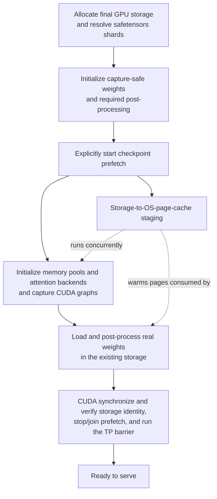

# MATERIAL PACK — sgl-project/sglang PR #32017

- title: [Model Loading] Overlap checkpoint staging with CUDA graph capture during startup
- author: yh0903
- merged/closed: 2026-08-13
- labels: run-ci, apple-silicon, release-highlight
- category: CUDA Graph / Compiler | tier: major
- diffstat: +None/-None across None files
- url: https://github.com/sgl-project/sglang/pull/32017

## perf claims detected in body (regex, unverified)
- (none detected by regex)

## PR body
```markdown
## Motivation

The native/default model-loading path currently finishes loading and post-processing the real weights before CUDA graph capture begins. For large checkpoints, checkpoint I/O and CUDA graph capture are both material parts of engine startup, but they run serially.

This PR introduces an opt-in startup path that stages safetensors checkpoint pages while the runtime initializes and CUDA graphs are captured. It then loads and post-processes the real weights in place, without changing the tensor storage referenced by the captured graphs.

The existing behavior remains the default:

```text
--startup-weight-load-mode serial  # default
```

This PR does not enable overlap by default.

## Modifications

### Startup flow

#### Existing serial startup


#### Opt-in overlap startup



The overlapped work is checkpoint staging from storage into the OS page cache. Real checkpoint iteration, GPU weight commit, and post-load processing still happen after CUDA graph capture.

- Add `--startup-weight-load-mode {serial,overlap}`, defaulting to `serial`.
- Split the exact `DefaultModelLoader` startup lifecycle into model/storage initialization, checkpoint resolution, capture-safe initialization, and post-capture in-place commit.
- Reuse the existing coordinated checkpoint page-cache prefetcher through a cancellable lifecycle handle and reuse the resolved checkpoint source during commit.
- Verify that graph-visible tensor object identity, data pointer, shape, stride, dtype, device, and storage offset remain unchanged after the real-weight commit.
- Start background prefetch only after `ModelRunner`/TP-worker construction completes; scheduler startup and `sglang.benchmark.one_batch` explicitly own the active lifetime.
- Propagate explicit start/finalize handling through `ModelRunner` and TP workers.
- Match the existing process-terminal startup contract: prepare, graph-capture, commit, and barrier failures are not recovered, so no failure-only cancellation or cleanup path is added. On the successful path, finalize stops and joins checkpoint prefetch before the TP barrier and serving.
- Keep `--weight-loader-prefetch-checkpoints` as an independent serial-path control and avoid starting a second prefetch when overlap already owns staging.

### Scope and rollout plan

This is PR 1 of a staged three-PR rollout. The overlap path is intentionally opt-in and explicitly gated here. Its initial supported scope is:

- CUDA graph capture with the exact `DefaultModelLoader`
- `auto`/`safetensors` loading with mmap enabled
- Native dense Llama, Qwen2, and Qwen3 generation models
- FP16/BF16, TP1/TP2, and a single primary checkpoint source

Unsupported configurations raise an explicit error instead of silently changing startup behavior. The existing serial path remains unchanged.

Planned follow-ups:

- **PR 2 — generalize and harden:** broaden the validated support matrix, add startup-phase timing/diagnostics, and factor shared lifecycle pieces so the native/default-loader and checkpoint-engine paths can converge where their semantics match. The feature remains opt-in while this coverage expands.
- **PR 3 — default rollout:** introduce an `auto` policy and make it the default after broader CI and benchmark burn-in. Validated configurations select overlap automatically; unsupported configurations retain the serial path, with an explicit serial escape hatch.

## Accuracy Tests

- Added a registered 1-GPU end-to-end test comparing default serial and overlap output token IDs, generated text, and output logprobs (`1e-5` tolerance).
- Added registered CPU unit coverage for compatibility selection, explicit rejection, successful lifecycle transitions, graph-visible storage invariants, checkpoint-source reuse, prefetch cancel/wait behavior, serial/overlap scheduler routing, server arguments, and MLX routing.
- Manually validated the overlap safetensors Engine path and `sglang.benchmark.one_batch` overlap path on H100. A focused latest-code smoke produced identical serial/overlap input IDs, prefill logits, and decoded text through real decode CUDA graphs; this smoke is not used for performance claims.
- Qwen3-32B benchmark runs produced matching output IDs, text, and logprobs across all three startup modes.
- `scripts/ci/check_registered_tests.py`, Python compilation, formatting/lint, and `git diff --check` pass.

## Speed Tests and Profiling

Configuration: Qwen3-32B BF16 on H100, Triton decode CUDA graphs through batch size 256, prefill CUDA graphs disabled, three timed samples per configuration with A/B/C scheduled in Latin-square order, and warmed compiler/graph caches. Reported values are mean ± sample standard deviation. Checkpoint files were present on the local NVMe filesystem before timing; before every run, `POSIX_FADV_DONTNEED` was applied and `mincore` verified zero resident checkpoint pages. Prefetch used four threads per rank unless otherwise noted. These results were collected against commit `0dbcd4199`.

### Primary result: incremental overlap benefit

The primary comparison is **B → C**. Both configurations use the same coordinated page-cache prefetch mechanism; C changes the startup order so runtime initialization and CUDA graph capture occur before the real-weight commit. This is the closest measured control for the additional overlap benefit.

| Storage | TP | B: Serial + prefetch | C: Overlap | Wall time saved | B → C reduction | Speedup |
|---|---:|---:|---:|---:|---:|---:|
| Local NVMe | 1 | 38.94 ± 0.56 s | 35.60 ± 0.83 s | 3.34 s | 8.6% | 1.09x |
| Local NVMe | 2 | 51.12 ± 1.16 s | 45.16 ± 0.29 s | 5.96 s | 11.7% | 1.13x |

Across the refreshed local-NVMe configurations, overlap reduced startup by **8.6–11.7%** relative to serial startup with coordinated prefetch. Each of the three paired B → C samples favored C for both TP1 and TP2. With three repeats per configuration, these results characterize the observed startup behavior but are not intended to establish tight statistical confidence.

A latest-code TP2 NFS rerun passed output parity but was excluded from the performance table because shared-storage contention made the samples unsuitable for a stable mean comparison: default-serial startup ranged from 148.70 to 1093.41 s, and overlap ranged from 53.72 to 118.67 s. No NFS speed claim is made from that run.

### End-to-end context

For context, the complete opt-in path also includes the existing coordinated-prefetch gain:

| Storage | TP | A: Default serial | B: Serial + prefetch | C: Overlap | A → B reduction | A → C reduction |
|---|---:|---:|---:|---:|---:|---:|
| Local NVMe | 1 | 84.83 ± 0.30 s | 38.94 ± 0.56 s | 35.60 ± 0.83 s | 54.1% | 58.0% (2.38x) |
| Local NVMe | 2 | 78.60 ± 0.36 s | 51.12 ± 1.16 s | 45.16 ± 0.29 s | 35.0% | 42.5% (1.74x) |

Most of the A → C reduction comes from coordinated checkpoint prefetching. A → C describes the end-to-end opt-in startup path; **B → C is the main result attributable to the new startup ordering**. The sequential percentage reductions are not additive because they use different baselines.

These measurements do not establish monotonic scaling with TP size. TP1 and TP2 were measured in separate executions on different nodes. Matching eight aggregate prefetch threads on TP1 produced means of 43.25 s for B and 36.71 s for C, a **15.1% reduction (1.18x)**, compared with **11.7% (1.13x)** on TP2 using four threads per rank, also eight aggregate threads. Each TP rank captures its own CUDA graph concurrently, so capture time is not summed across ranks. The results demonstrate a benefit at TP1 and TP2, but do not imply increasing percentage savings as TP rank grows.

## Checklist

- [x] Format the code according to the contribution guide.
- [x] Add registered unit and end-to-end tests.
- [x] Update user-facing argument help for the new control.
- [x] Provide accuracy and speed benchmark results.
- [x] Preserve the existing serial startup behavior by default.

<!-- pr-states:start -->
---
### CI States

Latest PR Test (Base): <!-- slot:pr-test:start -->:white_check_mark: [Run #31526564021](https://github.com/sgl-project/sglang/actions/runs/31526564021)<!-- slot:pr-test:end -->
Latest PR Test (Extra): <!-- slot:pr-test-extra:start -->:hourglass_flowing_sand: [Run #32449179602](https://github.com/sgl-project/sglang/actions/runs/32449179602)<!-- slot:pr-test-extra:end -->
Latest PR Test (AMD ROCm 7.2): <!-- slot:pr-test-amd-rocm720:start -->:heavy_minus_sign: **No AMD PR run found for this commit**.<!-- slot:pr-test-amd-rocm720:end -->
<!-- pr-states:end -->


```

## diff
```diff
diff --git a/python/sglang/benchmark/one_batch.py b/python/sglang/benchmark/one_batch.py
index b94396c37a23..6f5e67360344 100644
--- a/python/sglang/benchmark/one_batch.py
+++ b/python/sglang/benchmark/one_batch.py
@@ -350,9 +350,13 @@ def load_model(server_args, port_args, gpu_id, tp_rank):
         model_runner = MlxModelRunnerStub(**runner_kwargs)
     else:
         model_runner = ModelRunner(**runner_kwargs)
+        if server_args.is_startup_weight_load_overlap:
+            model_runner.start_startup_weight_load()
         model_runner.alloc_memory_pool()
         model_runner.init_attention_backends()
         model_runner.init_cuda_graphs()
+        if server_args.is_startup_weight_load_overlap:
+            model_runner.finalize_startup_weight_load()
     rank_print(f"max_total_num_tokens={model_runner.max_total_num_tokens}")
     tokenizer = get_tokenizer(
         server_args.tokenizer_path,
diff --git a/python/sglang/srt/hardware_backend/mlx/model_runner_stub.py b/python/sglang/srt/hardware_backend/mlx/model_runner_stub.py
index ddfb1e1fcd3e..7f1c70393f23 100644
--- a/python/sglang/srt/hardware_backend/mlx/model_runner_stub.py
+++ b/python/sglang/srt/hardware_backend/mlx/model_runner_stub.py
@@ -107,7 +107,15 @@ class MlxModelRunnerStub(ModelRunner):
     # that path working instead of raising AttributeError.
     prefill_aware_swa = False
 
+    @staticmethod
+    def validate_startup_weight_load_mode(server_args) -> None:
+        if server_args.is_startup_weight_load_overlap:
+            raise ValueError(
+                "--startup-weight-load-mode=overlap is not supported: CUDA only"
+            )
+
     def __init__(self, *args, mlx_pool_size: int | None = None, **kwargs):
+        self.validate_startup_weight_load_mode(kwargs["server_args"])
         self._mlx_pool_size = mlx_pool_size
         super().__init__(*args, **kwargs)
 
diff --git a/python/sglang/srt/hardware_backend/mlx/tp_worker.py b/python/sglang/srt/hardware_backend/mlx/tp_worker.py
index 2766e03f5600..ae9468cce05e 100644
--- a/python/sglang/srt/hardware_backend/mlx/tp_worker.py
+++ b/python/sglang/srt/hardware_backend/mlx/tp_worker.py
@@ -78,11 +78,14 @@ class MlxTpModelWorker(TpModelWorker):
 
     def _init_model_runner(self):
         """Create MLX runner first (auto-sizes pool), then stub with matching size."""
-        from sglang.srt.hardware_backend.mlx.model_runner import MlxModelRunner
         from sglang.srt.hardware_backend.mlx.model_runner_stub import (
             MlxModelRunnerStub,
         )
 
+        MlxModelRunnerStub.validate_startup_weight_load_mode(self.server_args)
+
+        from sglang.srt.hardware_backend.mlx.model_runner import MlxModelRunner
+
         logger.info("Initializing MlxModelRunner for end-to-end MLX inference")
         init_kwargs = dict(
             model_path=get_model().model_path,
diff --git a/python/sglang/srt/managers/scheduler.py b/python/sglang/srt/managers/scheduler.py
index c74ec817ef8f..885bd1964429 100644
--- a/python/sglang/srt/managers/scheduler.py
+++ b/python/sglang/srt/managers/scheduler.py
@@ -982,6 +982,8 @@ def init_all_cuda_graphs(self):
     def init_model_worker(self):
         # Load model weights.
         self.init_tp_model_worker()
+        if self.server_args.is_startup_weight_load_overlap:
+            self.tp_worker.start_startup_weight_load()
         self.maybe_init_draft_worker()
 
         # Prepare KV cache pools for all workers
@@ -998,6 +1000,9 @@ def init_model_worker(self):
             model_runner.post_capture_resize_kv_pool()
             self.kv_cache_allocation_time += time.perf_counter() - tic
 
+        if self.server_args.is_startup_weight_load_overlap:
+            self.tp_worker.finalize_startup_weight_load()
+
         if (
             get_exec().moe.elastic_ep_backend is not None
             and get_exec().moe.ep_join_mode == "recover"
diff --git a/python/sglang/srt/managers/tp_worker.py b/python/sglang/srt/managers/tp_worker.py
index cf71bc64c740..b05aa000102d 100644
--- a/python/sglang/srt/managers/tp_worker.py
+++ b/python/sglang/srt/managers/tp_worker.py
@@ -428,6 +428,18 @@ def init_cuda_graphs(self, capture_decode_cuda_graph: bool = True):
         for mr in self.model_runner_list[1:]:
             mr.init_cuda_graphs(capture_decode_cuda_graph=capture_decode_cuda_graph)
 
+    def start_startup_weight_load(self) -> None:
+        """Start deferred checkpoint prefetching for all model runners."""
+        self.model_runner.start_startup_weight_load()
+        for mr in self.model_runner_list[1:]:
+            mr.start_startup_weight_load()
+
+    def finalize_startup_weight_load(self) -> None:
+        """Commit deferred startup weights for all model runners."""
+        self.model_runner.finalize_startup_weight_load()
+        for mr in self.model_runner_list[1:]:
+            mr.finalize_startup_weight_load()
+
     def _init_model_config(self):
         from sglang.srt.configs.model_config import ModelConfig
 
diff --git a/python/sglang/srt/model_executor/model_runner.py b/python/sglang/srt/model_executor/model_runner.py
index 84bd42ffe2b1..c98c6d012e43 100644
--- a/python/sglang/srt/model_executor/model_runner.py
+++ b/python/sglang/srt/model_executor/model_runner.py
@@ -431,6 +431,11 @@ def __init__(
         # For hisparse (must be set before initialize() so CUDA graph capture can see it)
         self.hisparse_coordinator = None
 
+        # The native overlap path replaces this during load_model(). Keep the
+        # no-pending-work invariant for lightweight backends that override the
+        # base initialization and weight-loading flow.
+        self.startup_weight_load = None
+
         # Load model weights and configure
         self.initialize()
         self.check_quantized_moe_compatibility()
@@ -1110,6 +1115,7 @@ def load_model(self):
             )
         self.loader = loaded.loader
         self.model = loaded.model
+        self.startup_weight_load = loaded.startup_weight_load
         if loaded.remote_instance_weight_info is not None:
             self.remote_instance_weight_transporter.weight_info = (
                 loaded.remote_instance_weight_info
@@ -1153,14 +1159,15 @@ def load_model(self):
         # This handles both config.json (standard) and hf_quant_config.json (ModelOpt)
         quant_str = self.model_config.get_quantization_config_log_str()
 
-        logger.info(
-            f"Load weight end. "
-            f"elapsed={self.weight_load_time:.2f} s, "
-            f"type={type(self.model).__name__}, "
-            f"{quant_str + ', ' if quant_str else ''}"
-            f"avail mem={after_avail_memory:.2f} GB, "
-            f"mem usage={self.weight_load_mem_usage:.2f} GB."
-        )
+        if self.startup_weight_load is None:
+            logger.info(
+                f"Load weight end. "
+                f"elapsed={self.weight_load_time:.2f} s, "
+                f"type={type(self.model).__name__}, "
+                f"{quant_str + ', ' if quant_str else ''}"
+                f"avail mem={after_avail_memory:.2f} GB, "
+                f"mem usage={self.weight_load_mem_usage:.2f} GB."
+            )
 
         report_online_quantization(model=self.model, server_args=self.server_args)
 
@@ -1186,11 +1193,36 @@ def load_model(self):
             logger,
         )
 
+        if self.startup_weight_load is None:
+            dist_barrier_after_load(
+                elastic_ep_backend=get_exec().moe.elastic_ep_backend,
+                tp_rank=self.ps.tp_rank,
+                is_ep_joiner=self.server_args.is_ep_joiner,
+            )
+
+    def start_startup_weight_load(self) -> None:
+        assert self.startup_weight_load is not None
+        self.startup_weight_load.start_prefetch()
+
+    def finalize_startup_weight_load(self) -> None:
+        """Commit the real weights, then run the post-load barrier.
+
+        The barrier moves here because ``load_model`` returns with sentinel
+        values under overlap, so this is the first point at which "weights are
+        loaded" is true for this rank. It follows the commit and its validation
+        deliberately: a rank that fails to commit must not report readiness. A
+        commit failure is terminal for the process, so peer ranks observe it as
+        a barrier timeout rather than a clean collective abort, which matches
+        the existing startup contract for load failures.
+        """
+        assert self.startup_weight_load is not None
+        self.startup_weight_load.finalize()
         dist_barrier_after_load(
             elastic_ep_backend=get_exec().moe.elastic_ep_backend,
             tp_rank=self.ps.tp_rank,
             is_ep_joiner=is_ep_joiner(),
         )
+        self.startup_weight_load = None
 
     def maybe_precompile_model_kernels_after_loading(self) -> None:
         maybe_precompile_model_kernels_after_loading(self.model, self.device)
diff --git a/python/sglang/srt/model_executor/model_runner_components/load_model_utils.py b/python/sglang/srt/model_executor/model_runner_components/load_model_utils.py
index 6f2a23ea7f71..86ac470aae43 100644
--- a/python/sglang/srt/model_executor/model_runner_components/load_model_utils.py
+++ b/python/sglang/srt/model_executor/model_runner_components/load_model_utils.py
@@ -59,6 +59,7 @@ class LoadedModel(msgspec.Struct, frozen=True, kw_only=True):
     loader: Any
     model: Any
     remote_instance_weight_info: Optional[Any]
+    startup_weight_load: Optional[Any] = None
 
 
 def maybe_downgrade_dtype_for_legacy_gpu(
@@ -292,6 +293,7 @@ def load_model_with_memory_saver(
         enable_cpu_backup = False
 
     remote_instance_weight_info = None
+    startup_weight_load = None
     with memory_saver_adapter.region(
         GPU_MEMORY_TYPE_WEIGHTS,
         enable_cpu_backup=enable_cpu_backup,
@@ -300,10 +302,26 @@ def load_model_with_memory_saver(
             load_config=load_config,
             model_config=model_config,
         )
-        model = loader.load_model(
-            model_config=model_config,
-            device_config=DeviceConfig(device, gpu_id),
-        )
+        device_config = DeviceConfig(device, gpu_id)
+        if server_args.is_startup_weight_load_overlap:
+            from sglang.srt.model_executor.model_runner_components.startup_weight_load import (
+                StartupWeightLoadManager,
+            )
+
+            startup_weight_load = StartupWeightLoadManager.create_from_server_args(
+                loader=loader,
+                model_config=model_config,
+                load_config=load_config,
+                device_config=device_config,
+                server_args=server_args,
+                is_draft_worker=is_draft_worker,
+            )
+            model = startup_weight_load.prepare()
+        else:
+            model = loader.load_model(
+                model_config=model_config,
+                device_config=device_config,
+            )
         if hasattr(loader, "remote_instance_transfer_engine_weight_info"):
             remote_instance_weight_info = (
                 loader.remote_instance_transfer_engine_weight_info
@@ -318,6 +336,7 @@ def load_model_with_memory_saver(
         loader=loader,
         model=model,
         remote_instance_weight_info=remote_instance_weight_info,
+        startup_weight_load=startup_weight_load,
     )
 
 
diff --git a/python/sglang/srt/model_executor/model_runner_components/startup_weight_load.py b/python/sglang/srt/model_executor/model_runner_components/startup_weight_load.py
new file mode 100644
index 000000000000..0db6d610382c
--- /dev/null
+++ b/python/sglang/srt/model_executor/model_runner_components/startup_weight_load.py
@@ -0,0 +1,591 @@
+from __future__ import annotations
+
+import dataclasses
+import enum
+import logging
+import time
+from typing import TYPE_CHECKING, Optional, Tuple
+
+import torch
+from torch import nn
+
+from sglang.srt.configs.device_config import DeviceConfig
+from sglang.srt.configs.load_config import LoadConfig, LoadFormat
+from sglang.srt.distributed.parallel_state import monkey_patch_vllm_parallel_state
+from sglang.srt.model_executor.cuda_graph_config import Backend, Phase
+from sglang.srt.model_loader.loader import DefaultModelLoader
+from sglang.srt.model_loader.utils import get_model_architecture
+from sglang.srt.model_loader.weight_utils import (
+    CAPTURE_SAFE_WEIGHT_SENTINEL,
+    CheckpointFilePrefetchHandle,
+)
+from sglang.srt.platforms import current_platform
+
+if TYPE_CHECKING:
+    from sglang.srt.configs.model_config import ModelConfig
+    from sglang.srt.server_args import ServerArgs
+
+logger = logging.getLogger(__name__)
+
+
+_SUPPORTED_ARCHITECTURES = frozenset(
+    {
+        "LlamaForCausalLM",
+        "Qwen2ForCausalLM",
+        "Qwen3ForCausalLM",
+    }
+)
+_SUPPORTED_DTYPES = frozenset({torch.float16, torch.bfloat16})
+
+
+def _get_canonical_model_class(architecture: str):
+    if architecture == "LlamaForCausalLM":
+        from sglang.srt.models.llama import LlamaForCausalLM
+
+        return LlamaForCausalLM
+    if architecture == "Qwen2ForCausalLM":
+        from sglang.srt.models.qwen2 import Qwen2ForCausalLM
+
+        return Qwen2ForCausalLM
+    if architecture == "Qwen3ForCausalLM":
+        from sglang.srt.models.qwen3 import Qwen3ForCausalLM
+
+        return Qwen3ForCausalLM
+    raise ValueError(f"Unsupported startup-overlap architecture: {architecture}")
+
+
+class StartupWeightLoadState(str, enum.Enum):
+    CREATED = "created"
+    PREPARING = "preparing"
+    CAPTURE_READY = "capture_ready"
+    PREFETCHING = "prefetching"
+    COMMITTING = "committing"
+    READY = "ready"
+
+
+@dataclasses.dataclass(frozen=True, slots=True, kw_only=True)
+class StartupWeightLoadOptions:
+    device: str
+    is_cuda_platform: bool
+    cuda_graph_enabled: bool
+    prefill_cuda_graph_backend: Backend
+    is_draft_worker: bool
+    speculative_algorithm: Optional[str]
+    tp_size: int
+    attn_cp_size: int
+    dcp_size: int
+    pp_size: int
+    dp_size: int
+    ep_size: int
+    cpu_offload_gb: int
+    offload_group_size: int
+    enable_memory_saver: bool
+    enable_weights_cpu_backup: bool
+    torchao_config: str
+    enable_lora: bool
+    has_lora_paths: bool
+    weight_loader_disable_mmap: bool
+    weight_loader_drop_cache_after_load: bool
+    has_custom_weight_loader: bool
+    enable_torch_compile: bool
+    prefetch_num_threads: int
+
+    @classmethod
+    def from_server_args(
+        cls,
+        *,
+        server_args: ServerArgs,
+        is_draft_worker: bool,
+    ) -> StartupWeightLoadOptions:
+        cuda_graph_config = server_args.cuda_graph_config
+        cuda_graph_enabled = any(
+            getattr(cuda_graph_config, phase).backend != Backend.DISABLED
+            for phase in Phase.ALL
+        )
+        return cls(
+            device=server_args.device,
+            is_cuda_platform=current_platform.is_cuda(),
+            cuda_graph_enabled=cuda_graph_enabled,
+            prefill_cuda_graph_backend=cuda_graph_config.prefill.backend,
+            is_draft_worker=is_draft_worker,
+            speculative_algorithm=server_args.speculative_algorithm,
+            tp_size=server_args.tp_size,
+            attn_cp_size=server_args.attn_cp_size,
+            dcp_size=server_args.dcp_size,
+            pp_size=server_args.pp_size,
+            dp_size=server_args.dp_size,
+            ep_size=server_args.ep_size,
+            cpu_offload_gb=server_args.cpu_offload_gb,
+            offload_group_size=server_args.offload_group_size,
+            enable_memory_saver=server_args.enable_memory_saver,
+            enable_weights_cpu_backup=server_args.enable_weights_cpu_backup,
+            torchao_config=server_args.torchao_config,
+            enable_lora=server_args.enable_lora,
+            has_lora_paths=bool(server_args.lora_paths),
+            weight_loader_disable_mmap=server_args.weight_loader_disable_mmap,
+            weight_loader_drop_cache_after_load=(
+                server_args.weight_loader_drop_cache_after_load
+            ),
+            has_custom_weight_loader=bool(server_args.custom_weight_loader),
+            enable_torch_compile=server_args.enable_torch_compile,
+            prefetch_num_threads=server_args.weight_loader_prefetch_num_threads,
+        )
+
+
+@dataclasses.dataclass(frozen=True, slots=True)
+class TensorStorageMetadata:
+    tensor: torch.Tensor = dataclasses.field(repr=False, compare=False)
+    data_ptr: int
+    shape: Tuple[int, ...]
+    stride: Tuple[int, ...]
+    dtype: torch.dtype
+    device: torch.device
+    storage_offset: int
+
+    @classmethod
+    def from_tensor(cls, tensor: torch.Tensor) -> TensorStorageMetadata:
+        return cls(
+            tensor=tensor,
+            data_ptr=tensor.data_ptr(),
+            shape=tuple(tensor.shape),
+            stride=tuple(tensor.stride()),
+            dtype=tensor.dtype,
+            device=tensor.device,
+            storage_offset=tensor.storage_offset(),
+        )
+
+    def matches(self, other: TensorStorageMetadata) -> bool:
+        return self.tensor is other.tensor and (
+            self.data_ptr,
+            self.shape,
+            self.stride,
+            self.dtype,
+            self.device,
+            self.storage_offset,
+        ) == (
+            other.data_ptr,
+            other.shape,
+            other.stride,
+            other.dtype,
+            other.device,
+            other.storage_offset,
+        )
+
+
+@dataclasses.dataclass(frozen=True, slots=True)
+class ModelStorageManifest:
+    tensors: Tuple[Tuple[str, TensorStorageMetadata], ...]
+
+    @classmethod
+    def capture(cls, model: nn.Module) -> ModelStorageManifest:
+        entries = []
+        for kind, tensors in (
+            ("parameter", model.named_parameters(remove_duplicate=False)),
+            ("buffer", model.named_buffers(remove_duplicate=False)),
+        ):
+            entries.extend(
+                (f"{kind}:{name}", TensorStorageMetadata.from_tensor(tensor))
+                for name, tensor in tensors
+            )
+        # Key explicitly by name because TensorStorageMetadata is not orderable,
+        # and stable name ordering keeps diagnostics deterministic for aliases.
+        return cls(tensors=tuple(sorted(entries, key=lambda entry: entry[0])))
+
+    def changed_names(self, model: nn.Module) -> Tuple[str, ...]:
+        before = dict(self.tensors)
+        after = dict(ModelStorageManifest.capture(model).tensors)
+        return tuple(
+            name
+            for name in sorted(before.keys() | after.keys())
+            if name not in before
+            or name not in after
+            or not before[name].matches(after[name])
+        )
+
+    def unchanged_parameter_names(self, value: float) -> Tuple[str, ...]:
+        """Return floating-point parameters still entirely equal to ``value``.
+
+        This is the capture-sentinel check, and it is deliberately strict: every
+        floating-point parameter must be rewritten by ``model.load_weights()``.
+        A model that keeps an ``__init__``-computed floating-point parameter with
+        no checkpoint entry will fail startup here rather than silently serve the
+        sentinel, so this doubles as the admission gate for widening
+        ``_SUPPORTED_ARCHITECTURES``. Buffers are excluded because
+        ``initialize_capture_safe_weights`` never overwrites them.
+        """
+        names = []
+        checks = []
+        seen_tensor_ids = set()
+        for name, metadata in self.tensors:
+            tensor = metadata.tensor
+            if (
+                not name.startswith("parameter:")
+                or not torch.is_floating_point(tensor)
+                or id(tensor) in seen_tensor_ids
+            ):
+                continue
+            seen_tensor_ids.add(id(tensor))
+            names.append(name)
+            checks.append(torch.all(tensor == value))
+
+        if not checks:
+            return ()
+        unchanged = torch.stack(checks).cpu().tolist()
+        return tuple(
+            name for name, is_unchanged in zip(names, unchanged) if is_unchanged
+        )
+
+
+class StartupWeightLoadManager:
+    """Coordinate native CPU staging with capture and post-capture commit."""
+
+    def __init__(
+        self,
+        *,
+        loader: DefaultModelLoader,
+        model_config: ModelConfig,
+        device_config: DeviceConfig,
+        options: StartupWeightLoadOptions,
+    ) -> None:
+        self._loader = loader
+        self._model_config = model_config
+        self._device_config = device_config
+        self._options = options
+        self._model: Optional[nn.Module] = None
+        self._resolved_sources: Tuple[DefaultModelLoader.ResolvedSource, ...] = ()
+        self._prefetch_handle: Optional[CheckpointFilePrefetchHandle] = None
+        self._state = StartupWeightLoadState.CREATED
+        self._created_at = time.perf_counter()
+        self._capture_ready_at: Optional[float] = None
+        self._prefetch_started_at: Optional[float] = None
+        self._prefetch_failure_reported = False
+
+    @classmethod
+    def create_from_server_args(
+        cls,
+        *,
+        loader,
+        model_config: ModelConfig,
+        load_config: LoadConfig,
+        device_config: DeviceConfig,
+        server_args: ServerArgs,
+        is_draft_worker: bool,
+    ) -> StartupWeightLoadManager:
+        """Build a manager straight from ``ServerArgs``.
+
+        Callers on the model-loading path only decide *whether* to overlap; the
+        knowledge of which server arguments matter, and every support rule,
+        stays in this module.
+        """
+        return cls.create(
+            loader=loader,
+            model_config=model_config,
+            load_config=load_config,
+            device_config=device_config,
+            options=StartupWeightLoadOptions.from_server_args(
+                server_args=server_args,
+                is_draft_worker=is_draft_worker,
+            ),
+        )
+
+    @classmethod
+    def create(
+        cls,
+        *,
+        loader,
+        model_config: ModelConfig,
+        load_config: LoadConfig,
+        device_config: DeviceConfig,
+        options: StartupWeightLoadOptions,
+    ) -> StartupWeightLoadManager:
+        unsupported_reason = cls._get_unsupported_reason(
+            loader=loader,
+            model_config=model_config,
+            load_config=load_config,
+            options=options,
+        )
+        if unsupported_reason is not None:
+            raise ValueError(
+                "--startup-weight-load-mode=overlap is not supported: "
+                f"{unsupported_reason}"
+            )
+        return cls(
+            loader=loader,
+            model_config=model_config,
+            device_config=device_config,
+            options=options,
+        )
+
+    @staticmethod
+    def _get_unsupported_reason(
+        *,
+        loader,
+        model_config: ModelConfig,
+        load_config: LoadConfig,
+        options: StartupWeightLoadOptions,
+    ) -> Optional[str]:
+        architectures = tuple(model_config.hf_config.architectures or ())
+        # NOTE(2026-08): The initial rollout supports only the configurations
+        # admitted below. Expand this matrix only with storage-stability,
+        # capture-sentinel, and startup-correctness coverage for the new case.
+        # Keep these checks here because they depend on resolved loader and model
+        # state; ServerArgs owns only the mode selection.
+        basic_rules = (
+            (not options.is_cuda_platform or options.device != "cuda", "CUDA only"),
+            (not options.cuda_graph_enabled, "CUDA graph capture is disabled"),
+            (
+                options.prefill_cuda_graph_backend == Backend.TC_PIECEWISE,
+                "tc_piecewise prefill CUDA graphs are not supported",
+            ),
+            (type(loader) is not DefaultModelLoader, "DefaultModelLoader only"),
+            (
+                load_config.load_format
+                not in (LoadFormat.AUTO, LoadFormat.SAFETENSORS),
+                "load format must be auto or safetensors",
+            ),
+            (options.is_draft_worker, "draft workers are not supported"),
+            (
+                load_config.draft_model_idx is not None,
+                "draft model loading is unsupported",
+            ),
+            (
+                options.speculative_algorithm is not None,
+                "speculative decoding is not supported",
+            ),
+            (options.tp_size not in (1, 2), "only TP1 and TP2 are supported"),
+            (
+                options.attn_cp_size != 1,
+                "attention context parallelism is not supported",
+            ),
+            (
+                options.dcp_size != 1,
+                "decode context parallelism is not supported",
+            ),
+            (options.pp_size != 1, "pipeline parallelism is not supported"),
+            (options.dp_size != 1, "data parallelism is not supported"),
+            (options.ep_size != 1, "expert parallelism is not supported"),
+            (options.cpu_offload_gb > 0, "CPU offload is not supported"),
+            (
+                options.offload_group_size > 0,
+                "layer-group offloading is not supported",
+            ),
+            (options.enable_memory_saver, "memory saver is not supported"),
+            (
+                options.enable_weights_cpu_backup,
+                "CPU weight backup is not supported",
+            ),
+            (bool(options.torchao_config), "TorchAO is not supported"),
+            (
+                options.enable_lora or options.has_lora_paths,
+                "LoRA is not supported",
+            ),
+            (
+                options.weight_loader_disable_mmap,
+                "safetensors mmap must be enabled",
+            ),
+            (
+                options.weight_loader_drop_cache_after_load,
+                "dropping the page cache during load is not supported",
+            ),
+            (
+                options.has_custom_weight_loader,
+                "custom weight loaders are not supported",
+            ),
+            (options.enable_torch_compile, "torch.compile is not supported"),
+        )
+        unsupported_reason = next(
+            (reason for unsupported, reason in basic_rules if unsupported),
+            None,
+        )
+        if unsupported_reason is not None:
+            return unsupported_reason
+
+        model_rules = (
+            (model_config.dtype not in _SUPPORTED_DTYPES, "FP16 or BF16 only"),
+            (model_config.quantization is not None, "quantization is not supported"),
+            (
+                bool(getattr(model_config, "modelopt_quant", False)),
+                "ModelOpt is not supported",
+            ),
+            (model_config.is_multimodal, "multimodal models are not supported"),
+            (not model_config.is_generation, "generation models only"),
+            (
+                len(architectures) != 1
+                or architectures[0] not in _SUPPORTED_ARCHITECTURES,
+                "model architecture is not in the startup-overlap allowlist",
+            ),
+        )
+        unsupported_reason = next(
+            (reason for unsupported, reason in model_rules if unsupported),
+            None,
+        )
+        if unsupported_reason is not None:
+            return unsupported_reason
+
+        architecture = architectures[0]
+        resolved_model_class, resolved_architecture = get_model_architecture(
+            model_config
+        )
+        if (
+            resolved_architecture != architecture
+            or resolved_model_class is not _get_canonical_model_class(architecture)
+        ):
+            return "the native SGLang model implementation is required"
+        return None
+
+    @property
+    def state(self) -> StartupWeightLoadState:
+        return self._state
+
+    def prepare(self) -> nn.Module:
+        if self._state != StartupWeightLoadState.CREATED:
+            raise RuntimeError(
+                f"Cannot prepare startup weights from state {self._state}"
+            )
+        self._state = StartupWeightLoadState.PREPARING
+        model = self._loader.initialize_model_for_startup(
+            model_config=self._model_config,
+            device_config=self._device_config,
+        )
+        resolved_sources = self._loader.resolve_model_weights(
+            self._model_config,
+            model,
+        )
+        if len(resolved_sources) != 1:
+            raise ValueError(
+                "Startup weight-loading overlap does not support secondary weights"
+            )
+        model = self._loader.prepare_model_for_capture(
+            model=model,
+            model_config=self._model_config,
+        )
+        self._model = model
+        self._resolved_sources = resolved_sources
+        self._capture_ready_at = time.perf_counter()
+        self._state = StartupWeightLoadState.CAPTURE_READY
+        logger.info(
+            "Prepared capture-safe model in %.2f s",
+            self._capture_ready_at - self._created_at,
+        )
+        return model
+
+    def start_prefetch(self) -> None:
+        if self._state != StartupWeightLoadState.CAPTURE_READY:
+            raise RuntimeError(
+                f"Cannot prefetch startup weights from state {self._state}"
+            )
+        assert self._capture_ready_at is not None
+        prefetch_started_at = time.perf_counter()
+        self._prefetch_handle = self._loader.start_checkpoint_prefetch(
+            self._resolved_sources,
+            num_threads=self._options.prefetch_num_threads,
+        )
+        self._prefetch_started_at = prefetch_started_at
+        self._state = StartupWeightLoadState.PREFETCHING
+        logger.info(
+            "Started checkpoint prefetching %.2f s after capture-safe model prep",
+            self._prefetch_started_at - self._capture_ready_at,
+        )
+
+    def finalize(self) -> None:
+        if self._state == StartupWeightLoadState.READY:
+            return
+        if self._state != StartupWeightLoadState.PREFETCHING:
+            raise RuntimeError(
+                f"Cannot finalize startup weights from state {self._state}"
+            )
+        assert self._model is not None
+        assert self._capture_ready_at is not None
+        assert self._prefetch_started_at is not None
+        self._state = StartupWeightLoadState.COMMITTING
+        manifest = ModelStorageManifest.capture(self._model)
+        startup_prefetch_active = self._prepare_prefetch_for_commit()
+        commit_started_at = time.perf_counter()
+        monkey_patch_vllm_parallel_state()
+        self._loader.commit_model_weights(
+            model=self._model,
+            model_config=self._model_config,
+            resolved_sources=self._resolved_sources,
+            target_device=torch.device(self._device_config.device),
+            startup_prefetch_active=startup_prefetch_active,
+        )
+        torch.cuda.synchronize()
+        changed_names = manifest.changed_names(self._model)
+        if changed_names:
+            preview = ", ".join(changed_names[:8])
+            raise RuntimeError(
+                "Startup weight commit changed graph-visible tensor storage: "
+                f"{preview}"
+            )
+        unchanged_names = manifest.unchanged_parameter_names(
+            CAPTURE_SAFE_WEIGHT_SENTINEL
+        )
+        if unchanged_names:
+            preview = ", ".join(unchanged_names[:8])
+            raise RuntimeError(
+                "Startup weight commit did not replace capture-safe dummy values: "
+                f"{preview}"
+            )
+        monkey_patch_vllm_parallel_state(reverse=True)
+        self._stop_prefetch()
+        self._state = StartupWeightLoadState.READY
+        logger.info(
+            "Load weight end. Committed real weights after CUDA graph capture in %.2f s "
+            "(capture overlap window %.2f s, startup overlap total %.2f s)",
+            time.perf_counter() - commit_started_at,
+            commit_started_at - self._prefetch_started_at,
+            time.perf_counter() - self._created_at,
+        )
+
+    def _prepare_prefetch_for_commit(self) -> bool:
+        assert self._prefetch_handle is not None
+        if not self._prefetch_handle.failed:
+            return not self._prefetch_handle.done
+
+        self._prefetch_handle.stop()
+        self._report_prefetch_failure(falling_back=True)
+        return False
+
+    def _stop_prefetch(self) -> None:
+        if self._prefetch_handle is None:
+            return
+        try:
+            if self._prefetch_handle.done:
+                self._prefetch_handle.wait()
+            else:
+                self._prefetch_handle.stop()
+        except TimeoutError:
+            # Only reached after the real weights are committed and validated,
+            # so a stager that outlives its stop timeout must not fail an
+            # otherwise-successful startup. The worker is a daemon thread and
+            # cannot keep the process alive.
+            logger.warning(
+                "Checkpoint prefetch did not stop within its timeout after the "
+                "weight commit; leaving the daemon stager to exit on its own."
+            )
+        self._report_prefetch_failure(falling_back=False)
+        self._prefetch_handle = None
+
+    def _report_prefetch_failure(self, *, falling_back: bool) -> None:
+        handle = self._prefetch_handle
+        if handle is None or not handle.failed or self._prefetch_failure_reported:
+            return
+
+        if handle.errors:
+            path, error = handle.errors[0]
+            failure_detail = (
+                f"{len(handle.errors)} recorded failure(s), first: {path!r}: {error}"
+            )
+        else:
+            failure_detail = "the background worker terminated before completion"
+        action = (
+            "falling back to normal weight loading"
+            if falling_back
+            else "real weight loading completed despite incomplete staging"
+        )
+        logger.warning(
+            "Checkpoint prefetch was incomplete because %s; %s",
+            failure_detail,
+            action,
+        )
+        self._prefetch_failure_reported = True
diff --git a/python/sglang/srt/model_loader/loader.py b/python/sglang/srt/model_loader/loader.py
index cb941a800495..ba0262bc9317 100644
--- a/python/sglang/srt/model_loader/loader.py
+++ b/python/sglang/srt/model_loader/loader.py
@@ -103,6 +103,8 @@
 )
 from sglang.srt.environ import envs
 from sglang.srt.model_loader.weight_utils import (
+    CheckpointFilePrefetchHandle,
+    _prefetch_all_checkpoints,
     buffered_multi_thread_safetensors_weights_iterator,
     download_safetensors_index_file_from_hf,
     download_weights_from_hf,
@@ -112,6 +114,7 @@
     get_gguf_extra_tensor_names,
     get_quant_config,
     gguf_quant_weights_iterator,
+    initialize_capture_safe_weights,
     initialize_dummy_weights,
     maybe_add_mtp_safetensors,
     multi_thread_pt_weights_iterator,
@@ -409,6 +412,15 @@ def init_new(cls, model_config: ModelConfig, model):
                 model_config=model_config,
             )
 
+    @dataclasses.dataclass(frozen=True)
+    class ResolvedSource:
+        """A weight source whose local checkpoint files are already resolved."""
+
+        source: DefaultModelLoader.Source
+        hf_folder: str
+        weight_files: Tuple[str, ...]
+        use_safetensors: bool
+
     counter_before_loading_weights: float = 0.0
     counter_after_loading_weights: float = 0.0
 
@@ -570,22 +582,31 @@ def _prepare_weights(
         return hf_folder, hf_weights_files, use_safetensors
 
     def _get_weights_iterator(
-        self, source: Source
+        self,
+        source: Source,
+        *,
+        resolved_source: Optional[ResolvedSource] = None,
+        startup_prefetch_started: bool = False,
+        startup_prefetch_active: bool = False,
     ) -> Generator[Tuple[str, torch.Tensor], None, None]:
         """Get an iterator for the model weights based on the load format."""
         extra_config = self.load_config.model_loader_extra_config
         use_multithread = extra_config.get("enable_multithread_load", True)
-        hf_folder, hf_weights_files, use_safetensors = self._prepare_weights(
-            source.model_or_path, source.revision, source.fall_back_to_pt
-        )
-
-        if use_safetensors and source.model_config is not None:
-            hf_weights_files = maybe_add_mtp_safetensors(
-                hf_weights_files,
-                hf_folder,
-                "model.safetensors.index.json",
-                source.model_config.hf_config,
+        if resolved_source is None:
+            hf_folder, hf_weights_files, use_safetensors = self._prepare_weights(
+                source.model_or_path, source.revision, source.fall_back_to_pt
             )
+            if use_safetensors and source.model_config is not None:
+                hf_weights_files = maybe_add_mtp_safetensors(
+                    hf_weights_files,
+                    hf_folder,
+                    "model.safetensors.index.json",
+                    source.model_config.hf_config,
+                )
+        else:
+            hf_folder = resolved_source.hf_folder
+            hf_weights_files = list(resolved_source.weight_files)
+            use_safetensors = resolved_source.use_safetensors
 
         if self.load_config.load_format == LoadFormat.NPCACHE:
             # Currently np_cache only support *.bin checkpoints
@@ -598,7 +619,13 @@ def _get_weights_iterator(
             )
         elif use_safetensors:
             weight_loader_disable_mmap = get_model().weight_loader_disable_mmap
-            weight_loader_prefetch = get_model().weight_loader_prefetch_checkpoints
+            configured_prefetch = get_model().weight_loader_prefetch_checkpoints
+            start_iterator_prefetch = (
+                configured_prefetch and not startup_prefetch_started
+            )
+            concurrent_prefetch_active = (
+                startup_prefetch_active or start_iterator_prefetch
+            )
             prefetch_num_threads = get_model().weight_loader_prefetch_num_threads
             weight_loader_drop_cache_after_load = (
                 get_model().weight_loader_drop_cache_after_load
@@ -615,7 +642,7 @@ def _get_weights_iterator(
             # e.g. local NVMe, where prefetch is a no-op and multi-threading
             # helps.
             if (
-                weight_loader_prefetch
+                concurrent_prefetch_active
                 and not weight_loader_disable_mmap
                 and self.load_config.load_format != LoadFormat.FASTSAFETENSORS
                 and use_multithread
@@ -624,7 +651,7 @@ def _get_weights_iterator(
                 )
             ):
                 logger.warning(
-                    "--weight-loader-prefetch-checkpoints is enabled; falling "
+                    "Checkpoint prefetching is active; falling "
                     "back to single-threaded weight loading to avoid I/O "
                     "oversubscription with the prefetch threads. Set "
                     "enable_multithread_load=true in --model-loader-extra-config "
@@ -646,7 +673,7 @@ def _get_weights_iterator(
                         "num_threads", self.DEFAULT_NUM_THREADS
                     ),
                     disable_mmap=weight_loader_disable_mmap,
-                    prefetch=weight_loader_prefetch,
+                    prefetch=start_iterator_prefetch,
                     prefetch_num_threads=prefetch_num_threads,
                     drop_cache_after_load=weight_loader_drop_cache_after_load,
                 
... [truncated]

```

> 8 file(s) dropped from diff for size (see PR for full diff).
