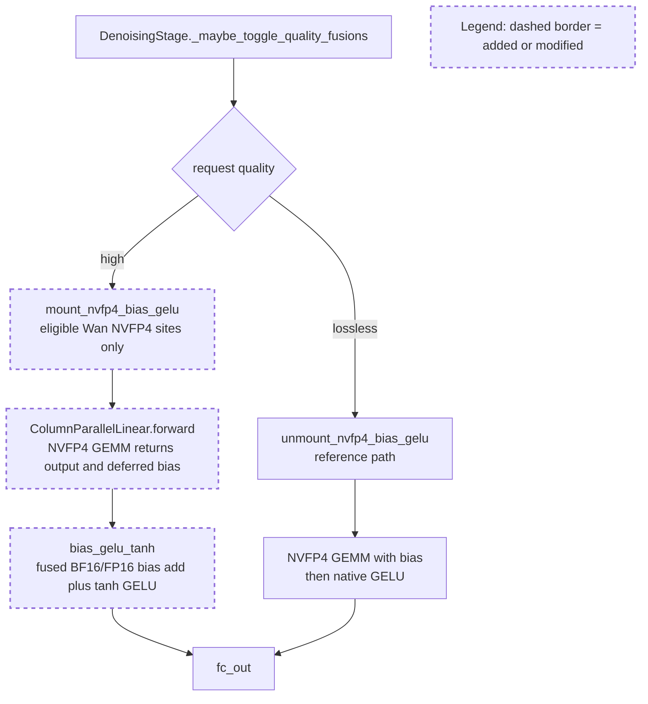

# MATERIAL PACK — sgl-project/sglang PR #37075

- title: [Diffusion][Kernel] Fuse Wan2.2 NVFP4 bias + GELU on Blackwell
- author: BBuf
- merged/closed: 2026-08-30
- labels: blackwell, run-ci, diffusion, jit-kernel, run-ci-extra, mergeable
- category: Quantization | tier: major
- diffstat: +None/-None across None files
- url: https://github.com/sgl-project/sglang/pull/37075

## perf claims detected in body (regex, unverified)
- Speedup | | --- | ---: | ---: | ---: | | 32760 x
- 2.984889% faster
- 2.945073% faster

## PR body
```markdown
## Motivation

Wan2.2 ModelOpt NVFP4 MLPs currently execute the `fc_in` hot path as three
separate operations:

```text
NVFP4 GEMM -> BF16 bias add -> tanh GELU
```

On GB300, the bias add and GELU are memory-bound and account for a meaningful
part of denoising time. This PR fuses the last two operations while preserving
the eager half-precision rounding boundary.



The request-scoped quality gate only defers `fc_in` bias when the live linear
method is `ModelOptFp4LinearMethod`. Unquantized checkpoint-excluded linears and
the default `quality=lossless` path remain unchanged.

## Modifications

- Add a lightweight JIT CUDA bias + approximate-GELU kernel with:
  - FP16/BF16 support;
  - 16-byte vectors before Blackwell and 32-byte vectors on Blackwell;
  - occupancy-capped persistent launch geometry;
  - PDL wait/trigger support;
  - an explicit half-precision rounding boundary after the bias add.
- Add a request-scoped Wan NVFP4 fusion site and integrate it with the existing
  diffusion `quality=high` lifecycle.
- Add registered H100 and B200 kernel tests, a registered kernel benchmark, and
  Wan mount/unmount plus excluded-linear regression tests.

## Accuracy Tests

Hardware: NVIDIA GB300 (compute capability 10.3).

- 11 focused GPU tests pass on the rebased PR:

  ```bash
  python3 -m pytest -q \
    test/registered/kernels/ops/elementwise/test_bias_gelu.py \
    python/sglang/multimodal_gen/test/unit/test_wan_gelu_mlp.py
  # 11 passed
  ```

- The fused kernel is bit-exact with `F.gelu(input + bias,
  approximate="tanh")` for FP16 and BF16, including the production
  `(1, 4096, 13824)` shape.
- Main A/B and PR A/B `quality=high` MP4 files are byte-identical. A direct
  81-frame comparison gives:

  | Accuracy metric | Main vs PR |
  | --- | ---: |
  | Decoded frames | 81 |
  | Mean / worst-frame SSIM | `1.000000 / 1.000000` |
  | Mean / worst-frame PSNR | `inf / inf` |
  | Maximum decoded-pixel difference | `0 / 255` |
  | LPIPS | `0` (identical decoded frames) |
  | MP4 SHA256, main | `d68d70a1cc7efc04bc6c5fbcf985d2f9f7b41edc4e54a23497541bbf821cd961` |
  | MP4 SHA256, PR | `d68d70a1cc7efc04bc6c5fbcf985d2f9f7b41edc4e54a23497541bbf821cd961` |

  The following comparison shows frames 1, 41, and 81 from the exact artifacts
  used for the metrics (same prompt, seed, shape, steps, guidance, and GPU):

  

- Candidate `quality=lossless` is byte-identical to the unmodified lossless
  baseline:
  `d75f78b4264618a0b8e170cd8d2649f18434787baee27374052dc4867b8205e5`.
- Existing `quality=high` versus `quality=lossless`, measured over all 81
  decoded frames: mean/worst SSIM `0.986642 / 0.983460`, mean/worst PSNR
  `41.092099 / 39.520000 dB`.

## Speed Tests and Profiling

End-to-end workload:

- Model: `nvidia/Wan2.2-T2V-A14B-Diffusers-NVFP4`
- Snapshot: `ac69f2655787c3af65e1756d001303cd4a4daa46`
- GB300, one GPU, eager native SGLang, synchronized stage profiling
- 832x480, 81 frames, 40 steps, guidance 4, seed 42
- Prompt: `A cat and a dog baking a cake together in a kitchen.`
- Performance base: `89816a21a1b5e9cf1f21dc407256e73905151ecc`

| Run | Denoise | End-to-end | Peak reserved |
| --- | ---: | ---: | ---: |
| Baseline A | 71.726712 s | 72.719473 s | 55.580 GiB |
| Candidate A | 69.585341 s | 70.579956 s | 55.580 GiB |
| Candidate B | 69.607537 s | 70.602064 s | 55.580 GiB |
| Baseline B | 71.748749 s | 72.746630 s | 55.580 GiB |

Mean improvement:

- Denoise: `71.737731 s -> 69.596439 s`, **2.984889% faster**.
- End-to-end: `72.733052 s -> 70.591010 s`, **2.945073% faster**.
- Paired denoise improvements: `2.985458%` and `2.984320%`.
- Peak reserved memory is unchanged.

Five profiled denoise timesteps after warmup:

| Metric | Baseline | Candidate |
| --- | ---: | ---: |
| CUDA time | 11,316.079 ms | 11,005.284 ms |
| CUDA events | 22,688 | 22,282 |
| BF16 add | 1,553.063 ms | 1,138.976 ms |
| Native GELU | 218.014 ms | 36.028 ms |
| Fused bias + GELU | 0 ms | 207.587 ms |

The targeted add + GELU chain decreases from `1,771.077 ms` to `1,382.591 ms`
(`388.486 ms` saved). FP4 GEMM and attention kernel counts remain stable.

The registered microbenchmark was repeated on GB300 after rebasing onto
`032fe91bf1`:

| Rows x hidden | JIT | PyTorch add + GELU | Speedup |
| --- | ---: | ---: | ---: |
| 32760 x 5120 | 171.9725 us | 498.9286 us | 2.90x |
| 32760 x 13824 | 457.6064 us | 1338.7175 us | 2.93x |

## Checklist

- [x] Format code with pre-commit (all applicable hooks pass).
- [x] Add unit tests (registered H100/B200 kernel coverage and Wan integration coverage).
- [x] Update documentation (N/A: no new public option or user-facing behavior).
- [x] Provide accuracy and speed benchmark results.
- [x] Follow the SGLang code style guidance.

<!-- pr-states:start -->
---
### CI States

Latest PR Test (Base): <!-- slot:pr-test:start -->:white_check_mark: [Run #33283700621](https://github.com/sgl-project/sglang/actions/runs/33283700621)<!-- slot:pr-test:end -->
Latest PR Test (Extra): <!-- slot:pr-test-extra:start -->:white_check_mark: [Run #33317400114](https://github.com/sgl-project/sglang/actions/runs/33317400114)<!-- slot:pr-test-extra:end -->
Latest PR Test (AMD ROCm 7.2): <!-- slot:pr-test-amd-rocm720:start -->:x: [Run #33283700582](https://github.com/sgl-project/sglang/actions/runs/33283700582)<!-- slot:pr-test-amd-rocm720:end -->
<!-- pr-states:end -->
```

## diff
```diff
diff --git a/python/sglang/kernels/jit/csrc/elementwise/bias_gelu.cuh b/python/sglang/kernels/jit/csrc/elementwise/bias_gelu.cuh
new file mode 100644
index 000000000000..5f697383d8f2
--- /dev/null
+++ b/python/sglang/kernels/jit/csrc/elementwise/bias_gelu.cuh
@@ -0,0 +1,105 @@
+#include <sgl_kernel/tensor.h>
+#include <sgl_kernel/utils.h>
+
+#include <sgl_kernel/runtime.cuh>
+#include <sgl_kernel/type.cuh>
+#include <sgl_kernel/utils.cuh>
+#include <sgl_kernel/vec.cuh>
+
+#include <tvm/ffi/container/tensor.h>
+
+#include <algorithm>
+#include <cmath>
+#include <cstdint>
+
+namespace sglang {
+
+SGL_DEVICE float gelu_tanh(float x) {
+  constexpr float kAlpha = 0.044715f;
+  constexpr float kBeta = 0.7978845608028654f;
+  const float cdf = 0.5f * (1.0f + tanhf(kBeta * (x + kAlpha * x * x * x)));
+  return x * cdf;
+}
+
+/**
+ * \brief Add a row-wise bias and apply approximate GELU.
+ *
+ * The intermediate bias result is rounded to the input dtype before GELU to
+ * preserve the eager add-then-GELU numerical boundary.
+ */
+template <typename T, int kVecN, bool kUsePDL>
+__global__ void bias_gelu_tanh_kernel(
+    const T* __restrict__ input,
+    const T* __restrict__ bias,
+    T* __restrict__ output,
+    int64_t num_vecs,
+    int64_t row_vecs) {
+  using vec_t = device::AlignedVector<T, kVecN>;
+
+  device::PDLWaitPrimary<kUsePDL>();
+  const int64_t stride = static_cast<int64_t>(blockDim.x) * gridDim.x;
+  for (int64_t vec_id = static_cast<int64_t>(blockIdx.x) * blockDim.x + threadIdx.x; vec_id < num_vecs;
+       vec_id += stride) {
+    vec_t x;
+    vec_t b;
+    x.load(input, vec_id);
+    b.load(bias, vec_id % row_vecs);
+
+    vec_t result;
+#pragma unroll
+    for (int i = 0; i < kVecN; ++i) {
+      const float x_f32 = device::cast<fp32_t>(x[i]);
+      const float bias_f32 = device::cast<fp32_t>(b[i]);
+      const T biased = device::cast<T>(x_f32 + bias_f32);
+      result[i] = device::cast<T>(gelu_tanh(device::cast<fp32_t>(biased)));
+    }
+    result.store(output, vec_id);
+  }
+  device::PDLTriggerSecondary<kUsePDL>();
+}
+
+/**
+ * \brief Validate and launch row-wise bias plus approximate GELU.
+ *
+ * \param input Contiguous two-dimensional input tensor.
+ * \param bias Contiguous bias matching the final input dimension.
+ * \param output Contiguous two-dimensional output tensor.
+ */
+template <typename T, bool kUsePDL>
+void bias_gelu_tanh(tvm::ffi::TensorView input, tvm::ffi::TensorView bias, tvm::ffi::TensorView output) {
+  using namespace host;
+
+  auto num_rows = SymbolicSize{"num_rows"};
+  auto hidden_dim = SymbolicSize{"hidden_dim"};
+  auto device_ = SymbolicDevice{};
+  device_.set_options<kDLCUDA>();
+
+  TensorMatcher({num_rows, hidden_dim}).with_dtype<T>().with_device(device_).verify(input);
+  TensorMatcher({hidden_dim}).with_dtype<T>().with_device(device_).verify(bias);
+  TensorMatcher({num_rows, hidden_dim}).with_dtype<T>().with_device(device_).verify(output);
+
+  constexpr int kVecN = device::kMaxVecBytes / sizeof(T);
+  const int64_t rows = num_rows.unwrap();
+  const int64_t width = hidden_dim.unwrap();
+  CHECK_HOST(rows > 0) << "bias_gelu_tanh: num_rows must be positive";
+  CHECK_HOST(width > 0 && width % kVecN == 0)
+      << "bias_gelu_tanh: hidden_dim must be positive and divisible by " << kVecN;
+
+  const int64_t row_vecs = width / kVecN;
+  const int64_t num_vecs = rows * row_vecs;
+  constexpr int64_t kBlockSize = 256;
+  const auto kernel = bias_gelu_tanh_kernel<T, kVecN, kUsePDL>;
+  const int64_t occupancy = runtime::get_blocks_per_sm(kernel, kBlockSize);
+  const int64_t num_sms = runtime::get_sm_count(device_.unwrap().device_id);
+  const int64_t grid = std::min(num_sms * occupancy, div_ceil(num_vecs, kBlockSize));
+  LaunchKernel(grid, kBlockSize, device_.unwrap())
+      .enable_pdl(kUsePDL)(
+          kernel,
+          static_cast<const T*>(input.data_ptr()),
+          static_cast<const T*>(bias.data_ptr()),
+          static_cast<T*>(output.data_ptr()),
+          num_vecs,
+          row_vecs);
+}
+
+}  // namespace sglang
diff --git a/python/sglang/kernels/ops/diffusion/__init__.py b/python/sglang/kernels/ops/diffusion/__init__.py
index 67793a51df2d..ea8486b5ddc8 100644
--- a/python/sglang/kernels/ops/diffusion/__init__.py
+++ b/python/sglang/kernels/ops/diffusion/__init__.py
@@ -463,6 +463,10 @@
     "mark_fused_gelu_site": "sites.fused_linear_gelu_site",
     "mount_fused_linear_gelu": "sites.fused_linear_gelu_site",
     "unmount_fused_linear_gelu": "sites.fused_linear_gelu_site",
+    "mark_nvfp4_bias_gelu_site": "sites.nvfp4_bias_gelu_site",
+    "mount_nvfp4_bias_gelu": "sites.nvfp4_bias_gelu_site",
+    "nvfp4_bias_gelu_active": "sites.nvfp4_bias_gelu_site",
+    "unmount_nvfp4_bias_gelu": "sites.nvfp4_bias_gelu_site",
     "can_use_ln_modulate": "sites.fused_ln_modulate_site",
     "fused_ln_modulate": "sites.fused_ln_modulate_site",
     "fused_ln_modulate_active": "sites.fused_ln_modulate_site",
diff --git a/python/sglang/kernels/ops/diffusion/sites/nvfp4_bias_gelu_site.py b/python/sglang/kernels/ops/diffusion/sites/nvfp4_bias_gelu_site.py
new file mode 100644
index 000000000000..0d800a11720d
--- /dev/null
+++ b/python/sglang/kernels/ops/diffusion/sites/nvfp4_bias_gelu_site.py
@@ -0,0 +1,67 @@
+"""Request-scoped Wan NVFP4 bias+GELU fusion.
+
+The fused JIT kernel is bit-exact with the local eager ``add + GELU`` chain for
+eligible ModelOpt FP4 linears. It still changes the model's kernel schedule, so
+keep the default ``quality="lossless"`` path unchanged and mount this fast path
+only for the existing ``quality="high"`` contract.
+"""
+
+from __future__ import annotations
+
+import logging
+
+import torch.nn as nn
+
+from sglang.kernels.ops.diffusion.sites.quality_gate import QualityGatedFusion
+
+logger = logging.getLogger(__name__)
+
+_FUSION = QualityGatedFusion(
+    name="Wan NVFP4 bias+GELU",
+    marker_attr="_sgl_nvfp4_bias_gelu_site",
+    enabled_attr="_sgl_nvfp4_bias_gelu_enabled",
+)
+
+
+def mark_nvfp4_bias_gelu_site(module: nn.Module) -> None:
+    """Mark an MLP whose ``fc_in`` bias can be deferred for this fusion."""
+    _FUSION.mark(module)
+
+
+def nvfp4_bias_gelu_active(module: nn.Module) -> bool:
+    """Whether the quality-gated fusion is mounted on ``module``."""
+    return _FUSION.is_enabled(module)
+
+
+def _site_reject_reason(site: nn.Module) -> str | None:
+    if not getattr(site, "fuse_bias_gelu_tanh", False):
+        return "site is not an NVFP4 fused-GELU target"
+    linear = getattr(site, "fc_in", None)
+    if linear is None:
+        return "missing fc_in"
+
+    from sglang.multimodal_gen.runtime.layers.quantization.modelopt_quant import (
+        ModelOptFp4LinearMethod,
+    )
+
+    if not isinstance(getattr(linear, "quant_method", None), ModelOptFp4LinearMethod):
+        return "fc_in is not ModelOpt NVFP4"
+    if getattr(linear, "bias", None) is None:
+        return "fc_in has no bias"
+    return None
+
+
+def mount_nvfp4_bias_gelu(root: nn.Module) -> bool:
+    """Enable every eligible marked site under ``root``."""
+    sites = list(_FUSION.iter_sites(root))
+    mounted = _FUSION.mount(root, reject_reason=_site_reject_reason, logger=logger)
+    for site in sites:
+        site.fc_in.skip_bias_add = mounted
+    return mounted
+
+
+def unmount_nvfp4_bias_gelu(root: nn.Module) -> None:
+    """Restore every marked site to its original linear+GELU path."""
+    _FUSION.unmount(root)
+    for site in _FUSION.iter_sites(root):
+        site.fc_in.skip_bias_add = False
diff --git a/python/sglang/kernels/ops/elementwise/bias_gelu.py b/python/sglang/kernels/ops/elementwise/bias_gelu.py
new file mode 100644
index 000000000000..ef3da192db21
--- /dev/null
+++ b/python/sglang/kernels/ops/elementwise/bias_gelu.py
@@ -0,0 +1,46 @@
+from __future__ import annotations
+
+from typing import TYPE_CHECKING
+
+import torch
+
+from sglang.kernels.jit.utils import (
+    cache_once,
+    is_arch_support_pdl,
+    load_jit,
+    make_cpp_args,
+)
+from sglang.srt.utils.custom_op import register_custom_op
+
+if TYPE_CHECKING:
+    from tvm_ffi.module import Module
+
+
+@cache_once
+def _jit_bias_gelu_tanh_module(dtype: torch.dtype) -> Module:
+    if dtype not in (torch.float16, torch.bfloat16):
+        raise RuntimeError(f"bias_gelu_tanh does not support {dtype}")
+    args = make_cpp_args(dtype, is_arch_support_pdl())
+    return load_jit(
+        "bias_gelu_tanh",
+        *args,
+        cuda_files=["elementwise/bias_gelu.cuh"],
+        cuda_wrappers=[("bias_gelu_tanh", f"bias_gelu_tanh<{args}>")],
+    )
+
+
+@register_custom_op(mutates_args=["output"])
+def _bias_gelu_tanh(
+    input: torch.Tensor, bias: torch.Tensor, output: torch.Tensor
+) -> None:
+    input_2d = input.view(-1, input.shape[-1])
+    output_2d = output.view_as(input_2d)
+    module = _jit_bias_gelu_tanh_module(input.dtype)
+    module.bias_gelu_tanh(input_2d, bias, output_2d)
+
+
+def bias_gelu_tanh(input: torch.Tensor, bias: torch.Tensor) -> torch.Tensor:
+    """Add a row-wise bias and apply approximate GELU."""
+    output = torch.empty_like(input)
+    _bias_gelu_tanh(input, bias, output)
+    return output
diff --git a/python/sglang/multimodal_gen/runtime/layers/mlp.py b/python/sglang/multimodal_gen/runtime/layers/mlp.py
index 11c1739fee0e..d582d0cc837b 100644
--- a/python/sglang/multimodal_gen/runtime/layers/mlp.py
+++ b/python/sglang/multimodal_gen/runtime/layers/mlp.py
@@ -38,12 +38,15 @@ def __init__(
         dtype: torch.dtype | None = None,
         prefix: str = "",
         quant_config: QuantizationConfig = None,
+        fuse_bias_gelu_tanh: bool = False,
     ):
         super().__init__()
+        self.fuse_bias_gelu_tanh = fuse_bias_gelu_tanh
         self.fc_in = ColumnParallelLinear(
             input_dim,
             mlp_hidden_dim,
             bias=True,
+            skip_bias_add=False,
             gather_output=False,
             quant_config=quant_config,
             prefix=add_prefix("fc_in", prefix),
@@ -61,9 +64,28 @@ def __init__(
             prefix=add_prefix("fc_out", prefix),
         )
 
+    def _apply_activation(
+        self,
+        x: torch.Tensor,
+        bias: torch.Tensor | None,
+        *,
+        use_fused_bias_gelu: bool = False,
+    ) -> torch.Tensor:
+        if self.fuse_bias_gelu_tanh and bias is not None:
+            if (
+                use_fused_bias_gelu
+                and x.is_cuda
+                and x.dtype in (torch.float16, torch.bfloat16)
+            ):
+                from sglang.kernels.ops.elementwise.bias_gelu import bias_gelu_tanh
+
+                return bias_gelu_tanh(x, bias)
+            return self.act(x + bias)
+        return self.act(x)
+
     def forward(self, x: torch.Tensor) -> torch.Tensor:
-        x, _ = self.fc_in(x)
-        x = self.act(x)
+        x, bias = self.fc_in(x)
+        x = self._apply_activation(x, bias)
         x, _ = self.fc_out(x)
         return x
 
diff --git a/python/sglang/multimodal_gen/runtime/models/dits/wanvideo.py b/python/sglang/multimodal_gen/runtime/models/dits/wanvideo.py
index 3333f73fb29e..b80b22702649 100755
--- a/python/sglang/multimodal_gen/runtime/models/dits/wanvideo.py
+++ b/python/sglang/multimodal_gen/runtime/models/dits/wanvideo.py
@@ -17,6 +17,8 @@
     fused_linear_gelu_tanh,
     fused_temb_table_slices,
     mark_fused_gelu_site,
+    mark_nvfp4_bias_gelu_site,
+    nvfp4_bias_gelu_active,
     tensors_equal,
 )
 from sglang.multimodal_gen.configs.models.dits import WanVideoConfig
@@ -49,6 +51,9 @@
 from sglang.multimodal_gen.runtime.layers.quantization.configs.base_config import (
     QuantizationConfig,
 )
+from sglang.multimodal_gen.runtime.layers.quantization.modelopt_quant import (
+    ModelOptFp4LinearMethod,
+)
 from sglang.multimodal_gen.runtime.layers.rotary_embedding import (
     NDRotaryEmbedding,
     _apply_rotary_emb,
@@ -81,7 +86,7 @@
 
 
 class _WanGELUMLP(MLP):
-    """Wan FFN with a quality-gated cublasLt GELU epilogue."""
+    """Wan FFN with request-scoped GELU fast paths."""
 
     def __init__(
         self,
@@ -96,15 +101,25 @@ def __init__(
             act_type="gelu_pytorch_tanh",
             prefix=prefix,
             quant_config=quant_config,
+            fuse_bias_gelu_tanh=False,
         )
         mark_fused_gelu_site(self, "fc_in")
+        self.fuse_bias_gelu_tanh = isinstance(
+            self.fc_in.quant_method, ModelOptFp4LinearMethod
+        )
+        if self.fuse_bias_gelu_tanh:
+            mark_nvfp4_bias_gelu_site(self)
 
     def forward(self, x: torch.Tensor) -> torch.Tensor:
         if fused_gelu_active(self) and can_use_linear_gelu(self.fc_in, x):
             x = fused_linear_gelu_tanh(x, self.fc_in.weight, self.fc_in.bias)
         else:
-            x, _ = self.fc_in(x)
-            x = self.act(x)
+            x, bias = self.fc_in(x)
+            x = self._apply_activation(
+                x,
+                bias,
+                use_fused_bias_gelu=nvfp4_bias_gelu_active(self),
+            )
         x, _ = self.fc_out(x)
         return x
 
diff --git a/python/sglang/multimodal_gen/runtime/pipelines_core/stages/denoising.py b/python/sglang/multimodal_gen/runtime/pipelines_core/stages/denoising.py
index 24f36549e40b..39b1799158bb 100644
--- a/python/sglang/multimodal_gen/runtime/pipelines_core/stages/denoising.py
+++ b/python/sglang/multimodal_gen/runtime/pipelines_core/stages/denoising.py
@@ -27,6 +27,7 @@
     mount_hunyuan_qknorm,
     mount_lingbot_video_rmsnorm,
     mount_ltx2_rms_norm_modulate,
+    mount_nvfp4_bias_gelu,
     mount_sana_video_linear_attention,
     unmount_fused_gate_rmsnorm,
     unmount_fused_linear_gelu,
@@ -34,6 +35,7 @@
     unmount_hunyuan_qknorm,
     unmount_lingbot_video_rmsnorm,
     unmount_ltx2_rms_norm_modulate,
+    unmount_nvfp4_bias_gelu,
     unmount_sana_video_linear_attention,
 )
 from sglang.multimodal_gen import envs
@@ -166,6 +168,11 @@
         mount_fused_linear_gelu,
         unmount_fused_linear_gelu,
     ),
+    (
+        "Wan NVFP4 fused bias+GELU",
+        mount_nvfp4_bias_gelu,
+        unmount_nvfp4_bias_gelu,
+    ),
     (
         "fused LN+modulate (affine folding)",
         mount_fused_ln_modulate,
diff --git a/python/sglang/multimodal_gen/test/unit/test_wan_gelu_mlp.py b/python/sglang/multimodal_gen/test/unit/test_wan_gelu_mlp.py
index 5fd84f2f27e6..c6bc413251c1 100644
--- a/python/sglang/multimodal_gen/test/unit/test_wan_gelu_mlp.py
+++ b/python/sglang/multimodal_gen/test/unit/test_wan_gelu_mlp.py
@@ -4,12 +4,18 @@
 from sglang.kernels.ops.diffusion import (
     fused_gelu_active,
     mount_fused_linear_gelu,
+    mount_nvfp4_bias_gelu,
+    nvfp4_bias_gelu_active,
     unmount_fused_linear_gelu,
+    unmount_nvfp4_bias_gelu,
 )
 from sglang.multimodal_gen.runtime.distributed.parallel_state import (
     maybe_init_distributed_environment_and_model_parallel,
     model_parallel_is_initialized,
 )
+from sglang.multimodal_gen.runtime.layers.quantization.modelopt_quant import (
+    ModelOptFp4Config,
+)
 from sglang.multimodal_gen.runtime.models.dits.wanvideo import _WanGELUMLP
 from sglang.multimodal_gen.test.single_test_file.component_accuracy.utils import (
     ensure_distributed_env_defaults,
@@ -23,6 +29,12 @@ def _ensure_single_process_parallel_runtime() -> None:
     maybe_init_distributed_environment_and_model_parallel(tp_size=1, sp_size=1)
 
 
+requires_blackwell = pytest.mark.skipif(
+    not torch.cuda.is_available() or torch.cuda.get_device_capability()[0] < 10,
+    reason="requires a Blackwell CUDA GPU",
+)
+
+
 @pytest.mark.skipif(not torch.cuda.is_available(), reason="requires CUDA")
 @torch.no_grad()
 def test_wan_gelu_mlp_quality_path_and_lossless_restore():
@@ -44,3 +56,42 @@ def test_wan_gelu_mlp_quality_path_and_lossless_restore():
     unmount_fused_linear_gelu(mlp)
     assert not fused_gelu_active(mlp)
     assert torch.equal(mlp(x), reference)
+
+
+@requires_blackwell
+def test_wan_nvfp4_mlp_defers_bias_for_gelu_fusion():
+    _ensure_single_process_parallel_runtime()
+    quant_config = ModelOptFp4Config(
+        is_checkpoint_nvfp4_serialized=True,
+        group_size=16,
+    )
+
+    mlp = _WanGELUMLP(64, 256, prefix="", quant_config=quant_config)
+
+    assert mlp.fuse_bias_gelu_tanh
+    assert not mlp.fc_in.skip_bias_add
+    assert not mlp.fc_out.skip_bias_add
+    assert not nvfp4_bias_gelu_active(mlp)
+
+    assert mount_nvfp4_bias_gelu(mlp)
+    assert nvfp4_bias_gelu_active(mlp)
+    assert mlp.fc_in.skip_bias_add
+    unmount_nvfp4_bias_gelu(mlp)
+    assert not nvfp4_bias_gelu_active(mlp)
+    assert not mlp.fc_in.skip_bias_add
+
+
+@requires_blackwell
+def test_wan_nvfp4_mlp_does_not_mark_excluded_linear():
+    _ensure_single_process_parallel_runtime()
+    quant_config = ModelOptFp4Config(
+        is_checkpoint_nvfp4_serialized=True,
+        group_size=16,
+        exclude_modules=["fc_in"],
+    )
+
+    mlp = _WanGELUMLP(64, 256, prefix="", quant_config=quant_config)
+
+    assert not mlp.fuse_bias_gelu_tanh
+    assert not mlp.fc_in.skip_bias_add
+    assert not mount_nvfp4_bias_gelu(mlp)
diff --git a/test/registered/kernels/benchmark/elementwise/bench_bias_gelu.py b/test/registered/kernels/benchmark/elementwise/bench_bias_gelu.py
new file mode 100644
index 000000000000..5c622b11d655
--- /dev/null
+++ b/test/registered/kernels/benchmark/elementwise/bench_bias_gelu.py
@@ -0,0 +1,41 @@
+import torch
+import torch.nn.functional as F
+
+from sglang.kernels.jit.benchmark import marker
+from sglang.kernels.ops.elementwise.bias_gelu import bias_gelu_tanh
+from sglang.test.ci.ci_register import register_cuda_ci
+
+register_cuda_ci(
+    est_time=12, stage="base-b-kernel-benchmark", runner_config="1-gpu-large"
+)
+
+
+def torch_bias_gelu(input: torch.Tensor, bias: torch.Tensor) -> torch.Tensor:
+    return F.gelu(input + bias, approximate="tanh")
+
+
+FN_MAP = {
+    "jit": bias_gelu_tanh,
+    "torch": torch_bias_gelu,
+}
+
+
+@marker.parametrize(
+    "rows,hidden_dim",
+    [(32760, 5120), (32760, 13824)],
+    [(4096, 13824)],
+)
+@marker.benchmark("impl", ["jit", "torch"])
+def benchmark(rows: int, hidden_dim: int, impl: str):
+    input = torch.randn(rows, hidden_dim, dtype=torch.bfloat16, device="cuda")
+    bias = torch.randn(hidden_dim, dtype=torch.bfloat16, device="cuda")
+    return marker.do_bench(
+        FN_MAP[impl],
+        input_args=(input, bias),
+        memory_args=(input, bias),
+        memory_output="out",
+    )
+
+
+if __name__ == "__main__":
+    benchmark.run()
diff --git a/test/registered/kernels/ops/elementwise/test_bias_gelu.py b/test/registered/kernels/ops/elementwise/test_bias_gelu.py
new file mode 100644
index 000000000000..6ff81595862e
--- /dev/null
+++ b/test/registered/kernels/ops/elementwise/test_bias_gelu.py
@@ -0,0 +1,48 @@
+import sys
+
+import pytest
+import torch
+import torch.nn.functional as F
+
+from sglang.kernels.ops.elementwise.bias_gelu import bias_gelu_tanh
+from sglang.test.ci.ci_register import register_cuda_ci
+
+register_cuda_ci(est_time=20, stage="base-b-kernel-unit", runner_config="1-gpu-large")
+register_cuda_ci(est_time=20, stage="base-b-kernel-unit", runner_config="4-gpu-b200")
+
+
+@pytest.mark.parametrize("dtype", [torch.float16, torch.bfloat16])
+@pytest.mark.parametrize("shape", [(1, 128), (2, 7, 512), (1, 4096, 13824)])
+def test_bias_gelu_tanh_is_bit_exact(dtype: torch.dtype, shape: tuple[int, ...]):
+    torch.manual_seed(0)
+    input = torch.randn(shape, device="cuda", dtype=dtype)
+    bias = torch.randn(shape[-1], device="cuda", dtype=dtype)
+    original_input = input.clone()
+
+    expected = F.gelu(input + bias, approximate="tanh")
+    actual = bias_gelu_tanh(input, bias)
+
+    assert actual.shape == input.shape
+    assert actual.data_ptr() != input.data_ptr()
+    assert torch.equal(input, original_input)
+    assert torch.equal(actual, expected)
+
+
+def test_bias_gelu_tanh_rejects_unsupported_width():
+    input = torch.randn(2, 127, device="cuda", dtype=torch.bfloat16)
+    bias = torch.randn(127, device="cuda", dtype=torch.bfloat16)
+
+    with pytest.raises(RuntimeError, match="hidden_dim"):
+        bias_gelu_tanh(input, bias)
+
+
+def test_bias_gelu_tanh_rejects_unsupported_dtype():
+    input = torch.ones(2, 128, device="cuda", dtype=torch.int32)
+    bias = torch.ones(128, device="cuda", dtype=torch.int32)
+
+    with pytest.raises(RuntimeError, match="does not support"):
+        bias_gelu_tanh(input, bias)
+
+
+if __name__ == "__main__":
+    sys.exit(pytest.main([__file__, "-v", "-s"]))

```
