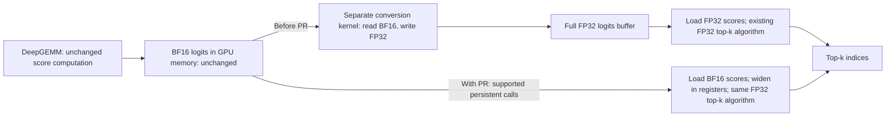

# MATERIAL PACK — vllm-project/vllm PR #64138

- title: [Perf][DSA] Read BF16 logits directly in persistent top-k
- author: Pb314314
- merged/closed: 2026-10-30
- labels: bug, ready
- category: Sampler / Detokenization | tier: major
- diffstat: +None/-None across None files
- url: https://github.com/vllm-project/vllm/pull/64138

## perf claims detected in body (regex, unverified)
- 5x speedup
- 44% speedup

## PR body
```markdown
<!-- markdownlint-disable -->

## Overview

Merged by WoosukKwon on 2026-10-30 as [`e31cf3dec7cf`](https://github.com/vllm-project/vllm/commit/e31cf3dec7cf14369b0c7a8447cdfb8b387af6e0), following approval of final PR head `5ff957619959`. The validation revisions and their scope are recorded below.

Let the existing persistent top-k backend read BF16 indexer logits and widen loaded scores to FP32 inside its kernels. On SM100 decode without DCP, this removes the full FP32 logits allocation whenever `auto` resolves to persistent, as well as for explicit persistent.

Query chunking is separate work. This PR complements [#62172](https://github.com/vllm-project/vllm/pull/62172), which implements BF16 input for cooperative top-k. This change implements persistent, filtered and sampled paths instead. Open-PR searches found no separate persistent-BF16 implementation. The caller uses the same `takes_bf16_logits()` capability-interface design as #62172; cooperative support remains with that PR.

## Claims

- Keep the existing backend selection and top-k algorithms. Scores loaded from BF16 widen to FP32 before binning/refinement; register score arrays remain FP32.
- Remove the dense FP32 logits copy for supported persistent decode calls, including default auto. Cooperative, DCP and prefill retain their existing behavior. No DeepSelect switch or query-row chunking is introduced.
- Preserve exact selected scores and valid top-k indices in the tested cases. Equal-score index identity/order and generated-token equivalence are not claimed.

## Validation

### Performance breakdown and memory traffic

**DeepGEMM's logits computation is unchanged.** This PR saves work **after** BF16 logits have been produced: it removes the separate BF16-to-FP32 materialization and lets persistent top-k read BF16 directly. It does not reduce Q/K projection work, the score computation, or the number of logits. The measurements below exclude DeepGEMM and are not end-to-end model speedups.



| Where the saving occurs | Before this PR | With this PR |
|---|---|---|
| External conversion | Allocate a full FP32 logits buffer; read 2 bytes and write 4 bytes per valid score | Remove this allocation and GPU conversion kernel |
| Top-k input loads | 4 bytes per FP32 score; an aligned four-score load reads 16 bytes | 2 bytes per BF16 score; an aligned four-score load reads 8 bytes and expands to four FP32 registers |
| Score arithmetic inside top-k | FP32 comparison/binning/refinement | The same FP32 algorithm, with on-load widening; register score arrays are still FP32 |

Code: [producer and conversion bypass](https://github.com/vllm-project/vllm/blob/6bcc085a55223db05705cf5b9b6e605eb11e9946/vllm/model_executor/layers/sparse_attn_indexer.py#L939-L954), [old allocation and conversion kernel](https://github.com/vllm-project/vllm/blob/6bcc085a55223db05705cf5b9b6e605eb11e9946/vllm/model_executor/layers/sparse_attn_indexer.py#L297-L329), and [FP32/BF16 load helpers](https://github.com/vllm-project/vllm/blob/6bcc085a55223db05705cf5b9b6e605eb11e9946/csrc/topk_histogram_4096.cuh#L70-L100).

**Measured breakdown: pre-PR `98fc6da9d735` versus PR `293880733f87`, GB200.** The PR source is unchanged by the subsequent main merges. The BF16 top-k timing includes its loads, register widening, and selection; it is not the cast alone.

| Q / valid K / top-k | External conversion: before → after (µs) | Native top-k: FP32 → BF16 (µs) | Native top-k latency change |
|---|---:|---:|---:|
| 65 / 4096 / 512 | 2.848 → removed | 4.832 → 5.632 | +16.56% |
| 128 / 100000 / 512 | 19.296 → removed | 31.232 → 30.240 | -3.18% |
| 128 / 200000 / 1024 | 35.264 → removed | 44.800 → 42.352 | -5.46% |

The **33–44% full selection-stage improvement** in the long-row cases mainly comes from eliminating the external conversion; native top-k alone improves by only about 3–5%. The short-row native kernel is slower with BF16, while the measured complete caller still improves after removing the conversion. Smaller input loads can help, but widening adds register instructions. Halving score-input bytes does not establish that total HBM traffic or latency halves; cache behavior and multiple passes matter. No hardware-counter measurement proves a bandwidth-only explanation.

**Allocation size and accessed bytes are different quantities.** At Q=128 and valid K=100000, the removed conversion logically reads 25.6 MB of BF16 data and writes 51.2 MB of FP32 data (decimal MB). A single full scan by top-k reads 51.2 MB of FP32 score payload versus 25.6 MB of BF16 payload; this is byte accounting, not measured DRAM traffic. The full FP32 allocation is larger because it retains capacity W=262144 and padded stride=262656: about **128.248 MiB**. That temporary disappears; the original BF16 logits and existing workspace remain. CUDA graph replay does not remove conversion kernels automatically; this PR removes that node and its FP32 storage from supported captured paths.

These component timings are separate cold-cache ablations, **not additive**. The complete caller measurements below remain the primary before/after result.

<details>
<summary>Breakdown measurement method and why the columns are not additive</summary>

Baseline `98fc6da9d7355d2cc85141980439fded9a5fb61c` versus measured PR `293880733f87a095acac787a996e68b097eac7cc`, using the same frozen runtimes and matching fixed BF16 inputs as the full-stage table below. GB200 job 41138: A/B/B/A fresh processes, 30 cold-L2 CUPTI graph samples per stage/run (60 per arm). Conversion uses the actual `as_fp32_logits`; top-k uses the native persistent entrypoint. Input capacity W=262144, padded stride=262656, host scheduling bound=1048576.

These are separately captured cold-cache ablations, not timestamps of nodes in one production graph. Conversion warms its FP32 output for the following kernel, while standalone top-k starts cold. The full caller also clears the output-index buffer; this native-only ablation omits that common operation. Summing the component columns therefore does not reconstruct the full-stage table. Jointly captured conversion+FP32 top-k medians are retained separately in the raw results (6.816, 46.5755 and 78.0805 µs); the full caller table remains the primary before/after comparison.

For intuition only, one full score scan would give 2-byte BF16 read + 4-byte FP32 write + 4-byte FP32 read before this PR, versus a 2-byte BF16 read after it. This 10→2 byte accounting excludes unchanged producer writes, metadata/workspace accesses, multiple selection passes and cache effects; it is not a measured traffic reduction or a 5x speedup prediction.

Every ablation passes exact selected-score, valid/unique-index and input-preservation checks. Raw samples, identities and commands are retained in `main_vs_packed_breakdown_v1` (`bench.py`, `run.sbatch`, `SUMMARY.json`, `results/41138_*`). These component measurements do not establish full-model accuracy or end-to-end performance.

</details>

### Full selection-stage results

Recorded performance baseline: **unmodified pre-PR base `98fc6da9d7355d2cc85141980439fded9a5fb61c` versus measured PR `293880733f87a095acac787a996e68b097eac7cc`**. The baseline has no persistent BF16 support and widens the BF16 producer output to a full FP32 logits tensor. The PR keeps BF16 for supported persistent calls. Neither arm includes cooperative BF16 support from #62172 or the FP32-producer configuration from #64580. This table measures the whole PR against its pre-PR baseline, not an intermediate PR commit.

Job 41130 on an exclusive GB200: A/B/B/A fresh processes, CUPTI cold-L2 CUDA-graph replay, 30 samples/run (60 per arm/shape). The actual indexer caller receives identical fixed injected BF16 logits. **Timing includes the required full-tensor conversion and top-k**, but excludes the real DeepGEMM producer, CPU Python dispatch and the model. Caller/provider source files match the stated revisions. Both target CUDA translation units were rebuilt; unrelated native objects/runtime are held fixed. This is a matched component comparison, not a fresh whole-main build or an end-to-end model benchmark.

| Q / valid K / top-k | Backend | Without PR / with PR median µs | Latency change | Without PR / with PR extra live MiB |
|---|---|---:|---:|---:|
| 64 / 4096 / 512 | cooperative (unchanged control) | 7.504 / 7.488 | -0.21% | 64.123 / 64.123 |
| 65 / 4096 / 512 | persistent | 7.616 / 6.784 | -10.92% | 66.000 / 0.000 |
| 256 / 8192 / 1024 | persistent | 15.648 / 15.456 | -1.23% | 256.498 / 0.000 |
| 128 / 100000 / 512 | persistent | 47.072 / 31.392 | -33.31% | 128.248 / 0.000 |
| 128 / 200000 / 1024 | persistent | 78.240 / 43.488 | -44.42% | 128.248 / 0.000 |

W=262144, row stride=262656, host scheduling bound=1048576; valid K length is separate. Small-Q cooperative is an unaffected control: both arms still widen and consume FP32, and its 0.21% timing difference is not claimed as an optimization gain. Persistent cases skip the widening in the PR. The longer-context results include removing that conversion; they must not be described as a 33–44% speedup of the top-k kernel alone. No universal speedup or no-regression claim is made for unmeasured shapes/backends/hardware.

<details>
<summary>Per-process medians and memory interpretation</summary>

| Q / valid K / top-k | Baseline run medians µs | PR run medians µs |
|---|---|---|
| 64 / 4096 / 512 | 7.4880, 7.5200 | 7.4880, 7.4880 |
| 65 / 4096 / 512 | 7.6320, 7.6160 | 6.7840, 6.7680 |
| 256 / 8192 / 1024 | 15.6480, 15.6480 | 15.4080, 15.4880 |
| 128 / 100000 / 512 | 46.9120, 47.2000 | 31.4555, 31.2960 |
| 128 / 200000 / 1024 | 78.1755, 78.2400 | 43.5200, 43.3920 |

Extra live peak excludes the already allocated BF16 inputs, outputs and workspace. Zero extra allocation does not mean zero total device/model memory. Graph-private reservations agree across repeats: Q64 66→66 MiB; Q65 66→0 MiB; Q256 258→0 MiB; both Q128 cases 130→0 MiB. Allocator reservation can exceed live tensor bytes. Profiling reservation is unchanged, so increased model KV capacity is not claimed.

All four arms at each shape have identical input hashes and selected-score bit bags, pass valid/unique-index checks, preserve input bits, and witness the expected conversion/dtype/backend behavior. Baseline FP32 widening is bit-exact against the fixed BF16 scores. Prior experiments are archived under their original baselines; their numbers are not mixed into this table.

</details>

**Expanded DeepSeek configuration coverage (GB200, job 41191).** Eighteen additional persistent-path cases use checkpoint-derived top-k and capacity, covering 16K/32K/64K raw contexts, Q=128/512/1024, uniform and mixed valid lengths, empty rows, and rows shorter than top-k. All 18 measured full-stage medians improve by **5.85%–39.66%** versus the same pre-PR baseline; no cooperative performance points were rerun. This is configuration-derived selection-stage coverage, not measured production-frequency coverage or an end-to-end model speedup.

<details>
<summary>All 18 additional cases, model provenance, correctness and measurement limits</summary>

Baseline `98fc6da9d7355d2cc85141980439fded9a5fb61c` versus current PR `293880733f87a095acac787a996e68b097eac7cc`; same pinned matched top-k builds as the primary table, on an exclusive GB200 node (`gb200-rack1-04`). A/B/B/A fresh processes, 30 cold-L2 CUPTI graph replays per process (60 samples/arm). The measured boundary retains actual caller output clearing, conditional conversion and automatic persistent dispatch. It injects deterministic synthetic BF16 logits instead of running DeepGEMM; the kernels and auto policy are not retuned.

| Configuration | Checkpoint revision | top-k | Compression | Logits capacity W / tested stride |
|---|---|---:|---:|---:|
| v4_c4 (DeepSeek-V4-Flash-DSpark) | `62af8fffb2f7030cac4de2f0169f5b8d1101b646` | 512 | 4 | 262144 / 262656 |
| v41_c2 (DeepSeek-V4.1-Flash) | `2cba9e42aa026125f3ed06c6d98c1db82f7ca027` | 512 | 2 | 524288 / 525312 |
| v41_c1_dense (DeepSeek-V4.1-Flash) | `2cba9e42aa026125f3ed06c6d98c1db82f7ca027` | 512 | 1 | 1048576 / 1049088 |
| v32exp_selection (DeepSeek-V3.2-Exp) | `194c67e12b1b0d6df0ef373ddcf215bc84027409` | 2048 | 1 | 163840 / 164352 |

V4/V4.1 checkpoint maximum context is 1048576; dense indexer width is configured context divided by compression. V3.2-Exp's configured maximum is 163840. The 128K deployment-capacity control uses W=32768 and stride=33792. Tested strides round W up to multiples of 1536 and are explicit padded selection-input layouts; they do not assert that every producer version uses this padding. Host scheduling bound equals W. V4.1 c1 measurements apply to its **dense** indexer path, not candidate-consuming sparse-logits layers. V3.2-Exp cases validate its dimensions at the BF16 selection boundary, not its actual producer/model execution.

| Configuration | Q | Valid K max | top-k | Rows | Baseline → PR µs | Change | Extra peak MiB before → after |
|---|---:|---:|---:|---|---:|---:|---:|
| v4_c4 | 128 | 4096 | 512 | uniform | 8.192 → 7.344 | -10.35% | 128.248 → 0.000 |
| v4_c4 | 128 | 8192 | 512 | uniform | 9.888 → 9.104 | -7.92% | 128.248 → 0.000 |
| v4_c4 | 128 | 16384 | 512 | uniform | 13.056 → 11.968 | -8.33% | 128.248 → 0.000 |
| v4_c4 | 512 | 16384 | 512 | mixed | 24.961 → 21.440 | -14.10% | 512.998 → 0.000 |
| v41_c2 | 128 | 8192 | 512 | uniform | 9.536 → 8.736 | -8.39% | 256.496 → 0.000 |
| v41_c2 | 128 | 16384 | 512 | uniform | 12.928 → 11.696 | -9.53% | 256.496 → 0.000 |
| v41_c2 | 128 | 32768 | 512 | uniform | 20.032 → 17.184 | -14.22% | 256.496 → 0.000 |
| v41_c2 | 512 | 32768 | 512 | mixed | 38.752 → 31.280 | -19.28% | 1026.000 → 0.000 |
| v41_c1_dense | 128 | 16384 | 512 | uniform | 12.864 → 11.744 | -8.71% | 512.248 → 0.000 |
| v41_c1_dense | 128 | 32768 | 512 | uniform | 20.128 → 17.104 | -15.02% | 512.248 → 0.000 |
| v41_c1_dense | 128 | 65536 | 512 | uniform | 39.168 → 25.856 | -33.99% | 512.248 → 0.000 |
| v41_c1_dense | 512 | 65536 | 512 | mixed | 80.209 → 48.400 | -39.66% | 2048.998 → 0.000 |
| v32exp_selection | 128 | 16384 | 2048 | uniform | 16.912 → 15.280 | -9.65% | 80.248 → 0.000 |
| v32exp_selection | 128 | 32768 | 2048 | uniform | 25.297 → 21.696 | -14.23% | 80.248 → 0.000 |
| v32exp_selection | 128 | 65536 | 2048 | uniform | 35.520 → 25.472 | -28.29% | 80.248 → 0.000 |
| v32exp_selection | 512 | 65536 | 2048 | mixed | 83.552 → 53.695 | -35.73% | 320.998 → 0.000 |
| v4_c4_128k_capacity | 128 | 8192 | 512 | uniform | 9.568 → 9.008 | -5.85% | 16.496 → 0.000 |
| v4_c4_large_q | 1024 | 16384 | 512 | mixed | 41.952 → 35.200 | -16.09% | 1026.000 → 0.000 |

Q is the total number of query rows. Uniform cases use raw contexts 16K/32K/64K, divided by the listed compression ratio. Mixed cases cycle valid K lengths through 0, top-k/2, top-k, L/4, L/2, L−1 and L, where L is the table's maximum. This deliberately stresses variable-length and empty/padded rows; it is not a measured serving distribution. Q=1024 can represent a large verification batch dimension but does not validate the speculative-decoding pipeline.

All **18 × 4 process/case combinations** pass eager and CUDA-graph replay checks: matching fixed input hashes, exact selected-score FP32 bit multisets against an integer-order reference, in-range unique indices, correct -1 padding, and unchanged input bits. Baseline conversions match the BF16 values widened to FP32 bit-for-bit. All arms agree on selected-score hashes; tie-index identity/order is not required. Observed auto dispatch is persistent in every case; baseline materializes FP32 and current PR consumes BF16.

Extra peak is measured beyond preallocated input/output/workspace; zero does not mean zero model/device memory. The removed FP32 temporary ranges from 16.496 to 2048.998 MiB in these cases. Graph-pool reservations and all per-process medians/raw samples are retained alongside the report. Scope remains one GPU architecture and synthetic score distributions: no new final-commit PD/collocated model performance or generated-token equivalence is established.

Reproducibility bundle: `deepseek_config_coverage_v1/{benchmark.py,CASES.json,MODEL_CONFIGS.json,run.sbatch,summarize.py,SUMMARY.json,MANIFEST.json,results/41191_*}`. Config files, caller/provider sources and loaded native libraries are fingerprinted. Run `sbatch -p normal .../deepseek_config_coverage_v1/run.sbatch` with the recorded runtime paths to repeat the full comparison. An initial attempt (41190) stopped in an untimed benchmark observer due to a CPU/GPU mask mismatch; it produced no timing data and was fixed before every arm of 41191.

</details>

### Correctness and CI

<details>
<summary>Branch and CI status (2026-10-30)</summary>

**Branch/CI status (2026-10-30):** Woosuk merged main `2f6f7861ba` into this branch as `6bcc085a55223db05705cf5b9b6e605eb11e9946` and triggered [Buildkite #98802](https://buildkite.com/vllm/ci/builds/98802). Upstream pre-run-check, pre-commit and all three B200 Kernels shards now pass on that head. [B200 Kernels shard 1/3](https://buildkite.com/vllm/ci/builds/98802#01a18e85-10df-4239-935c-93fb4bfdddf6) ran the full `tests/kernels/test_top_k_per_row.py`: **806 passed, 44 skipped, 0 failed**, including all 32 PR-specific BF16 kernel/dispatch cases. **All required CI checks now pass on `6bcc085a5522`**, including the aggregate Buildkite status, pre-run-check, pre-commit and DCO. The final GitHub rollup contains 464 successful checks and 4 skipped checks, with no failures or pending checks. The last B200 Fusion E2E TP2 job completed with 32 passed and 0 failed.

**Post-merge verification (2026-10-30):** final PR head `5ff957619959` synchronized newer main changes before WoosukKwon approved and merged it as `e31cf3dec7cf`. All 11 PR-changed files plus the recorded native dependencies (16 unique files) are byte-identical between tested `6bcc085a5522`, final PR head `5ff957619959`, and merged `e31cf3dec7cf`; the final PR head and merged commit have identical source trees. The full PR CI result above belongs to `6bcc085a5522`, not a new full-suite run on the final synchronized tree. [Post-merge main CI #98832](https://buildkite.com/vllm/ci/builds/98832) is a separate run; no completed result is claimed here.

All 11 PR-changed files and the recorded transitive top-k native source dependencies are byte-identical across measured `293880733f`, locally tested `92e45217c97`, and upstream-CI-tested `6bcc085a5522`. Local `pre-commit run --show-diff-on-failure --all-files --hook-stage manual` passed on `92e45217c97`, including mypy. Local GPU CI reproduction on GB200 also passed: `pytest -v -s tests/kernels/test_top_k_per_row.py` — **806 passed, 44 skipped, 0 failed** (850 collected), including all 24 BF16 immediate-cast kernel cases, all 8 BF16 persistent dispatch cases, and the existing FP32/backend regressions. Skips: 38 ROCm-only cases and 6 unsupported cooperative shapes. The local test used Python/test sources from `92e45217c97` and reused the PR native extension after verifying unchanged transitive top-k sources; it was not a fresh full-main native build. Local results do not replace upstream Buildkite, and no new model evaluation is claimed for either main merge.

</details>

| Correctness check | Result / scope |
|---|---|
| Upstream B200 CI, head `6bcc085a5522`, complete top-k test file | 806 passed, 44 skipped, 0 failed; includes all 32 new BF16 cases |
| Final standalone BF16 immediate-widen/provider tests, including graph replay and row boundaries | 32 passed |
| Timed pre-PR versus current-PR comparisons | All 5 shapes × 4 processes pass exact selected-score, valid/unique-index and input-preservation checks; baseline widens, PR skips widening only on supported persistent paths |
| Exhaustive scalar versus packed2/packed4 widening | All 65,536 BF16 bit patterns match in FP32 bits on tested GB200/compiler, including NaNs and signed zero |
| Local reconciliation with #62172 | 451 kernel/provider tests passed; 25 additional offset/tail checks and 6 candidate-block comparisons passed in the associated helper/integration runs |
| FP32 compiled paths | All 37 specialization instruction texts match across the standalone helper update |

The integration checks validate the separately reconciled code, not a clean merge of the two online heads. They do not establish full-model equivalence.

Historical model evaluation, **before the packed helper update**: collocated DeepSeek V4-Flash-DSpark, TP4+EP, eager, no speculation, explicit persistent; 8 fixed ~9.9K-context GSM8K-derived prompts. FP32 baseline 8/8 final answers correct, BF16 version 8/8; all workers witnessed the intended dtype and effective K > 512. Only 2/8 full token-string sequences match. The cause of the other sequence differences remains unlocalized. This was not rerun for the packed update; no generated-token equivalence, broad accuracy or end-to-end performance claim is made.

Focused reproduction after building the native extension:

```bash
.venv/bin/python -m pytest tests/kernels/test_top_k_per_row.py -q \
  -k 'persistent_topk_bf16_immediate_cast or sparse_indexer_resolved_persistent_bf16'
```

Raw samples, commands, source/native fingerprints and archived prior results are retained in the author review bundle (`main_vs_packed_pr_v1`, job 41130 for the performance table; prior standalone/helper/integration jobs 41117, 41103 and 41107 for the respective correctness scopes). Pre-commit checks passed for the final helper delta. AI assistance was used for implementation, validation and this description.

## Details

The aligned BF16 vector-load helpers use the same packed integer load and bit-expansion implementation as #62172; scalar and guarded tail loads remain available. FP32 overloads are unchanged.

### BF16 and FP32 load behavior

The helpers separate the input storage type from the existing FP32 selection arithmetic:

| Helper | BF16 input | FP32 input |
|---|---|---|
| `to_float(x)` | Widen one BF16 value with `__bfloat162float(x)` | Identity: `return x;` |
| `load_score2(ptr)` | Read 4 bytes containing two BF16 values and expand them to two FP32 values (8 bytes of value storage) | The existing `float2` load (8 input bytes) |
| `load_score4(ptr)` | Read 8 bytes containing four BF16 values and expand them to four FP32 values (16 bytes of value storage) | The existing `float4` load (16 input bytes) |
| Guarded tail load | Read only valid BF16 elements, widen individually, and fill invalid elements with negative infinity | Retain the existing FP32 predicated-load implementation |

For the aligned four-score BF16 helper, [`topk_histogram_4096.cuh:78–82`](https://github.com/vllm-project/vllm/blob/e31cf3dec7cf14369b0c7a8447cdfb8b387af6e0/csrc/topk_histogram_4096.cuh#L78-L82) contains:

```cpp
const uint2 raw = *reinterpret_cast<const uint2*>(ptr);
return make_float4(
    __uint_as_float(raw.x << 16), __uint_as_float(raw.x & 0xFFFF0000u),
    __uint_as_float(raw.y << 16), __uint_as_float(raw.y & 0xFFFF0000u));
```

`uint2` contains two 32-bit words, so the input payload is 8 bytes. Each word holds two BF16 values. The shifts and masks place each BF16 bit pattern in the upper 16 bits of its own FP32 word; `__uint_as_float` reinterprets that word as a float. `make_float4` returns four 32-bit values: **8 input bytes become 16 bytes of FP32 values, not 32 bytes**. These values feed the kernel's existing FP32 register computation; the helper does not allocate or write a full FP32 logits tensor in global memory.

The [FP32 scalar overload](https://github.com/vllm-project/vllm/blob/e31cf3dec7cf14369b0c7a8447cdfb8b387af6e0/csrc/topk_histogram_4096.cuh#L70-L73) returns its input unchanged, and the [FP32 four-score overload](https://github.com/vllm-project/vllm/blob/e31cf3dec7cf14369b0c7a8447cdfb8b387af6e0/csrc/topk_histogram_4096.cuh#L75-L77) retains `*reinterpret_cast<const float4*>(ptr)`. FP32 inputs are never downcast to BF16.


Code references: [BF16-to-FP32 register conversion](https://github.com/vllm-project/vllm/blob/293880733f87a095acac787a996e68b097eac7cc/csrc/topk_histogram_4096.cuh#L71-L92), [backend capability query](https://github.com/vllm-project/vllm/blob/293880733f87a095acac787a996e68b097eac7cc/vllm/model_executor/layers/indexer_topk.py#L236-L255), and [conditional full-tensor conversion](https://github.com/vllm-project/vllm/blob/293880733f87a095acac787a996e68b097eac7cc/vllm/model_executor/layers/sparse_attn_indexer.py#L951-L954).

BF16 input is widened losslessly on load; this avoids materiali
```

## diff
```diff
diff --git a/csrc/persistent_topk.cuh b/csrc/persistent_topk.cuh
index bd18483b48d0..30ffed044561 100644
--- a/csrc/persistent_topk.cuh
+++ b/csrc/persistent_topk.cuh
@@ -65,8 +65,9 @@ struct RadixRowState {
 // Kernel parameters
 // ============================================================================
 
+template <typename InT>
 struct PersistentTopKParams {
-  const float* __restrict__ input;      // [num_rows, stride]
+  const InT* __restrict__ input;        // [num_rows, stride]
   int32_t* __restrict__ output;         // [num_rows, top_k]
   const int32_t* __restrict__ lengths;  // [num_rows]
   RadixRowState* row_states;            // large path: per-group state
@@ -150,9 +151,9 @@ __device__ __forceinline__ void select_coarse_bin(
 // kernel
 // Returns where exact recovery resumes when the threshold bin overflows the
 // candidate buffer; .needed is false otherwise.
-template <int TopK, uint32_t VecSize>
+template <int TopK, uint32_t VecSize, typename InT>
 __device__ __noinline__ overflow::MediumResume histogram_medium_topk(
-    const float* __restrict__ logits, int* __restrict__ output_indices,
+    const InT* __restrict__ logits, int* __restrict__ output_indices,
     int seq_len) {
   // All shared state lives in dynamic shared memory to avoid static
   extern __shared__ char medium_smem[];
@@ -291,7 +292,8 @@ __device__ __noinline__ overflow::MediumResume histogram_medium_topk(
     if (remaining_k == 0) {
       for (int i = thread_id; i < num_buffered; i += kThreadsPerBlock) {
         const int idx = buffered_indices[src_buffer][i];
-        const uint32_t fp32_bits = convert_to_uint32_v2(logits[idx]);
+        const uint32_t fp32_bits =
+            convert_to_uint32_v2(topk_histogram_4096::to_float(logits[idx]));
         const int bin = (fp32_bits >> bit_offset) & 0xFF;
         if (bin > threshold_bin) {
           const int output_pos = atomicAdd(&shared_output_count, 1);
@@ -310,7 +312,7 @@ __device__ __noinline__ overflow::MediumResume histogram_medium_topk(
 
     for (int i = thread_id; i < num_buffered; i += kThreadsPerBlock) {
       const int idx = buffered_indices[src_buffer][i];
-      const float logit_value = logits[idx];
+      const float logit_value = topk_histogram_4096::to_float(logits[idx]);
       const uint32_t fp32_bits = convert_to_uint32_v2(logit_value);
       const int bin = (fp32_bits >> bit_offset) & 0xFF;
       if (bin > threshold_bin) {
@@ -400,8 +402,8 @@ __device__ __forceinline__ void wait_ge(int* ptr, int target_val,
 // Adapted from https://github.com/flashinfer-ai/flashinfer/pull/2215
 // ============================================================================
 
-template <int TopK, uint32_t VEC_SIZE>
-__device__ void radix_topk(const float* __restrict__ row_input,
+template <int TopK, uint32_t VEC_SIZE, typename InT>
+__device__ void radix_topk(const InT* __restrict__ row_input,
                            int32_t* __restrict__ row_output, uint32_t seq_len,
                            uint32_t my_chunk_start, uint32_t chunk_size,
                            uint32_t* local_histogram, uint32_t* suffix_sum,
@@ -421,24 +423,26 @@ __device__ void radix_topk(const float* __restrict__ row_input,
 
     for (uint32_t i = tx * VEC_SIZE; i < aligned_size;
          i += kThreadsPerBlock * VEC_SIZE) {
-      const float* src = row_input + my_chunk_start + i;
+      const InT* src = row_input + my_chunk_start + i;
       if constexpr (VEC_SIZE == 4) {
-        float4 v = *reinterpret_cast<const float4*>(src);
+        float4 v = topk_histogram_4096::load_score4(src);
         shared_ordered[i] = convert_to_uint32_v2(v.x);
         shared_ordered[i + 1] = convert_to_uint32_v2(v.y);
         shared_ordered[i + 2] = convert_to_uint32_v2(v.z);
         shared_ordered[i + 3] = convert_to_uint32_v2(v.w);
       } else if constexpr (VEC_SIZE == 2) {
-        float2 v = *reinterpret_cast<const float2*>(src);
+        float2 v = topk_histogram_4096::load_score2(src);
         shared_ordered[i] = convert_to_uint32_v2(v.x);
         shared_ordered[i + 1] = convert_to_uint32_v2(v.y);
       } else {
-        shared_ordered[i] = convert_to_uint32_v2(*src);
+        shared_ordered[i] =
+            convert_to_uint32_v2(topk_histogram_4096::to_float(*src));
       }
     }
     for (uint32_t i = aligned_size + tx; i < actual_chunk_size;
          i += kThreadsPerBlock) {
-      shared_ordered[i] = convert_to_uint32_v2(row_input[my_chunk_start + i]);
+      shared_ordered[i] = convert_to_uint32_v2(
+          topk_histogram_4096::to_float(row_input[my_chunk_start + i]));
     }
   }
   __syncthreads();
@@ -609,9 +613,9 @@ __device__ void radix_topk(const float* __restrict__ row_input,
 // Persistent kernel — short/medium/large paths with RadixTopK.
 // ============================================================================
 
-template <int TopK = 2048, uint32_t VEC_SIZE = 1>
+template <int TopK = 2048, uint32_t VEC_SIZE = 1, typename InT = float>
 __global__ void __launch_bounds__(kThreadsPerBlock, 2)
-    persistent_topk_kernel(PersistentTopKParams params) {
+    persistent_topk_kernel(PersistentTopKParams<InT> params) {
   const uint32_t tx = threadIdx.x;
   extern __shared__ uint8_t smem_raw[];
 
@@ -675,7 +679,7 @@ __global__ void __launch_bounds__(kThreadsPerBlock, 2)
     const uint32_t seq_len =
         non_negative_len < row_bound ? non_negative_len : row_bound;
     int32_t* row_output = params.output + row_idx * params.top_k;
-    const float* row_input = params.input + row_idx * params.stride;
+    const InT* row_input = params.input + row_idx * params.stride;
 
     if (seq_len <= RADIX_THRESHOLD) {
       if (cta_in_group == 0) {
@@ -736,10 +740,11 @@ struct vec_t {
   FLASHINFER_INLINE T& operator[](size_t i) { return data[i]; }
   FLASHINFER_INLINE const T& operator[](size_t i) const { return data[i]; }
 
-  FLASHINFER_INLINE void cast_load(const T* ptr) {
+  template <typename InT>
+  FLASHINFER_INLINE void cast_load(const InT* ptr) {
 #pragma unroll
     for (size_t i = 0; i < N; ++i) {
-      data[i] = ptr[i];
+      data[i] = topk_histogram_4096::to_float(ptr[i]);
     }
   }
 };
@@ -802,7 +807,7 @@ __device__ __forceinline__ bool filtered_topk_row(
   extern __shared__ __align__(16) uint8_t dynamic_smem[];
   constexpr uint32_t BLOCK_SIZE = FILTERED_TOPK_BLOCK_THREADS;
   constexpr int SMEM_INPUT_SIZE = FILTERED_TOPK_SMEM_INPUT_SIZE;
-  using Traits = FilteredTopKTraits<DType, UseWideCoarse>;
+  using Traits = FilteredTopKTraits<float, UseWideCoarse>;
   constexpr int RADIX = 1 << Traits::REFINE_BITS;
   static_assert(RADIX == FilteredTopKStorage<MAX_K, UseWideCoarse>::RADIX);
   constexpr int COARSE_RADIX = Traits::COARSE_RADIX;
@@ -853,7 +858,7 @@ __device__ __forceinline__ bool filtered_topk_row(
   }
   __syncthreads();
 
-  vec_t<DType, VEC_SIZE> score_vec;
+  vec_t<float, VEC_SIZE> score_vec;
 
   const int aligned_length = (length / VEC_SIZE) * VEC_SIZE;
 #pragma unroll 2
@@ -868,7 +873,7 @@ __device__ __forceinline__ bool filtered_topk_row(
   }
   // Handle tail
   for (int i = aligned_length + tx; i < length; i += BLOCK_SIZE) {
-    const auto bin = Traits::ToCoarseKey(score[i]);
+    const auto bin = Traits::ToCoarseKey(hist4096::to_float(score[i]));
     atomicAdd(&s_coarse_histogram[bin], 1);
   }
   __syncthreads();
@@ -920,7 +925,8 @@ __device__ __forceinline__ bool filtered_topk_row(
     }
     // Handle tail
     for (int i = aligned_length + tx; i < length; i += BLOCK_SIZE) {
-      const auto bin = static_cast<int>(Traits::ToCoarseKey(score[i]));
+      const auto bin =
+          static_cast<int>(Traits::ToCoarseKey(hist4096::to_float(score[i])));
       if (bin > threshold_bin) {
         const auto pos = atomicAdd(&s_counter, 1);
         s_indices[pos] = i;
@@ -972,7 +978,7 @@ __device__ __forceinline__ bool filtered_topk_row(
     }
     // Handle tail
     for (int i = aligned_length + tx; i < length; i += BLOCK_SIZE) {
-      filter_and_add_to_histogram(score[i], i);
+      filter_and_add_to_histogram(hist4096::to_float(score[i]), i);
     }
     __syncthreads();
 
@@ -1007,7 +1013,8 @@ __device__ __forceinline__ bool filtered_topk_row(
         for (int i = tx; i < num_input; i += BLOCK_SIZE) {
           const auto idx = s_input_idx[r_idx][i];
           const auto bin =
-              (Traits::ToOrdered(score[idx]) >> offset) & (RADIX - 1);
+              (Traits::ToOrdered(hist4096::to_float(score[idx])) >> offset) &
+              (RADIX - 1);
           if (static_cast<int>(bin) > threshold) {
             const auto pos = atomicAdd(&s_counter, 1);
             s_indices[pos] = idx;
@@ -1023,7 +1030,7 @@ __device__ __forceinline__ bool filtered_topk_row(
         __syncthreads();
         for (int i = tx; i < num_input; i += BLOCK_SIZE) {
           const auto idx = s_input_idx[r_idx][i];
-          const auto raw_input = score[idx];
+          const float raw_input = hist4096::to_float(score[idx]);
           const auto bin =
               (Traits::ToOrdered(raw_input) >> offset) & (RADIX - 1);
           if (static_cast<int>(bin) > threshold) {
@@ -1100,7 +1107,7 @@ constexpr uint32_t gcd(uint32_t a, uint32_t b) {
 // Returns 1, 2, 4, or 8
 template <typename DType>
 constexpr int ComputeFilteredTopKVecSize(uint32_t max_len) {
-  constexpr int MAX_VEC = 16 / sizeof(DType);  // 4 for float32, 8 for fp16/bf16
+  constexpr int MAX_VEC = 4;
   // Use GCD to find largest power-of-2 divisor
   const uint32_t g = gcd(max_len, static_cast<uint32_t>(MAX_VEC));
   return static_cast<int>(g);
@@ -1114,7 +1121,7 @@ cudaError_t FilteredTopKRaggedTransform(const DType* input,
                                         uint32_t max_len,
                                         cudaStream_t stream = 0) {
   constexpr size_t smem_size = FILTERED_TOPK_SMEM_DYNAMIC;
-  constexpr int MAX_VEC = 16 / sizeof(DType);
+  constexpr int MAX_VEC = 4;
 
   dim3 grid(num_rows);
   dim3 block(FILTERED_TOPK_BLOCK_THREADS);
diff --git a/csrc/persistent_topk_overflow.cuh b/csrc/persistent_topk_overflow.cuh
index 9ae116998e89..306dcfe263a5 100644
--- a/csrc/persistent_topk_overflow.cuh
+++ b/csrc/persistent_topk_overflow.cuh
@@ -19,10 +19,10 @@ struct MediumResume {
   uint32_t remaining = 0;
 };
 
-template <int TopK, int BlockSize, int VecSize>
-__device__ __noinline__ void recover_medium(const float* scores,
-                                            int32_t* output, uint32_t length,
-                                            void* smem, uint32_t prefix,
+template <int TopK, int BlockSize, int VecSize, typename InT>
+__device__ __noinline__ void recover_medium(const InT* scores, int32_t* output,
+                                            uint32_t length, void* smem,
+                                            uint32_t prefix,
                                             uint32_t remaining) {
   topk_histogram_4096::exact_topk_rescan<TopK, BlockSize, VecSize, 1, 4096>(
       scores, output, length, smem, prefix, remaining);
@@ -70,7 +70,9 @@ __device__ bool try_sampled_exact_topk(const DType* __restrict__ scores,
                                        IdType* __restrict__ output,
                                        uint32_t length, uint32_t top_k,
                                        void* dynamic_smem, int* scratch) {
-  using Traits = FilteredTopKTraits<DType, false>;
+  using Traits =
+      FilteredTopKTraits<decltype(topk_histogram_4096::to_float(DType{})),
+                         false>;
   using Radix = SampledRadixDigits;
   constexpr uint32_t kItemsPerThread = 2;
   constexpr uint32_t kSampleSize = BlockSize * kItemsPerThread;
@@ -92,7 +94,8 @@ __device__ bool try_sampled_exact_topk(const DType* __restrict__ scores,
     const uint32_t score_idx = static_cast<uint32_t>(
         (static_cast<uint64_t>(2 * sample_idx + 1) * length) /
         (2 * kSampleSize));
-    sample_keys[i] = Traits::ToOrdered(scores[score_idx]);
+    sample_keys[i] =
+        Traits::ToOrdered(topk_histogram_4096::to_float(scores[score_idx]));
   }
 
   auto* sort_smem =
@@ -127,14 +130,14 @@ __device__ bool try_sampled_exact_topk(const DType* __restrict__ scores,
       static_cast<uint64_t>(CandidateCapacity) * kSampleSize) {
     return false;
   }
-  const auto collect_candidate = [&](uint32_t idx, DType score) {
+  const auto collect_candidate = [&](uint32_t idx, float score) {
     if (Traits::ToOrdered(score) >= proposed_pivot) {
       const int pos = atomicAdd(candidate_count, 1);
       if (pos < static_cast<int>(CandidateCapacity)) candidates[pos] = idx;
     }
   };
 
-  vec_t<DType, VecSize> score_vec;
+  vec_t<float, VecSize> score_vec;
   const uint32_t aligned_length = length / VecSize * VecSize;
   for (uint32_t base = tx * VecSize; base < aligned_length;
        base += BlockSize * VecSize) {
@@ -145,7 +148,7 @@ __device__ bool try_sampled_exact_topk(const DType* __restrict__ scores,
     }
   }
   for (uint32_t idx = aligned_length + tx; idx < length; idx += BlockSize) {
-    collect_candidate(idx, scores[idx]);
+    collect_candidate(idx, topk_histogram_4096::to_float(scores[idx]));
   }
   __syncthreads();
 
@@ -157,8 +160,8 @@ __device__ bool try_sampled_exact_topk(const DType* __restrict__ scores,
 
   auto* candidate_keys = candidates + CandidateCapacity;
   for (int i = tx; i < num_candidates; i += BlockSize) {
-    candidate_keys[i] =
-        static_cast<int>(Traits::ToOrdered(scores[candidates[i]]));
+    candidate_keys[i] = static_cast<int>(Traits::ToOrdered(
+        topk_histogram_4096::to_float(scores[candidates[i]])));
   }
 
   if (tx == 0) {
diff --git a/csrc/sampled_topk.cuh b/csrc/sampled_topk.cuh
index c25f8ed8e731..9923dcbf417e 100644
--- a/csrc/sampled_topk.cuh
+++ b/csrc/sampled_topk.cuh
@@ -69,9 +69,8 @@ __device__ void select_bin(Storage& s) {
 
 // Find a coarse bin, then refine its full FP32 keys one byte at a time.
 // Read shared candidates normally, or the full row for exact fallback.
-template <bool Buffered>
-__device__ uint32_t threshold(Storage& s, const float* row, int count,
-                              int rank) {
+template <bool Buffered, typename InT>
+__device__ uint32_t threshold(Storage& s, const InT* row, int count, int rank) {
   const int tid = threadIdx.x;
   if (tid == 0) {
     s.remaining = rank;
@@ -81,7 +80,8 @@ __device__ uint32_t threshold(Storage& s, const float* row, int count,
   __syncthreads();
   for (int i = tid; i < count; i += kThreads) {
     const uint32_t key =
-        Buffered ? s.candidates[i].y : hist4096::convert_to_uint32_v2(row[i]);
+        Buffered ? s.candidates[i].y
+                 : hist4096::convert_to_uint32_v2(hist4096::to_float(row[i]));
     atomicAdd(&s.histogram[coarse(key)], 1);
   }
   __syncthreads();
@@ -94,7 +94,8 @@ __device__ uint32_t threshold(Storage& s, const float* row, int count,
     const uint32_t prefix = s.prefix;
     for (int i = tid; i < count; i += kThreads) {
       const uint32_t key =
-          Buffered ? s.candidates[i].y : hist4096::convert_to_uint32_v2(row[i]);
+          Buffered ? s.candidates[i].y
+                   : hist4096::convert_to_uint32_v2(hist4096::to_float(row[i]));
       if (coarse(key) == coarse_bin && (key & mask) == prefix) {
         atomicAdd(&s.histogram[(key >> shift) & 255], 1);
       }
@@ -118,8 +119,8 @@ __device__ __forceinline__ int reserve(bool hit, int* counter) {
   return base + __popc(mask & ((1u << lane) - 1));
 }
 
-template <bool Buffered>
-__device__ void emit(Storage& s, const float* row, int32_t* dst, int count,
+template <bool Buffered, typename InT>
+__device__ void emit(Storage& s, const InT* row, int32_t* dst, int count,
                      uint32_t cutoff) {
   const int tid = threadIdx.x;
   if (tid == 0) s.count = 0;
@@ -127,10 +128,10 @@ __device__ void emit(Storage& s, const float* row, int32_t* dst, int count,
   for (int base = 0; base < count; base += kThreads) {
     const int i = base + tid;
     const uint2 pair =
-        i < count
-            ? (Buffered ? s.candidates[i]
-                        : make_uint2(i, hist4096::convert_to_uint32_v2(row[i])))
-            : make_uint2(0, 0);
+        i < count ? (Buffered ? s.candidates[i]
+                              : make_uint2(i, hist4096::convert_to_uint32_v2(
+                                                  hist4096::to_float(row[i]))))
+                  : make_uint2(0, 0);
     bool keep = i < count && pair.y > cutoff;
     if (i < count && pair.y == cutoff) {
       keep = atomicSub(&s.remaining, 1) > 0;
@@ -140,9 +141,9 @@ __device__ void emit(Storage& s, const float* row, int32_t* dst, int count,
   }
 }
 
-template <int K>
+template <int K, typename InT>
 __global__ void __launch_bounds__(kThreads)
-    sampled_topk_kernel(const float* __restrict__ input,
+    sampled_topk_kernel(const InT* __restrict__ input,
                         const int32_t* __restrict__ lengths,
                         int32_t* __restrict__ output, int64_t stride,
                         int max_length) {
@@ -150,7 +151,7 @@ __global__ void __launch_bounds__(kThreads)
   auto& s = *reinterpret_cast<Storage*>(smem);
   const int tid = threadIdx.x;
   const int length = max(0, min(lengths[blockIdx.x], max_length));
-  const float* row = input + blockIdx.x * stride;
+  const InT* row = input + blockIdx.x * stride;
   int32_t* dst = output + blockIdx.x * K;
   // Graph allocations can hold rows much shorter than the host length bound.
   if (length < kMinSampledLength<K>) {
@@ -158,11 +159,11 @@ __global__ void __launch_bounds__(kThreads)
     bool selected;
     if ((stride & 3) == 0 && (reinterpret_cast<uintptr_t>(row) & 15) == 0) {
       selected =
-          filtered_topk::filtered_topk_row<float, int32_t, 4, K, false, true>(
+          filtered_topk::filtered_topk_row<InT, int32_t, 4, K, false, true>(
               row, dst, length, K, fallback_storage);
     } else {
       selected =
-          filtered_topk::filtered_topk_row<float, int32_t, 1, K, true, true>(
+          filtered_topk::filtered_topk_row<InT, int32_t, 1, K, true, true>(
               row, dst, length, K, fallback_storage);
     }
     if (!selected) {
@@ -177,7 +178,8 @@ __global__ void __launch_bounds__(kThreads)
   // Sample contiguous warps spread across the row to keep loads coalesced.
   for (int i = tid; i < kSample; i += kThreads) {
     const int index = (i / 32) * (length / (kSample / 32)) + i % 32;
-    atomicAdd(&s.histogram[coarse(hist4096::convert_to_uint32_v2(row[index]))],
+    atomicAdd(&s.histogram[coarse(hist4096::convert_to_uint32_v2(
+                  hist4096::to_float(row[index])))],
               1);
   }
   __syncthreads();
@@ -200,7 +202,7 @@ __global__ void __launch_bounds__(kThreads)
 #pragma unroll
       for (int j = 0; j < kItems / 4; ++j) {
         const float4 values =
-            reinterpret_cast<const float4*>(row + base)[tid + j * kThreads];
+            hist4096::load_score4(row + base + (tid + j * kThreads) * 4);
         keys[4 * j] = hist4096::convert_to_uint32_v2(values.x);
         keys[4 * j + 1] = hist4096::convert_to_uint32_v2(values.y);
         keys[4 * j + 2] = hist4096::convert_to_uint32_v2(values.z);
@@ -210,7 +212,10 @@ __global__ void __launch_bounds__(kThreads)
 #pragma unroll
       for (int j = 0; j < kItems; ++j) {
         const int i = base + tid * 4 + (j / 4) * kThreads * 4 + j % 4;
-        keys[j] = i < length ? hist4096::convert_to_uint32_v2(row[i]) : 0;
+        keys[j] =
+            i < length
+                ? hist4096::convert_to_uint32_v2(hist4096::to_float(row[i]))
+                : 0;
       }
     }
 #pragma unroll
diff --git a/csrc/topk.cu b/csrc/topk.cu
index d5ff2a8386eb..1322ca3b0dd4 100644
--- a/csrc/topk.cu
+++ b/csrc/topk.cu
@@ -15,7 +15,7 @@
 namespace {
 
 #ifndef USE_ROCM
-template <int TopK>
+template <int TopK, typename InT>
 void launch_persistent_topk(const torch::stable::Tensor& logits,
                             const torch::stable::Tensor& lengths,
                             torch::stable::Tensor& output,
@@ -28,6 +28,7 @@ void launch_persistent_topk(const torch::stable::Tensor& logits,
   const int64_t num_rows = logits.size(0);
   const int64_t stride = logits.stride(0);
   const cudaStream_t stream = get_current_cuda_stream();
+  const auto* input = reinterpret_cast<const InT*>(logits.const_data_ptr());
 
   static int num_sms = 0;
   static int max_smem_per_block = 0;
@@ -37,11 +38,15 @@ void launch_persistent_topk(const torch::stable::Tensor& logits,
     max_smem_per_block = device_prop->sharedMemPerBlockOptin;
   }
 
+  STD_TORCH_CHECK(
+      sizeof(InT) == sizeof(float) || max_smem_per_block >= 128 * 1024,
+      "bfloat16 persistent_topk requires 128 KiB shared memory");
+
   // Allow static fallback storage in addition to the 128 KiB dynamic buffer.
   if (num_rows > 64 &&
       max_seq_len >= vllm::sampled_topk::kMinSampledLength<TopK> &&
       max_smem_per_block >= 144 * 1024) {
-    auto kernel = vllm::sampled_topk::sampled_topk_kernel<TopK>;
+    auto kernel = vllm::sampled_topk::sampled_topk_kernel<TopK, InT>;
     constexpr size_t smem_size =
         vllm::filtered_topk::FILTERED_TOPK_SMEM_DYNAMIC;
     cudaError_t status = cudaFuncSetAttribute(
@@ -49,15 +54,14 @@ void launch_persistent_topk(const torch::stable::Tensor& logits,
     STD_TORCH_CHECK(status == cudaSuccess,
                     "sampled_topk smem failed: ", cudaGetErrorString(status));
     kernel<<<num_rows, vllm::sampled_topk::kThreads, smem_size, stream>>>(
-        logits.const_data_ptr<float>(), lengths.const_data_ptr<int32_t>(),
+        input, lengths.const_data_ptr<int32_t>(),
         output.mutable_data_ptr<int32_t>(), stride,
         static_cast<int>(std::min(max_seq_len, logits.size(1))));
   } else if (num_rows > 32 && max_smem_per_block >= 128 * 1024) {
-    cudaError_t status =
-        vllm::FilteredTopKRaggedTransform<float, int32_t, TopK>(
-            logits.const_data_ptr<float>(), output.mutable_data_ptr<int32_t>(),
-            lengths.const_data_ptr<int32_t>(), static_cast<uint32_t>(num_rows),
-            static_cast<uint32_t>(TopK), static_cast<uint32_t>(stride), stream);
+    cudaError_t status = vllm::FilteredTopKRaggedTransform<InT, int32_t, TopK>(
+        input, output.mutable_data_ptr<int32_t>(),
+        lengths.const_data_ptr<int32_t>(), static_cast<uint32_t>(num_rows),
+        static_cast<uint32_t>(TopK), static_cast<uint32_t>(stride), stream);
     STD_TORCH_CHECK(status == cudaSuccess,
                     "FilteredTopK failed: ", cudaGetErrorString(status));
   } else {
@@ -83,8 +87,7 @@ void launch_persistent_topk(const torch::stable::Tensor& logits,
         static_cast<uint32_t>(available_for_ordered / sizeof(uint32_t));
 
     // Views like x[:, 1:] keep the stride but shift the base.
-    const auto base =
-        reinterpret_cast<uintptr_t>(logits.const_data_ptr<float>());
+    const auto base = reinterpret_cast<uintptr_t>(input);
     uint32_t vec_size = 1;
     if (stride % 4 == 0 && base % 16 == 0)
       vec_size = 4;
@@ -112,16 +115,16 @@ void launch_persistent_topk(const torch::stable::Tensor& logits,
     cudaError_t occ_err = cudaSuccess;
     if (vec_size == 4) {
       occ_err = cudaOccupancyMaxActiveBlocksPerMultiprocessor(
-          &occupancy, P::persistent_topk_kernel<TopK, 4>, P::kThreadsPerBlock,
-          smem_size);
+          &occupancy, P::persistent_topk_kernel<TopK, 4, InT>,
+          P::kThreadsPerBlock, smem_size);
     } else if (vec_size == 2) {
       occ_err = cudaOccupancyMaxActiveBlocksPerMultiprocessor(
-          &occupancy, P::persistent_topk_kernel<TopK, 2>, P::kThreadsPerBlock,
-          smem_size);
+          &occupancy, P::persistent_topk_kernel<TopK, 2, InT>,
+          P::kThreadsPerBlock, smem_size);
     } else {
       occ_err = cudaOccupancyMaxActiveBlocksPerMultiprocessor(
-          &occupancy, P::persistent_topk_kernel<TopK, 1>, P::kThreadsPerBlock,
-          smem_size);
+          &occupancy, P::persistent_topk_kernel<TopK, 1, InT>,
+          P::kThreadsPerBlock, smem_size);
     }
     STD_TORCH_CHECK(occ_err == cudaSuccess,
                     "persistent_topk occupancy query failed: ",
@@ -162,9 +165,8 @@ void launch_persistent_topk(const torch::stable::Tensor& logits,
         return;
       }
       cudaError_t status =
-          vllm::FilteredTopKRaggedTransform<float, int32_t, TopK>(
-              logits.const_data_ptr<float>(),
-              output.mutable_data_ptr<int32_t>(),
+          vllm::FilteredTopKRaggedTransform<InT, int32_t, TopK>(
+              input, output.mutable_data_ptr<int32_t>(),
               lengths.const_data_ptr<int32_t>(),
               static_cast<uint32_t>(num_rows), static_cast<uint32_t>(TopK),
               static_cast<uint32_t>(stride), stream);
@@ -209,8 +211,8 @@ void launch_persistent_topk(const torch::stable::Tensor& logits,
                       "row_states memset failed: ", cudaGetErrorString(mz_err));
     }
 
-    P::PersistentTopKParams params;
-    params.input = logits.const_data_ptr<float>();
+    P::PersistentTopKParams<InT> params;
+    params.input = input;
     params.output = output.mutable_data_ptr<int32_t>();
     params.lengths = lengths.const_data_ptr<int32_t>();
     params.num_rows = static_cast<uint32_t>(num_rows);
@@ -224,7 +226,7 @@ void launch_persistent_topk(const torch::stable::Tensor& logits,
 
   #define LAUNCH_PERSISTENT(TOPK_VAL, VS)                                     \
     do {                                                                      \
-      auto kernel = &P::persistent_topk_kernel<TOPK_VAL, VS>;                 \
+      auto kernel = &P::persistent_topk_kernel<TOPK_VAL, VS, InT>;            \
       cudaError_t err = cudaFuncSetAttribute(                                 \
           kernel, cudaFuncAttributeMaxDynamicSharedMemorySize, smem_size);    \
       STD_TORCH_CHECK(err == cudaSuccess,                                     \
@@ -246,6 +248,21 @@ void launch_persistent_topk(const torch::stable::Tensor& logits,
   STD_TORCH_CHECK(err == cudaSuccess,
                   "persistent_topk failed: ", cudaGetErrorString(err));
 }
+
+template <int TopK>
+void launch_persistent_topk_dtype(const torch::stable::Tensor& logits,
+                                  const torch::stable::Tensor& lengths,
+                                  torch::stable::Tensor& output,
+                                  torch::stable::Tensor& workspace,
+                                  int64_t max_seq_len) {
+  if (logits.scalar_type() == torch::headeronly::ScalarType::BFloat16) {
+    launch_persistent_topk<TopK, __nv_bfloat16>(logits, lengths, output,
+                                                workspace, max_seq_len);
+  } else {
+    launch_persistent_topk<TopK, float>(logits, lengths, output, workspace,
+                                        max_seq_len);
+  }
+}
 #endif
 
 }  // anonymous namespace
@@ -259,8 +276,14 @@ void persistent_topk(const torch::stable::Tensor& logits,
   STD_TORCH_CHECK(logits.is_cuda(), "logits must be CUDA tensor");
   STD_TORCH_CHECK(lengths.is_cuda(), "lengths must be CUDA tensor");
   STD_TORCH_CHECK(output.is_cuda(), "output must be CUDA tensor");
-  STD_TORCH_CHECK(logits.scalar_type() == torch::headeronly::ScalarType::Float,
-                  "Only float32 supported");
+  STD_TORCH_CHECK(
+      logits.scalar_type() == torch::headeronly::ScalarType::Float ||
+          logits.scalar_type() == torch::headeronly::ScalarType::BFloat16,
+      "logits must be float32 or bfloat16");
+  STD_TORCH_CHECK(
+      logits.scalar_type() != torch::headeronly::ScalarType::BFloat16 ||
+          logits.stride(1) == 1,
+      "bfloat16 logits columns must be contiguous");
   STD_TORCH_CHECK(lengths.scalar_type() == torch::headeronly::ScalarType::Int,
                   "lengths must be int32");
   STD_TORCH_CHECK(output.scalar_type() == torch::headeronly::ScalarType::Int,
@@ -284,14 +307,14 @@ void persistent_topk(const torch::stable::Tensor& logits,
       logits.get_device_index());
 
   if (k == 512) {
-    launch_persistent_topk<512>(logits, lengths, output, workspace,
-                                max_seq_len);
+    launch_persistent_topk_dtype<512>(logits, lengths, output, workspace,
+                                      max_seq_len);
   } else if (k == 1024) {
-    launch_persistent_topk<1024>(logits, lengths, output, workspace,
-                                 max_seq_len);
+    launch_persistent_topk_dtype<1024>(logits, lengths, output, workspace,
+                                       max_seq_len);
   } else {
-    launch_persistent_topk<2048>(logits, lengths, output, workspace,
-                                 max_seq_len);
+    launch_persistent_topk_dtype<2048>(logits, lengths, output, workspace,
+                                       max_seq_len);
   }
 #else
   STD_TORCH_CHECK(false, "persistent_topk is not supported on ROCm");
diff --git a/csrc/topk_histogram_4096.cuh b/csrc/topk_histogram_4096.cuh
index b5aeb2d78cd6..86e7b680461e 100644
--- a/csrc/topk_histogram_4096.cuh
+++ b/csrc/topk_histogram_4096.cuh
@@ -5,6 +5,7 @@
 #ifndef TOPK_HISTOGRAM_4096_CUH_
 #define TOPK_HISTOGRAM_4096_CUH_
 
+#include <cuda_bf16.h>
 #include <cuda_fp16.h>
 #include <cuda_runtime.h>
 #include <cstdint>
@@ -66,6 +67,39 @@ __device__ __forceinline__ void load_float4_predicated(const float* ptr,
   v3 = __uint_as_float(r3);
 }
 
+__device__ __forceinline__ float to_float(float x) { return x; }
+__device__ __forceinline__ float to_float(__nv_bfloat16 x) {
+  return __bfloat162float(x);
+}
+
+__device__ __forceinline__ float4 load_score4(const float* ptr) {
+  return *reinterpret_cast<const float4*>(ptr);
+}
+__device__ __forceinline__ float4 load_score4(const __nv_bfloat16* ptr) {
+  const uint2 raw = *reinterpret_cast<const uint2*>(ptr);
+  return make_float4(
+      __uint_as_float(raw.x << 16), __uint_as_float(raw.x & 0xFFFF0000u),
+      __uint_as_float(raw.y << 16), __uint_as_float(raw.y & 0xFFFF0000u));
+}
+__device__ __forceinline__ float2 load_score2(const float* ptr) {
+  return *reinterpret_cast<const float2*>(ptr);
+}
+__device__ __forceinline__ float2 load_score2(const __nv_bfloat16* ptr) {
+  const uint32_t raw = *reinterpret_cast<const uint32_t*>(ptr);
+  return make_float2(__uint_as_float(raw << 16),
+                     __uint_as_float(raw & 0xFFFF0000u));
+}
+
+__device__ __forceinline__ void load_float4_predicated(const __nv_bfloat16* ptr,
+                                                       int base, int seq_len,
+                                                       float& v0, float& v1,
+                                                       float& v2, float& v3) {
+  v0 = base < seq_len ? to_float(ptr[0]) : __uint_as_float(0xFF800000u);
+  v1 = base + 1 < seq_len ? to_float(ptr[1]) : __uint_as_float(0xFF800000u);
+  v2 = base + 2 < seq_len ? to_float(ptr[2]) : __uint_as_float(0xFF800000u);
+  v3 = base + 3 < seq_len ? to_float(ptr[3]) : __uint_as_float(0xFF800000u);
+}
+
 // converts the float32 score to a 32-bit ordered unsigned integer — the full
 // precision key for radix sorting
 __device__ __forceinline__ auto convert_to_uint32_v2(float x) -> uint32_t {
@@ -333,9 +367,9 @@ struct Histogram4096Smem {
 
 // Defined in topk_histogram_4096_overflow.cuh. Only kFp32Rescan instantiations
 // call it, and their callers include that header.
-template <uint32_t TopK, uint32_t BlockSize, uint32_t VecSize>
+template <uint32_t TopK, uint32_t BlockSize, uint32_t VecSize, typename InT>
 __device__ __noinline__ void exact_topk_rescan_cold(
-    const float* __restrict__ scores, int32_t* __restrict__ output,
+    const InT* __restrict__ scores, int32_t* __restrict__ output,
     uint32_t length, void* smem);
 
 // kRegisterValues refines from the values already held in registers and
@@ -349,16 +383,17 @@ __device__ __forceinline__ bool exact_topk_refine_registers(
     uint32_t length, uint32_t coarse_bin, uint32_t num_above, void* _smem);
 
 template <uint32_t TopK, uint32_t BlockSize, uint32_t VecSize,
-          uint32_t StartRound, uint32_t FinalCandidateCapacity>
-__device__ void exact_topk_rescan(const float* __restrict__ scores,
+          uint32_t StartRound, uint32_t FinalCandidateCapacity, typename InT>
+__device__ void exact_topk_rescan(const InT* __restrict__ scores,
                                   int32_t* __restrict__ output, uint32_t length,
                                   void* _smem, uint32_t initial_prefix,
                                   uint32_t initial_remaining);
 
 template <uint32_t TopK, uint32_t HIST_BITS,
           uint32_t VECS_PER_THREAD = kHist4096VecsPerThread,
-          bool UsePredicatedLoads = false, OverflowRecovery Recovery>
-__device__ void histogram_4096_topk(const float* __restrict__ scores,
+          bool UsePredicatedLoads = false, OverflowRecovery Recovery,
+          typename InT>
+__device__ void histogram_4096_topk(const InT* __restrict__ scores,
                                     int32_t* __restrict__ output,
                                     uint32_t length, void* _smem) {
   constexpr uint32_t HIST_BINS = 1 << HIST_BITS;
@@ -388,14 +423,14 @@ __device__ void histogram_4096_topk(const float* __restrict__ scores,
     smem->counter_gt = 0;
     smem->counter_eq = 0;
   }
-  if constexpr (UsePredicatedLoads) {
+  if constexpr (UsePredicatedLoads || sizeof(InT) == 2) {
     const bool row_aligned = (reinterpret_cast<uintptr_t>(scores) & 0xFu) == 0;
 #pragma unroll
     for (uint32_t v = 0; v < VECS_PER_THREAD; v++) {
       const uint32_t base = (tx + v * kBlockSize) * 4;
       if (base < length) {
         if (row_aligned && base + 3 < length) {
-          vecs[v] = *reinterpret_cast<const float4*>(scores + base);
+          vecs[v] = load_score4(scores + base);
         } else {
           load_float4_predicated(scores + base, static_cast<int>(base),
                                  static_cast<int>(length), vecs[v].x, vecs[v].y,
@@ -408,7 +443,7 @@ __device__ void histogram_4096_topk(const float* __restrict__ scores,
     for (uint32_t v = 0; v < VECS_PER_THREAD; v++) {
       const uint32_t base = (tx + v * kBlockSize) * 4;
       if (base < length) {
-        vecs[v] = *reinterpret_cast<const float4*>(scores + base);
+        vecs[v] = load_score4(scores + base);
       }
     }
   }
@@ -596,9 +631,9 @@ __device__ void histogram_4096_topk(const float* __restrict__ scores,
 
 template <uint32_t TopK, uint32_t HIST_BITS,
           uint32_t VECS_PER_THREAD = kHist4096VecsPerThread,
-          OverflowRecovery Recovery>
+          OverflowRecovery Recovery, typename InT>
 __device__ __noinline__ void histogram_4096_topk_predicated(
-    const float* __restrict__ scores, int32_t* __restrict__ output,
+    const InT* __restrict__ scores, int32_t* __restrict__ output,
     uint32_t length, void* _smem) {
   histogram_4096_topk<TopK, HIST_BITS, VECS_PER_THREAD, true, Recovery>(
       scores, output, length, _smem);
diff --git a/csrc/topk_histogram_4096_overflow.cuh b/csrc/topk_histogram_4096_overflow.cuh
index 7433a0362acf..f788cadac2c9 100644
--- a/csrc/topk_histogram_4096_overflow.cuh
+++ b/csrc/topk_histogram_4096_overflow.cuh
@@ -9,15 +9,15 @@ namespace vllm {
 namespace topk_histogram_4096 {
 
 // Visit a row with vectorized loads and a scalar tail.
-template <uint32_t BlockSize, uint32_t VecSize, typename Visit>
-__device__ __forceinline__ void scan_scores(const float* __restrict__ scores,
+template <uint32_t BlockSize, uint32_t VecSize, typename InT, typename Visit>
+__device__ __forceinline__ void scan_scores(const InT* __restrict__ scores,
                                             uint32_t length, Visit visit) {
   static_assert(VecSize == 1 || VecSize == 2 || VecSize == 4);
   const uint32_t tx = threadIdx.x;
 
   if constexpr (VecSize == 1) {
     for (uint32_t idx = tx; idx < length; idx += BlockSize) {
-      visit(idx, scores[idx]);
+      visit(idx, to_float(scores[idx]));
     }
     return;
   }
@@ -27,20 +27,20 @@ __device__ __forceinline__ void scan_scores(const float* __restrict__ scores,
   for (uint32_t base = tx * VecSize; base < aligned_length;
        base += BlockSize * VecSize) {
     if constexpr (VecSize == 4) {
-      const float4 values = *reinterpret_cast<const float4*>(scores + base);
+      const float4 values = load_score4(scores + base);
       visit(base, values.x);
       visit(base + 1, values.y);
       visit(base + 2, values.z);
       visit(base + 3, values.w);
     } else {
-      const float2 values = *reinterpret_cast<const float2*>(scores + base);
+      const float2 values = load_score2(scores + base);
       visit(base, values.x);
       visit(base + 1, values.y);
     }
   }
 
   for (uint32_t idx = aligned_length + tx; idx < length; idx += BlockSize) {
-    visit(idx, scores[idx]);
+    visit(idx, to_float(scores[idx]));
   }
 }
 
@@ -70,8 +70,9 @@ constexpr uint32_t kExactCandidateOffset = 16 * 1024;
 // resume at StartRound from a known prefix, and with FinalCandidateCapacity
 // the last round stages its candidates so the output pass skips a row scan.
 template <uint32_t TopK, uint32_t BlockSize, uint32_t VecSize = 1,
-          uint32_t StartRound = 0, uint32_t FinalCandidateCapacity = 0>
-__device__ void exact_topk_rescan(const float* __restrict__ scores,
+          uint32_t StartRound = 0, uint32_t FinalCandidateCapacity = 0,
+          typename InT>
+__device__ void exact_topk_rescan(const InT* __restrict__ scores,
                                   int32_t* __restrict__ output, uint32_t length,
                                   void* _smem, uint32_t initial_prefix = 0,
                                   uint32_t initial_remaining = TopK) {
@@ -215,7 +216,7 @@ __device__ void exact_topk_rescan(const float* __restrict__ scores,
     if (candidate_count <= FinalCandidateCapacity) {
       for (uint32_t i = tx; i < candidate_count; i += BlockSize) {
         const uint32_t idx = final_candidates[i];
-        collect(idx, scores[idx]);
+        collect(idx, to_float(scores[idx]));
       }
     } else if (smem->pivot_count == candidate_count) {
       // Every key under the final prefix equals the pivot (heavy ties), so
@@ -240,9 +241,9 @@ __device__ void exact_topk_rescan(const float* __restrict__ scores,
   __syncthreads();
 }
 
-template <uint32_t TopK, uint32_t BlockSize, uint32_t VecSize>
+template <uint32_t TopK, uint32_t BlockSize, uint32_t VecSize, typename InT>
 __device__ __noinline__ void exact_topk_rescan_cold(
-    const float* __restrict__ scores, int32_t* __restrict__ output,
+    const InT* __restrict__ scores, int32_t* __restrict__ output,
     uint32_t length, void* smem) {
   exact_topk_rescan<TopK, BlockSize, VecSize>(scores, output, length, smem);
 }
diff --git a/tests/kernels/test_top_k_per_row.py b/tests/kernels/test_top_k_per_row.py
index 3937f86d8df3..6b015e54160b 100644
--- a/tests/kernels/test_top_k_per_row.py
+++ b/tests/kernels/test_top_k_per_row.py
@@ -1886,37 +1886,43 @@ def test_cooperative_topk_overflow_nan(num_rows: int, seq_len: int) -> None:
 
 
 NAN_ORDERING_CASES = [
-    # (backend, num_rows): persistent_topk runs its radix kernel at <= 32 rows,
+    # (backend, num_rows, dtype): persistent_topk runs its radix kernel at <= 32 rows,
     # FilteredTopK at 33-64 rows, and sampled_topk above 64 rows once
     # max_seq_len reaches its length gate (FilteredTopK fallback below it).
     pytest.param(
         "cooperative_topk",
         1,
+        torch.float32,
         marks=pytest.mark.skipif(not _has_cooperative_topk(), reason="needs SM90+"),
     ),
     pytest.param(
         "cooperative_topk",
         9,
+        torch.float32,
         marks=pytest.mark.skipif(not _has_cooperative_topk(), reason="needs SM90+"),
     ),
     pytest.param(
         "cooperative_topk",
         64,
+        torch.float32,
         marks=pytest.mark.skipif(not _has_cooperative_topk(), reason="needs SM90+"),
     ),
-    (
... [truncated]

```

> 5 file(s) dropped from diff for size (see PR for full diff).
