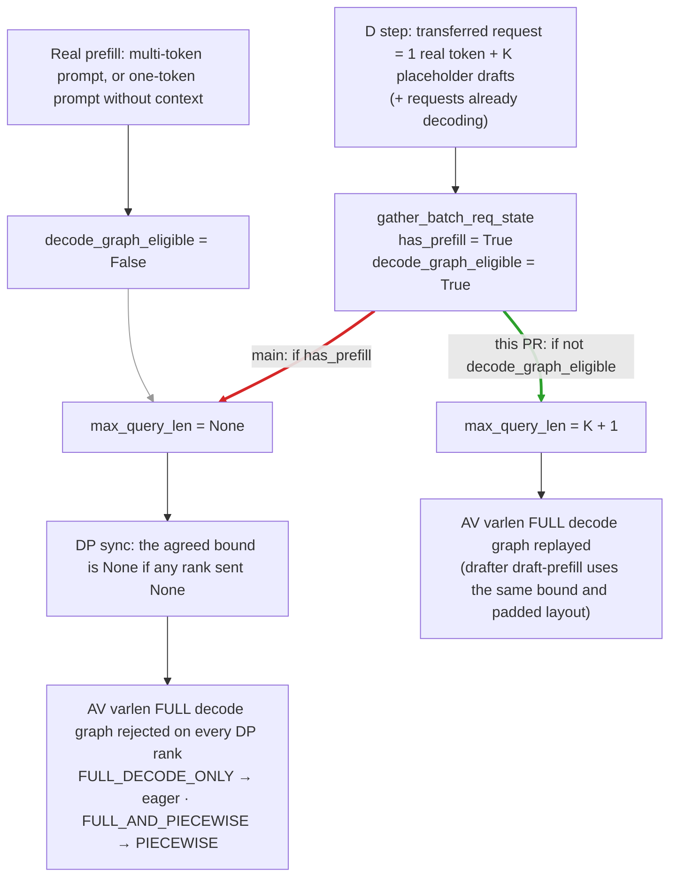

# MATERIAL PACK — vllm-project/vllm PR #65041

- title: [Bugfix][MRV2][Spec Decode] Keep P/D prompt tails on FULL graphs with adaptive verification
- author: Pb314314
- merged/closed: 2026-11-03
- labels: bug, speculative-decoding, ready, kv-connector, nvidia, mrv2
- category: Model-specific Fast Path | tier: major
- diffstat: +None/-None across None files
- url: https://github.com/vllm-project/vllm/pull/65041

## perf claims detected in body (regex, unverified)
- 6x faster

## PR body
```markdown
<!-- markdownlint-disable -->

## Overview

On a P/D decode instance with adaptive verification (AV), a step that admits a KV-transferred request runs eager instead of replaying the FULL decode graph, and under DP every rank runs eager with it. This PR fixes the condition that rejects the graph, in the runner and in the EAGLE/EAGLE3/MTP drafter: two lines.

## Claims

- **Before.** On D, a transferred request recomputes its last prompt token, so it is scheduled as 1 real token + K placeholder drafts, the shape of a decode row. It still counts as prefilling (`has_prefill=True`). The AV path (#57263) drops the query-length bound for any batch with `has_prefill`, so the AV decode graph rejects the step. The step runs eager under `FULL_DECODE_ONLY` (PIECEWISE under `FULL_AND_PIECEWISE`), and the requests already decoding in the batch run eager with it. DP ranks agree on the bound, so one rank's arrival makes every rank run eager.
- **After.** The bound is dropped only when the batch is not `decode_graph_eligible` (#58400). That existing classifier admits a one-token extension over existing KV and rejects real prefills, and the non-AV decode path already uses it. The drafter uses the same condition, so it keeps the target's padded layout (#62796).
- **Effect.** DeepSeek-V4.1-Flash + DSpark, vLLM P/D recipe settings at 1P1D DEP4. On main, eager steps (about 6x slower than FULL) take 60–77% of D's time, and most of them are ranks pulled eager by another rank's arrival. With this PR all of them replay FULL: output throughput is **2.0x** (OSL 256) and **1.76x** (OSL 1024), and D TPOT goes from 19.2 to 6.95 ms and from 10.6 to 5.69 ms.
- **No degradation expected.** The changed value only feeds CUDA graph dispatch, and matching is monotonic: a bound where there was `None` can only add a match, since graphs without a bound match either way. Only AV captures bounded graphs, so dispatch without AV is unchanged. Real prefills (multi-token prompts, one-token prompts without prior KV, PCP batches) still run eager or PIECEWISE. GSM8K and draft acceptance stay within the baseline's run-to-run spread (DSpark and MTP, TP4 and DEP4).
- **No extra resources.** No new graphs are captured, so graph count, CUDA graph memory and KV cache size are unchanged. The condition is a host-side bool already computed each step, so there is no new GPU sync or DP collective.
- **Trade-offs.** An arrival step now pads its requests to the graph's capture size, the same padding every decode step pays; it is still about 6x faster than eager in the runs below. With D under `FULL_AND_PIECEWISE`, arrival steps move from PIECEWISE to FULL; D TPOT is unchanged within noise (TP4 cross-check below).

<details>
<summary>Code path on main: why an arrival step runs eager</summary>

1. **The arriving request counts as prefilling.** `prefill_len` is the number of tokens handed to the runner ([`states.py#L106`](https://github.com/vllm-project/vllm/blob/be09292f0904ae594c5eeca401a926baefb90be5/vllm/v1/worker/gpu/states.py#L106)), usually the prompt length. `num_computed_prefill_tokens = min(num_computed_tokens, prefill_len)` ([`model_runner.py#L1332-L1336`](https://github.com/vllm-project/vllm/blob/be09292f0904ae594c5eeca401a926baefb90be5/vllm/v1/worker/gpu/model_runner.py#L1332-L1336)). On D, the transferred KV covers all but the last prompt token, so the request arrives with `num_computed = prefill_len - 1` and is prefilling ([`#L1385-L1386`](https://github.com/vllm-project/vllm/blob/be09292f0904ae594c5eeca401a926baefb90be5/vllm/v1/worker/gpu/model_runner.py#L1385-L1386)). After that step `num_computed >= prefill_len`, and the request decodes.
2. **`has_prefill` clears the bound.** The runner passes `max_query_len = None` for any batch with `has_prefill` ([`model_runner.py#L1848-L1851`](https://github.com/vllm-project/vllm/blob/be09292f0904ae594c5eeca401a926baefb90be5/vllm/v1/worker/gpu/model_runner.py#L1848-L1851)), and so does the drafter ([`speculator.py#L273`](https://github.com/vllm-project/vllm/blob/be09292f0904ae594c5eeca401a926baefb90be5/vllm/v1/worker/gpu/spec_decode/target_dependent_ar/speculator.py#L273)).
3. **DP spreads `None`.** Ranks exchange the bound and keep it only if no rank sent `None` ([`dp_utils.py#L117-L119`](https://github.com/vllm-project/vllm/blob/be09292f0904ae594c5eeca401a926baefb90be5/vllm/v1/worker/gpu/dp_utils.py#L117-L119)).
4. **AV decode graphs need a bound.** With AV, decode graphs are captured as varlen graphs with `max_query_len=decode_query_len` ([`cudagraph_utils.py#L305-L319`](https://github.com/vllm-project/vllm/blob/be09292f0904ae594c5eeca401a926baefb90be5/vllm/v1/worker/gpu/cudagraph_utils.py#L305-L319)). A bounded graph matches only a batch that carries a bound within it ([`cudagraph_utils.py#L130-L133`](https://github.com/vllm-project/vllm/blob/be09292f0904ae594c5eeca401a926baefb90be5/vllm/v1/worker/gpu/cudagraph_utils.py#L130-L133)), so a `None` batch matches no decode graph. Under `FULL_DECODE_ONLY` there is no PIECEWISE graph to fall back to, so the step runs eager.
5. **Without AV this does not happen.** Uniform decode graphs carry no bound and are matched by `uniform_token_count`, which already uses `decode_graph_eligible` ([`model_runner.py#L1404`](https://github.com/vllm-project/vllm/blob/be09292f0904ae594c5eeca401a926baefb90be5/vllm/v1/worker/gpu/model_runner.py#L1404), [`utils.py#L1011`](https://github.com/vllm-project/vllm/blob/be09292f0904ae594c5eeca401a926baefb90be5/vllm/v1/worker/utils.py#L1011)). An arrival row (1 real token + K placeholder drafts) is uniform with the decode rows, so the step replays FULL.

This PR uses `decode_graph_eligible` in step 2, the same classifier step 5 already uses.

</details>

## Validation

All runs use upstream main `b8c04dd3b4` with that commit's precompiled wheel, 1P1D on two GB200 nodes over NIXL, with a fresh P/D pair per run. "Baseline" is that main commit without this PR.

### Performance

The deployment follows the vLLM recipe preset for DeepSeek-V4.1-Flash P/D (`gb300_agentx_pd`, from InferenceX #3941), scaled to one GB200 node per role:
- P: DEP4, 64 seqs/rank, `max_num_batched_tokens=32768`, `FULL_AND_PIECEWISE`, no AV.
- D: DEP4, 40 seqs/rank, `max_num_batched_tokens=400`, `FULL_DECODE_ONLY` with capture sizes 6..240, AV on, no prefix caching.
- Both: DSpark K=5, MegaAttention, MegaMoE, DeepSelect top-k, Engram CPU offload.

The client keeps 320 requests in flight (2x D capacity). Each request goes to P with `max_tokens=1`, then streams from D. Prompts are unique, outputs use `ignore_eos`, and 640 warmup requests run first. Baseline and this PR run in ABAB order; the table shows both rounds. TPOT and TTFT are measured on the D stream; TTFT includes queueing, since the client oversubscribes D.

| Workload | Version | Output tok/s | TPOT mean | TPOT p99 | D TTFT |
| --- | --- | --- | --- | --- | --- |
| ISL ~290, OSL 256, 4096 req | baseline | 4,100 / 4,385 | 19.0 / 19.4 ms | 33.4 / 32.8 ms | 7.4 / 6.8 s |
| | this PR | **8,559 / 8,519** | **6.93 / 6.97 ms** | 10.5 / 10.5 ms | 3.6 / 3.7 s |
| ISL ~2.2K, OSL 1024, 2048 req | baseline | 8,533 / 8,666 | 10.7 / 10.6 ms | 19.3 / 19.4 ms | 13.0 / 12.8 s |
| | this PR | **15,099 / 15,231** | **5.71 / 5.66 ms** | 9.9 / 10.1 ms | 7.3 / 7.2 s |

**Why it is large under data parallelism.** DP ranks agree on one graph shape per step, and the agreed query-length bound is `None` if any rank sends `None`. So a single rank admitting a transferred request forces every rank's step to run eager, including ranks that only have decodes. A second traced run of the same setup splits D's steps per rank (4 ranks, warmup excluded). Step time is the gap to the next step on the same rank:

| Workload | Version | Own arrival steps | Decode steps forced eager by another rank | FULL decode steps | Time in eager steps |
| --- | --- | --- | --- | --- | --- |
| OSL 256 | baseline | 11.7%, eager, 102 ms | **20.5%, 102 ms** | 67.8%, 15.0 ms | 77% |
| | this PR | 10.0%, FULL, 15.2 ms | 0 | 90.0%, 15.4 ms | 0 |
| OSL 1024 | baseline | 5.4%, eager, 101 ms | **13.0%, 101 ms** | 81.6%, 17.1 ms | 60% |
| | this PR | 5.5%, FULL, 16.1 ms | 0 | 94.5%, 17.7 ms | 0 |

Steps forced eager by another rank outnumber a rank's own arrival steps 1.75–2.4x. The chance that some rank admits a request in a given step rises with the DP size, so we expect the effect to be larger on the recipe's DEP16 decode (not measured here).

The gain depends on how often a decode step admits a transferred request, so it is smaller for longer outputs. In the TP4 cross-check below, D under `FULL_DECODE_ONLY` with this PR reaches the same TPOT (6.7 ms) as the same D under `FULL_AND_PIECEWISE`, where arrival steps ran PIECEWISE instead of eager.

<details>
<summary>TP4 cross-check: P PIECEWISE, D TP4 FULL_DECODE_ONLY + AV, 128 seqs, 128 in flight, ISL ~290, OSL 256, 3 ABAB rounds</summary>

| Model | Version | TPOT mean (3 rounds) | TPOT p99 | D TTFT |
| --- | --- | --- | --- | --- |
| DeepSeek-V4.1-Flash + DSpark K=3 | baseline | 17.8 / 20.0 / 20.0 ms | 29.9-31.0 ms | 1.08-1.12 s |
| | this PR | 6.72 / 6.70 / 6.75 ms | 9.4 ms | 0.40-0.42 s |
| DeepSeek-V4-Flash + MTP K=3 | baseline | 17.8 / 24.7 / 25.8 ms | 35.0-37.6 ms | 1.41-1.54 s |
| | this PR | 5.42 / 5.41 / 5.38 ms | 7.1-7.2 ms | 0.37-0.39 s |

Same workload with D under `FULL_AND_PIECEWISE`, where main runs arrival steps PIECEWISE and this PR runs them FULL:

| Model | Version | TPOT mean | TPOT p99 | D TTFT |
| --- | --- | --- | --- | --- |
| DeepSeek-V4.1-Flash + DSpark K=3 | baseline | 6.72 ms | 9.38 ms | 0.44 s |
| | this PR | 6.75 ms | 9.27 ms | 0.41 s |
| DeepSeek-V4-Flash + MTP K=3 | baseline | 5.44 / 5.68 ms | 7.41 / 7.48 ms | 0.47 / 0.39 s |
| | this PR | 5.33 ms | 7.19 ms | 0.39 s |

</details>

### Correctness

Setup:
- P and D TP4 + EP.
- D: `FULL_DECODE_ONLY` + AV, 128 seqs.
- The decode-side graph mode is traced per step on all ranks; the ranks agree.
- "Arrival step" means a decode-eligible batch with `has_prefill`, i.e. it contains a transferred request computing its last prompt token.

Workload per run:
- 8 serial prompts (19..8195 tokens), 16 staggered and 32 burst requests.
- Two direct-to-D negative controls: a multi-token prompt without transferred KV, and a fresh one-token prompt.
- Full GSM8K: 1319 questions, 5-shot, concurrency 8, temperature 0.

**DeepSeek-V4.1-Flash + DSpark (K=3)**

| Version | Arrival steps | Real prefills | GSM8K | Accepted tokens / draft |
| --- | --- | --- | --- | --- |
| baseline | 1128 eager | 6 eager | 1190 / 1319 | 1.962 |
| this PR | **1316 FULL** | 6 eager | 1194 / 1319 | 1.961 |
| baseline, repeat | | | 1187 / 1319 | 1.976 |

**DeepSeek-V4-Flash + MTP (K=3)**, which uses `TargetDependentARSpeculator`

| Version | Arrival steps: target / drafter | GSM8K | Accepted tokens / draft |
| --- | --- | --- | --- |
| baseline | eager / eager (1010) | 1248 / 1319 | 1.879 |
| runner condition only | FULL / **eager** (1168) | 1249 / 1319 | 1.877 |
| this PR | **FULL / FULL** (1163) | 1253 / 1319 | 1.873 |

**DeepSeek-V4.1-Flash + DSpark (K=5), DEP4 recipe config from the performance section**

| Version | Own arrival steps | Decode steps forced eager by another rank | Real prefills | GSM8K | Accepted tokens / draft |
| --- | --- | --- | --- | --- | --- |
| baseline | 5.0%, eager | 11.7%, eager | 2 eager | 1193 / 1319 | 2.067 |
| this PR | 5.1%, **FULL** | **0** | 2 eager | 1184 / 1319 | 2.049 |
| baseline, repeat | | | | 1196 / 1319 | 2.048 |
| this PR, repeat | | | | 1200 / 1319 | 2.090 |

Serving with expert parallelism is not bitwise deterministic run to run. Baseline spans 1193–1196 and 2.048–2.067; this PR spans 1184–1200 and 2.049–2.090. Between the first baseline and first PR runs, 45 questions flip correct → wrong and 36 wrong → correct.

With only the runner condition, an arrival step replays the target graph padded to, for example, 32 requests, while the drafter runs eager over the 7 real ones on the same attention metadata. That is the mismatch #62796 removed. On this sparse-MLA model it costs no measurable acceptance; #62793 shows that it does on FA3.

In every run, all measured requests succeeded, with no preemptions and no KV transfer failures. Pure decode steps are FULL in every run, except the startup warmup steps, which run eager. The GSM8K and acceptance differences fall within the baseline repeat spread.

<details>
<summary>Unit tests</summary>

```bash
pytest tests/v1/worker/test_gpu_model_runner_v2.py tests/v1/cudagraph/test_cudagraph_manager.py \
  tests/v1/worker/test_gpu_target_dependent_ar_speculator.py tests/v1/worker/test_gpu_dp_utils.py \
  tests/v1/spec_decode/test_adaptive_verification.py
# 116 passed, on the branch rebased onto current main
```

- Reverting only the runner condition fails `test_prompt_tail_keeps_decode_graph_bound[True-8]`.
- Reverting only the drafter condition fails `test_draft_prefill_matches_shared_target_metadata_shape[decode-eligible-prefill-tail]`.
- Both files already run in CI under `tests/v1/worker` and `tests/v1/cudagraph`.

</details>

## Details

**Request path.**
1. The proxy sends the prompt to P with `max_tokens=1` and `do_remote_decode`; P prefills and returns KV transfer metadata.
2. The proxy sends the same prompt with that metadata to D. D's scheduler pulls the KV over NIXL and marks the whole prompt as computed.
3. On load completion, the scheduler sets `num_computed_tokens = N - 1`, so D recomputes the last prompt position to get logits for its first sampled token. With K speculative tokens, the request is scheduled as 1 real token + K placeholder drafts (`q = K + 1`): the shape of a decode row.
4. The runner classifies the batch and dispatches a CUDA graph. This step is the one that changes.

**Root cause.** In step 4, the request is still prefilling (`num_computed_prefill < prefill_len`), so `has_prefill` is True.
- #57263 cleared the runner's `max_query_len` for any batch with `has_prefill`, because a varlen decode graph matched on that bound alone would admit a short real prefill.
- Two days later, #58400 added `decode_graph_eligible`, which treats a one-token extension over existing context as a decode. Input preparation already handles this case through `prefill_runs_as_decode`. #58400 wired the classification into the uniform decode path only.
- The varlen path that AV uses kept the `has_prefill` check. So with AV off, D replays FULL on arrival steps; with AV on, it does not.
- `TargetDependentARSpeculator.propose` has the same check for its draft-prefill dispatch.

**Dispatch before and after.** The red edge is main's path for a P/D arrival step; the green edge is the path this PR takes. Real prefills take the grey path in both.



Without AV, the decode graph is matched by `uniform_token_count`, which already uses `decode_graph_eligible`, so arrival steps were not affected.

**Change.**
- Two conditions change from `has_prefill` to `not decode_graph_eligible`: one in `GPUModelRunner.execute_model`, one in `TargetDependentARSpeculator.propose`. The other edits update comments that described the old rule.
- The classifier, scheduler, input preparation, capture sizes and kernels are unchanged.
- Keeping the bound only removes one rejection reason. The existing graph checks (query-length bound, request/token coverage, explicit eager, DP agreement on the bound) still apply.
- DFlash/DSpark drafters dispatch with a fixed uniform shape and are not affected.
- Model Runner V1 does not support AV, so it needs no change.

**Relation to #64915.** #64915 contains the same runner condition as part of a larger feature: varlen decode graphs for fixed-width speculation, with new backend and capacity checks. This PR is only the AV bug fix. It adds the drafter condition, which #64915 lacks, plus a regression test and P/D validation with real KV transfer, which #64915 lists as outstanding. If this PR merges first, #64915 drops the overlapping line. No other open PR changes these conditions.

**Limitations.**
- GPU validation covers DeepSeek-V4.1-Flash (DSpark) and DeepSeek-V4-Flash (MTP) on GB200 with the MLA backends those models use. FA3/FlashInfer targets are covered only by the unit test of the drafter/target layout contract.
- The performance runs are 1P1D with D scaled down from the recipe's DEP16 to DEP4. Prompts are synthetic, with no prefix reuse.

AI assistance (Claude Code) was used for the investigation, implementation, validation and this description. The submitter reviewed every changed line and the results.

---

<details>
<summary> Pull Request Checklist </summary>

- [x] I used vLLM's `/pr-checklist` skill. (Mandatory for agents, optional for humans).
- [x] AI assistance was used during the creation of this PR.

- [x] **Design Fit:** Minimizes impact on core components, reuses existing functionality, and justifies added complexity.
- [x] **Testing and Validation:** Validates the change and ensures any added tests are meaningful and reliable, with CI coverage or documented CI resource constraints and validation performed outside CI.
- [x] **Code Quality and Style:** Keeps code and comments clear and concise, and updates relevant documentation and examples.
- [x] **Pull Request Contents:** Includes a brief summary and relevant links, supports claims with evidence, explains root causes and implementation trade-offs, and follows the contributing guide.
</details>

🤖 Generated with [Claude Code](https://claude.com/claude-code)

https://claude.ai/code/session_01D7mm2nfeDm8urozFY3PCda

```

## diff
```diff
diff --git a/tests/v1/cudagraph/test_cudagraph_manager.py b/tests/v1/cudagraph/test_cudagraph_manager.py
index a81586605673..dc626403b6e0 100644
--- a/tests/v1/cudagraph/test_cudagraph_manager.py
+++ b/tests/v1/cudagraph/test_cudagraph_manager.py
@@ -438,8 +438,8 @@ def test_mixed_batch_never_selects_a_uniform_decode_graph(monkeypatch):
 
 def test_varlen_decode_graph_takes_bounded_decode_batches_only(monkeypatch):
     """A varlen decode graph replays any decode batch within its query-length
-    bound. The runner passes no bound for a batch with a prefill, which must not
-    replay one however short the prefill is."""
+    bound. The runner passes no bound for a batch that is not decode-eligible,
+    which must not replay one however short the prefill is."""
     manager = _make_spec_decode_manager(monkeypatch, varlen_decode=True)
 
     def dispatch(max_query_len):
@@ -517,7 +517,7 @@ def all_reduce(tensor):
         max_query_len if decode_eligible else None,
         dp_size=dp_size,
         dp_rank=0,
-        max_query_len=None if has_prefill else max_query_len,
+        max_query_len=max_query_len if decode_eligible else None,
     )
     hidden_states = torch.zeros(target_desc.num_tokens, 1)
     speculator = SimpleNamespace(
diff --git a/tests/v1/worker/test_gpu_model_runner_v2.py b/tests/v1/worker/test_gpu_model_runner_v2.py
index 2904c7faf46c..245a8fde29f3 100644
--- a/tests/v1/worker/test_gpu_model_runner_v2.py
+++ b/tests/v1/worker/test_gpu_model_runner_v2.py
@@ -24,6 +24,7 @@
 )
 from vllm.model_executor.warmup.jit_warmup import JitWarmupRegistry
 from vllm.v1.attention.backends.registry import AttentionBackendEnum
+from vllm.v1.core.sched.output import SchedulerOutput
 from vllm.v1.kv_cache_interface import (
     CircularBufferSpec,
     FullAttentionSpec,
@@ -39,6 +40,32 @@
 from vllm.v1.worker.gpu.spec_decode.utils import get_drafter_hidden_states
 
 
+@pytest.mark.parametrize("eligible,expected_bound", [(True, 8), (False, None)])
+def test_prompt_tail_keeps_decode_graph_bound(monkeypatch, eligible, expected_bound):
+    """A decode-eligible prompt tail must not lose its varlen graph bound."""
+    runner = Mock(
+        lora_config=None,
+        aux_output_connector=None,
+        encoder_cache=None,
+        pcp_manager=None,
+        is_encoder_decoder=False,
+    )
+    runner.gather_batch_req_state.return_value = (
+        SimpleNamespace(num_tokens=8, has_prefill=True, decode_graph_eligible=eligible),
+        None,
+    )
+    scheduler_output = SchedulerOutput.make_empty()
+    scheduler_output.num_scheduled_tokens = {"request": 8}
+    scheduler_output.total_num_scheduled_tokens = 8
+    dispatch = Mock(side_effect=RuntimeError("stop before forward"))
+    monkeypatch.setattr(model_runner_module, "dispatch_cg_and_sync_dp", dispatch)
+
+    with pytest.raises(RuntimeError, match="stop before forward"):
+        GPUModelRunner.execute_model(runner, scheduler_output)
+
+    assert dispatch.call_args.kwargs["max_query_len"] == expected_bound
+
+
 def test_non_last_pp_rank_uses_global_batch_for_sample_feedback(monkeypatch):
     runner = GPUModelRunner.__new__(GPUModelRunner)
     runner.is_last_pp_rank = False
diff --git a/vllm/v1/worker/gpu/cudagraph_utils.py b/vllm/v1/worker/gpu/cudagraph_utils.py
index 995657462bf2..1ba164262b27 100644
--- a/vllm/v1/worker/gpu/cudagraph_utils.py
+++ b/vllm/v1/worker/gpu/cudagraph_utils.py
@@ -77,8 +77,8 @@ class BatchExecutionDescriptor:
     num_reqs: int | None  # None means no request padding is needed (PIECEWISE graphs)
     uniform_token_count: int | None = None
     # Upper bound on per-request query length. Varlen decode graphs leave
-    # uniform_token_count unset, so this is what keeps a prefill batch out of one:
-    # the runner passes None for any batch with a prefill.
+    # uniform_token_count unset; the runner passes None for batches that are
+    # not decode-graph eligible, even if their queries fit within the bound.
     max_query_len: int | None = None
     num_active_loras: int = 0
     # Number of microbatches the batch is split into (DBO). 1 means no splitting.
diff --git a/vllm/v1/worker/gpu/dp_utils.py b/vllm/v1/worker/gpu/dp_utils.py
index 008c3cafd28d..37ca4c33b67c 100644
--- a/vllm/v1/worker/gpu/dp_utils.py
+++ b/vllm/v1/worker/gpu/dp_utils.py
@@ -263,9 +263,10 @@ def dispatch_cg_and_sync_dp(
         dp_size: Data-parallel world size. 1 skips all cross-rank work.
         dp_rank: This rank's index in the DP group.
         max_query_len: Upper bound on per-request query length, for selecting
-            varlen decode graphs. None, as for a batch with a prefill, keeps
-            the batch out of graphs that constrain it. Reusing a sync replaces
-            this with `dp_sync_state.max_query_len`, including when it is None.
+            varlen decode graphs. None, as for a batch that is not decode-graph
+            eligible, keeps the batch out of graphs that constrain it. Reusing a
+            sync replaces this with `dp_sync_state.max_query_len`, including
+            when it is None.
         need_eager: Force `CUDAGraphMode.NONE` instead of dispatching.
         num_active_loras: Active LoRA count for this rank. Does not need
             cross-rank agreement; it never changes a bucket's token count.
diff --git a/vllm/v1/worker/gpu/model_runner.py b/vllm/v1/worker/gpu/model_runner.py
index 665e8347329a..2d37997345fe 100644
--- a/vllm/v1/worker/gpu/model_runner.py
+++ b/vllm/v1/worker/gpu/model_runner.py
@@ -1845,9 +1845,8 @@ def execute_model(
         )
         if batch_req_state is not None:
             num_toks = batch_req_state.num_tokens
-            if batch_req_state.has_prefill:
-                # Varlen decode graphs replay decodes only, and their bound
-                # alone would admit a short prefill.
+            if not batch_req_state.decode_graph_eligible:
+                # A query-length bound alone would admit a short prefill.
                 max_query_len = None
             if self.pcp_manager is not None:
                 num_toks = self.pcp_manager.get_num_tokens_for_dispatch(
diff --git a/vllm/v1/worker/gpu/spec_decode/target_dependent_ar/speculator.py b/vllm/v1/worker/gpu/spec_decode/target_dependent_ar/speculator.py
index f17a820c4f1f..8b4ca9fc9e59 100644
--- a/vllm/v1/worker/gpu/spec_decode/target_dependent_ar/speculator.py
+++ b/vllm/v1/worker/gpu/spec_decode/target_dependent_ar/speculator.py
@@ -270,7 +270,9 @@ def propose(
             uniform_token_count,
             dp_size=self.dp_size,
             dp_rank=self.dp_rank,
-            max_query_len=None if input_batch.has_prefill else int(max_query_len),
+            max_query_len=(
+                int(max_query_len) if input_batch.decode_graph_eligible else None
+            ),
             need_eager=is_profile,
             dp_sync_state=dp_sync_state,
             parallel_config=self.vllm_config.parallel_config,

```
