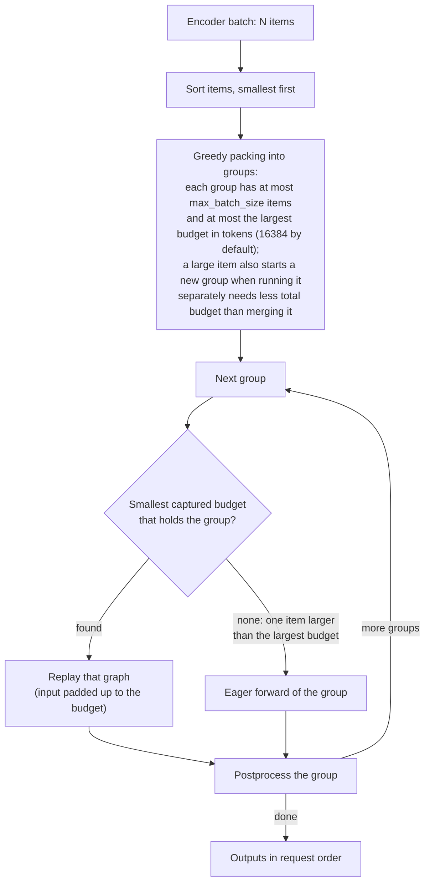
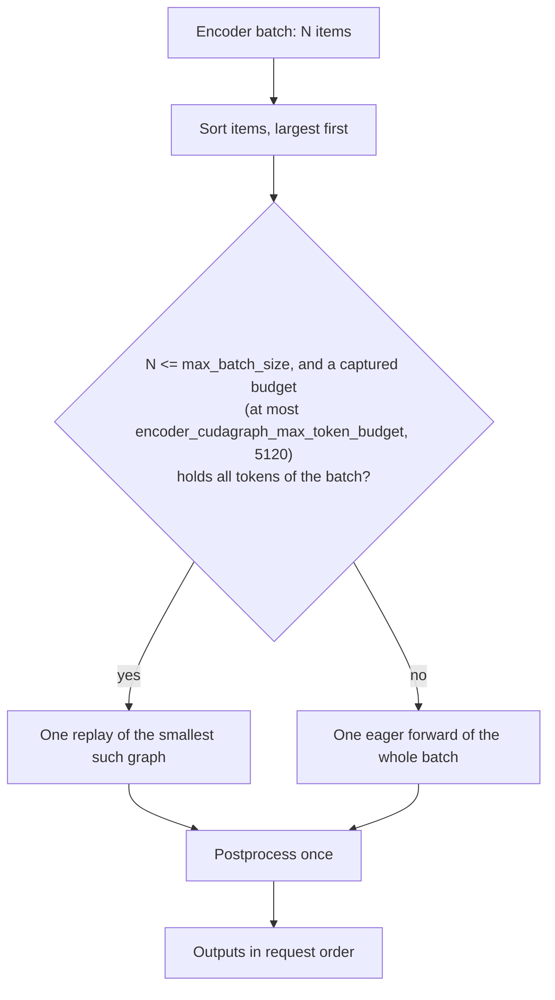

# MATERIAL PACK — vllm-project/vllm PR #65227

- title: [Perf][Multimodal] Encoder CUDA graphs: one replay per batch, finer grid up to one max budget
- author: Pb314314
- merged/closed: 2026-11-08
- labels: documentation, rocm, ready, llama, qwen, deepseek, nvidia, kimi, glm, minimax, cohere, DSv4.1
- category: CUDA Graph / Compiler | tier: major
- diffstat: +None/-None across None files
- url: https://github.com/vllm-project/vllm/pull/65227

## perf claims detected in body (regex, unverified)
- Faster than current main** (which includes #65084): 1.07x
- up to 9.7%
- up to 24%
- up to 11%
- 19% faster

## PR body
```markdown
<!-- markdownlint-disable -->

## Overview

Encoder (ViT) CUDA graphs only help while eager is bound by host launch time. On main, graphs are captured up to `max_num_batched_tokens` (16384 by default), and a batch is greedily split into several padded replays, so large batches often run slower as graphs than eagerly.

This PR applies one rule to every model, in the style of the LLM's CUDA graphs:
- **One replay per batch.** A batch replays the smallest budget that holds it; anything else runs as one eager forward.
- **A finer budget grid up to one global maximum.** The new `encoder_cudagraph_max_token_budget` (default 5120) works like the LLM's maximum capture size. The default balances graph memory against replay coverage using the GB200 measurements below; it is not a universal GPU-bound threshold. Larger batches run eagerly, with a known Gemma 4 trade-off documented below. `encoder_cudagraph_token_budgets` still overrides both.

No model has its own setting.

Follow-up: #66067 (stacked on this PR) moves the per-model encoder CUDA graph code that is copied across Qwen2/2.5/3-VL, GLM-4.1V and Cohere Compass into shared mixins, with no behavior change.

**This PR builds on #65084** (shared capture buffers, by @Isotr0py), which is now merged; it is rebased onto it. All budget graphs share one set of input and output buffers sized for the largest budget, so the finer grid below costs no extra buffer memory. This PR's own changes:
- [`fcba393f65`](https://github.com/vllm-project/vllm/pull/65227/commits/fcba393f65): one replay per batch, budget grid, global maximum, largest item first, and eager-path fixes.
- [`8bf9354b99`](https://github.com/vllm-project/vllm/pull/65227/commits/8bf9354b99): GLM-4.1V rounds its capture size up like the other models. **This also fixes a crash on current main.** #65084's finer budgets (80, 96, ...) make GLM-4.1V's round-down capture too few rows, so with encoder CUDA graphs on (the default) a single 252x252 image stops the engine with `RuntimeError: The size of tensor a (256) must match the size of tensor b (324)` (GLM-4.1V-9B, GB200, default `limit_mm_per_prompt`; eager runs). With this PR the same requests run, with both video-enabled and image-only limits, and match eager within run-to-run noise (except the known 672x672 video-enabled case fixed by #65453). See Details.
- The remaining commits document and validate `encoder_cudagraph_max_token_budget`.

## How dispatch changes

`EncoderCudaGraphManager.execute()` receives one encoder batch (all images or videos the scheduler sends to the encoder in one step) and returns one output per item.

**Before (main).** A batch is greedily split into groups, and each group replays its own padded graph.



A batch of K groups costs K replays, each padded to its budget. Graphs go up to 16384 tokens, where most encoders are already GPU-bound, so a large batch split into several padded replays is often slower than one eager forward.

**After (this PR).** The whole batch replays at most one graph; anything that does not fit runs as one eager forward.



Models with several encoder paths (Step3-VL, DeepSeek-OCR) take this decision once per path.

**Captured graphs (startup).**

| | Before (main) | After (this PR) |
| --- | --- | --- |
| Budgets | Quarter-octave steps up to 1024, then half-octave steps, up to the model's largest budget, usually `max_num_batched_tokens` (64, 80, 96, ..., 12288, 16384: 25 graphs) | Quarter-octave steps up to 1024, every 128 up to 2560, then 1/8-octave steps, up to `encoder_cudagraph_max_token_budget` (64, 80, 96, ..., 4608, 5120: 36 graphs). The same for every model |
| Buffers | One set of buffers sized for the largest budget, shared by all graphs (#65084) | Unchanged; the largest budget is now 5120, so the shared buffers are smaller |
| Fixed-size items (Step3-VL, DeepSeek-OCR) | Budgets are multiples of the item size, so up to 16 items fit exactly (#65084) | Unchanged |
| User override | `encoder_cudagraph_token_budgets` | Unchanged; it also overrides the maximum |

## Claims

- **Faster than current main** (which includes #65084): 1.07x–1.13x geomean encoder latency on 6 models with real weights, 1.10x–1.21x on batches above 2560 tokens. GLM-4.1V cannot be compared because current main crashes on it (see above); this PR fixes that.
- **About 3x less graph memory than current main**, for example 4.99 → 1.79 GiB (MiniMax-M3) and 6.29 → 2.25 GiB (DeepSeek-V4.1), because graphs stop at 5120 tokens instead of 16384.
- Against main before #65084 (the earlier measurements kept below): 1.03x–1.30x on 24 models. One known slower case: Gemma 4 batches of exactly 32 images run eagerly and are 9% slower than an exactly fitting graph (see "Choosing the maximum").
- **Simpler:** one global maximum instead of per-model tuning, and one replay per batch instead of greedy packing. This PR's own change is −10 lines outside tests and docs.
- **Correct:** no batch on any model matches eager worse than on main, and the encoder CUDA graph test suite fails the same tests as on main.

## Validation

All runs: GB200, BF16, default settings (no user budgets).

### Encoder latency and memory vs current main, real weights

**Baseline** = main at `ebc97ad8d0` (includes #65084). **After PR** = this PR (`eebc7d0dcf`) on the same main. Encoder only, TP1, 48 batches of 1–40 images with random, continuous sizes and counts (token totals 45–16,128); InternVL3 runs 34 because its tiles are fixed. Each cell is the median of 10 timed calls of the full encoder step. Order Baseline, After PR, After PR, Baseline; each batch keeps the faster of its two runs.

| Model | After PR speedup (geomean) | Batches > 2560 tokens | Batches >2% slower | Encoder graphs | Graph memory | Capture time |
| --- | --- | --- | --- | --- | --- | --- |
| InternVL3-8B | 1.133x | 1.172x | 0 / 34 | 17 → 28 | 2.89 → 0.98 GiB | 4.2 → 3.9 s |
| Qwen2.5-VL-7B | 1.113x | 1.214x | 0 / 48 | 25 → 36 | 3.59 → 1.34 GiB | 12.9 → 13.2 s |
| MiniMax-M3 | 1.086x | 1.119x | 2 / 48 (60 tokens +2.2%, 3996 tokens +2.1%) | 25 → 36 | 4.99 → 1.79 GiB | 7.4 → 7.2 s |
| DeepSeek-V4.1-Flash | 1.072x | 1.137x | 0 / 48 | 25 → 36 | 6.29 → 2.25 GiB | 6.0 → 7.5 s |
| Kimi-K2.5 (vision) | 1.071x | 1.099x | 9 / 48 (≤6.6%, single images ≤384 tokens) | 25 → 36 | 3.03 → 1.12 GiB | 6.1 → 6.5 s |
| Qwen3.8-27B | 1.067x | 1.121x | 5 / 48 (≤3.3%, single images ≤374 tokens) | 25 → 36 | 3.31 → 1.16 GiB | 7.9 → 7.5 s |
| GLM-4.1V-9B | main crashes | – | – | – | – | – |

Batches of at most 600 tokens use the same budgets on both sides (the grids agree below 1024). There, main's own two runs differ by a median 1.1–3.7% (Kimi-K2.5 3.7%, up to 9.7%; Qwen3.8 2.5%, up to 24%), and the median After PR vs Baseline difference is −1.0% to +2.0% (Kimi-K2.5 +2.0%, others ≤ +0.8%).

### Encoder latency and memory vs main before #65084, real weights

These are the earlier measurements. **Baseline** = main at `ef8870b09f`, before #65084 merged; **After PR** = this PR's pre-rebase head on that main, which carried #65084's commit. After the rebase, encoder outputs are bitwise identical to that head (see Correctness).

Encoder only, TP1. Each model runs 48 batches of 1–40 images whose sizes and counts are random and continuous (token totals 45–16,128); InternVL3 runs 34 because its tiles are fixed. Each cell is the median of 10 timed calls of the full encoder step (input staging, replay or eager, output copies). Baseline and After PR ran in the same session in the order Baseline, After PR, After PR, Baseline, and each batch keeps the faster of its two runs.

| Model | After PR speedup vs Baseline (geomean) | Batches >2% slower | Encoder graphs | Graph memory | Capture time |
| --- | --- | --- | --- | --- | --- |
| Qwen2.5-VL-7B | 1.300x | 0 / 48 | 9 → 36 | 3.85 → 1.34 GiB | 9.3 → 11.2 s |
| InternVL3-8B | 1.202x | 0 / 34 | 7 → 28 | 3.19 → 0.98 GiB | 3.1 → 4.8 s |
| DeepSeek-V4.1-Flash | 1.189x | 0 / 48 | 9 → 36 | 6.46 → 2.25 GiB | 4.4 → 7.1 s |
| MiniMax-M3 | 1.182x | 0 / 48 | 9 → 36 | 5.12 → 1.79 GiB | 6.9 → 6.8 s |
| Kimi-K2.5 (vision) | 1.167x | 3 / 48 (≤2.8%) | 9 → 36 | 3.22 → 1.12 GiB | 5.5 → 7.5 s |
| Qwen3.8-27B | 1.144x | 2 / 48 (≤3.1%) | 9 → 36 | 3.63 → 1.16 GiB | 6.2 → 7.0 s |
| GLM-4.1V-9B | 1.143x | 1 / 48 (2.1%) | 9 → 36 | 5.00 → 1.48 GiB | 8.8 → 15.8 s |

"Graph memory" is the device memory taken by encoder graph capture.

The batches more than 2% slower are all single images of at most 600 tokens (2–5 ms), and they are noise: their graphs have the same shape as main's, main's own two runs differ by a median 1.3–2.7% and up to 11% on these batches, and the median After PR vs Baseline difference over all single images of at most 600 tokens is −0.3% to +0.4% for Kimi-K2.5, Qwen3.8 and GLM-5.3-Flash.

### Encoder latency, every other model (vs main before #65084)

Same harness, batches and order, with dummy weights (Gemma 4: real weights), for every other model with encoder CUDA graph support that loads on this machine. Gemma 3 and Llama 4 use ungated mirrors of the same configs; Idefics3 is SmolVLM-256M. Rows marked † ran the exact PR head. For the other rows the graphs are the same as the PR head's (identical budgets and capture code up to 5120 tokens), and batches above 5120 tokens use the eager time measured in the same run; see "Choosing the maximum".

| Model | After PR speedup (geomean) | Batches >2% slower |
| --- | --- | --- |
| LFM2-VL | 1.266x | 0 / 48 |
| Idefics3 (SmolVLM-256M) | 1.263x | 1 / 46 (4096 tokens, +2.4%) |
| Ernie-4.5-VL † | 1.214x | 0 / 48 |
| Qwen2-VL-2B | 1.203x | 0 / 48 |
| GLM-5.3-Flash † | 1.197x | 3 / 48 (≤4.9%, single images ≤496 tokens) |
| DeepSeek-VL2 | 1.195x | 0 / 40 |
| Llama 4 | 1.178x | 0 / 45 |
| Mistral 3 | 1.178x | 0 / 48 |
| Kimi-VL | 1.169x | 0 / 48 |
| Cohere Compass | 1.153x | 1 / 48 (80 tokens, +3.8%) |
| Qwen3-VL-2B † | 1.151x | 4 / 35 (≤6.6%, single images ≤208 tokens) |
| Step3-VL-10B | 1.138x | 0 / 48 |
| DeepSeek-OCR | 1.135x | 0 / 48 |
| Qwen3.5-0.8B † | 1.120x | 5 / 48 (≤6.0%, single images ≤80 tokens) |
| Gemma 3 | 1.079x | 0 / 48 |
| Gemma 4 (E2B) | 1.072x | 0 / 48 |
| Kimi-K3 (vision) | 1.033x | 0 / 48 |

The slower single images on the † rows are noise in the same way: on Qwen3-VL-2B and Qwen3.5-0.8B, main's own two runs differ by a median 8.0% and 2.4% on these images, and the median After PR vs Baseline difference is −2.1% and −0.5%. Graph memory on the † rows: Ernie-4.5-VL 4.03 → 1.33 GiB, GLM-5.3-Flash 4.03 → 1.38 GiB, Qwen3-VL-2B 3.63 → 1.14 GiB, Qwen3.5-0.8B 2.36 → 0.76 GiB.

### Choosing the maximum (measured vs main before #65084)

For every batch, the harness also times eager on the same inputs. This gives, for any maximum X, what each batch would cost with graphs up to X and eager above (the grid below X does not depend on X). Over all 24 models:

| Maximum | Models with a batch >2% slower than main because it ran eagerly | Worst such batch | Geomean speedup over all 24 models |
| --- | --- | --- | --- |
| 2560 | 7 of 24 (Qwen3-VL-2B, Qwen3.5-0.8B, Gemma 4, Ernie-4.5-VL, LFM2-VL, Mistral 3, GLM-5.3-Flash) | +42% (Qwen3.5-0.8B) | 1.161x |
| 3072 | 7 of 24 (same) | +42% (Qwen3.5-0.8B) | 1.163x |
| 4096 | 1 of 24 (Gemma 4) | +10% (Gemma 4) | 1.167x |
| **5120** | **0 of 24** | — | **1.169x** |
| 8192 | 0 of 24 | — | 1.167x |
| 16384 (no maximum) | 0 of 24 | — | 1.165x |

DeepSeek-V4.1 needs the batched eager forward of this PR for this: with main's one-forward-per-image eager, every maximum below 8192 makes some of its batches 2–3x slower.

5120 is the smallest maximum at which no model has a batch in this set that is slower than main because it ran eagerly. Gemma 4, for example, has 4480-token batches that are 10% slower than main when they run eagerly.

Gemma 4 is the model that sets this bound, and its random batches jump from 16 images (4480 tokens) to 24 (6720), so I measured every image count in between and above (280 tokens per image, same harness, main / PR / PR without a maximum, two runs each, best of two):

| Images (tokens) | Main | This PR (5120) | This PR, no maximum |
| --- | --- | --- | --- |
| 16 (4480) | graph 4480 | graph 4608: 1.00x | 1.00x |
| 17–18 (4760–5040) | graph 8960 | graph 5120: 1.75x | 1.75x |
| 19–23 (5320–6440) | graph 8960 | eager: 1.27x–1.52x | 1.32x–1.58x |
| 24–28 (6720–7840) | graph 8960 | eager: 1.03x–1.11x | 1.10x–1.32x |
| 32 (8960) | graph 8960 | eager: **0.91x** | 1.00x |

Speedups are vs main. Gemma 4's encoder stays host-bound up to at least 8960 tokens: a graph at the next budget is 0–19% faster than eager there. So with the 5120 maximum it is faster than main except at exactly 32 images, where main's power-of-2 budget fits exactly and eager is 9% slower. Covering that needs a maximum of 8960, which costs graph memory on every model (Gemma 4: 3.58 → 8.68 GiB) and makes large-encoder models slightly slower, because above ~5000 tokens their eager forward is already faster than a padded graph (DeepSeek-V4.1 geomean 1.187x at 5120, 1.169x at 8192). I kept 5120 and accept this Gemma 4 case. Users who serve many-image Gemma 4 batches can raise `encoder_cudagraph_max_token_budget`.

### Correctness

An encoder CUDA graph must give the same output as eager. Every check below compares this PR and main against eager on the same inputs.

| Check | Models | Result |
| --- | --- | --- |
| Encoder output, graph vs eager, 48 random + 34 fixed batches | 7 models with real weights, 17 with dummy weights | No batch is close to eager on main but not close After PR (`torch.allclose(atol=0.01, rtol=0.01)`). No model has more batches that differ from eager than on main (Qwen2.5-VL 46 → 16 of 96 runs, MiniMax-M3 34 → 20, others equal). |
| `test_vit_cudagraph_image` / `_video`: graph vs eager tokens, dummy weights | All 22 models in the test file, as configured and with pinned budgets removed (default grid) | After PR and Baseline fail exactly the same tests: Gemma 3, Llama 4, MiniCPM-V 2.6 (gated repositories this machine cannot download) and MiniCPM-V 4.0 (fails to start with encoder graphs on main too). |
| Encoder output, graph vs eager, vs current main `ebc97ad8d0` | The 6 real-weight models above | Same or fewer batches not close to eager After PR: Qwen2.5-VL 34 → 16 of 96 runs, MiniMax-M3 28 → 20, others equal (InternVL3 0, DeepSeek-V4.1 0, Kimi-K2.5 6, Qwen3.8 6). |
| Rebase onto merged #65084: encoder outputs of this head vs the pre-rebase head `08c8e8ec90` | GLM-4.1V-9B, Qwen2.5-VL-7B, Qwen3.8-27B (real weights, 34–35 fixed batches each) | Bitwise identical: 0 of 3992 item outputs differ. |
| `tests/v1/cudagraph/test_encoder_cudagraph.py` | — | 96 passed. On current main (`ebc97ad8d0`), 16 of them fail: the one-replay dispatch, budget grid and `encoder_cudagraph_max_token_budget` tests. |

The batches that still differ from eager are single images, from bf16 rounding when one image runs in a padded replay (relative L2 1–4%, as on main). Gemma 4 cannot be compared at the encoder level: the harness passes its images as one padded tensor, so graph and eager return different row counts on both versions; the test suite covers its serving path.

End-to-end generated-token checks with real weights (Qwen2.5-VL, Qwen3.8, Qwen2-VL, GLM-4.1V, LFM2-VL; TP1, TP2, Model Runner V2) were run on an earlier revision of this PR that used per-model caps: 0 non-tied divergences. They were not rerun on this revision.

<details>
<summary>Review follow-up: token-budget configuration validation</summary>

`encoder_cudagraph_max_token_budget` now rejects `0` and negative values; `None` and positive integers remain valid. The regression tests call the real `LLM` entry point with an empty local model directory, so invalid caps must be rejected before model loading. No weights or GPU compute are needed.

Using the existing Python virtual environment, baseline `45d7c06185dc` with the new tests:

```bash
CUDA_VISIBLE_DEVICES='' HF_HUB_OFFLINE=1 .venv/bin/python -m pytest tests/v1/cudagraph/test_encoder_cudagraph.py -k 'max_token_budget_rejected or valid_max_token_budget_preserved' -q --tb=short
```

Result: **2 failed, 3 passed, 91 deselected**. Both invalid caps pass configuration validation and reach `ModelConfig`, which rejects the empty model directory instead of reporting the expected `encoder_cudagraph_max_token_budget must be positive` error (`Regex pattern did not match`).

With the fix, including adjacent initialization and default-budget tests:

```bash
CUDA_VISIBLE_DEVICES='' HF_HUB_OFFLINE=1 .venv/bin/python -m pytest tests/v1/cudagraph/test_encoder_cudagraph.py -k 'TestInitInvariantValidation or TestDefaultBudgetTable' -q --tb=short
```

Result: **23 passed, 73 deselected**. Valid configurations retain their existing execution paths; this follow-up does not change dispatch or rerun the model benchmarks above.

</details>

## Details

**Why a graph can lose.** Eager latency is roughly max(host launch time, GPU time). A replay costs the GPU time of its whole captured shape, padding included. Once eager is GPU-bound there is no launch time left to save, so padding and extra replays are pure cost. Main captures up to 16384 tokens and splits a batch into several padded replays.

**Why one global maximum and not per-model tuning.** An earlier revision of this PR capped some models at 2560 and left others uncapped, based on per-model measurements. That needed a decision for every model and for every subclass that inherits one, so it is not maintainable. The measurements above support 5120 as a common memory/performance compromise, with the documented Gemma 4 32-image regression. Graph memory is a little higher than with per-model caps (MiniMax-M3 1.79 vs 1.01 GiB), and speed is within about 1–2%.

**GLM-4.1V capture size (`8bf9354b99`).** GLM-4.1V sized each dummy capture item as `budget // max_batch_size`, while the other models round up. With the old power-of-2 budgets this was exact. The finer grid has budgets such as 96 with `max_batch_size` 64: one 96-token image needs 384 patch rows, but the graph captured 64 × 1 × 4 = 256, so replay fails in `_copy_padded_buffer` ("size of tensor a (256) must match the size of tensor b (384)"). Found on GLM-4.1V-9B with a single 96-token image. Since #65084 merged on its own, main has the finer budgets without this fix and crashes the same way (re-checked end to end on main `ebc97ad8d0`: a 252x252 image fails with 256 vs 324 rows; eager and main plus this commit run). After the fix, all 82 GLM-4.1V batches and all 34 GLM-5.3-Flash batches (which inherits the code) run and match eager as on main.

**Eager paths.** Batches above the maximum now take each model's `encoder_eager_forward`, which main rarely used. Three were fixed:
- **DeepSeek-V4.1:** ran one forward per image, which is 2–3x slower than main's graphs on large batches. It now runs all images as one varlen batch through the same forward as the graph.
- **Ernie-4.5-VL:** ran the resampler twice and crashed (`shape '[-1, 10240]' is invalid`).
- **DeepSeek-VL2:** had no `encoder_eager_forward` and returned `None`.

**Trade-offs and limitations.**
- **More graphs:** 36 instead of 9. Buffers are shared, so memory still drops. Capture takes 0–3 s longer, except GLM-4.1V (8.8 → 15.8 s).
- **Other GPUs:** only GB200 was measured; no AMD hardware was available. If eager becomes GPU-bound later on another GPU, `encoder_cudagraph_max_token_budget` can be raised.
- **Video frame capacity (fixed by #60112):** a graph holds `min(max_batch_size * max_frames_per_video, token_budget)` frames. With the default video limit, `max_frames_per_video` is 1, so a single long low-resolution video (e.g. 130 frames at 112x112 on Qwen2.5-VL) overflows `cu_seqlens` and crashes the engine, on main too (reported and reproduced by subhashpolisetti). #60112 runs such batches eagerly; it needs a small rebase after this PR.
- **GLM-4.1V-family image replays with video enabled (fixed by #65453):** capture pads `cu_seqlens` to `max_frames_per_batch` but image replays pad to `max_batch_size`, so GLM-4.1V, GLM-OCR and GLM-5.3-Flash image outputs are wrong when video is enabled, on main too. The image correctness checks above ran with video disabled.
- vorapolsiloai's MI355X serving numbers posted below were for an earlier revision (startup timing probe).

**Not a duplicate.** #65084 (merged) shares capture buffers but keeps greedy multi-replay dispatch; this PR builds on it. #65351 is a similar buffer-sharing change. #66067 (stacked on this PR) moves the per-model encoder CUDA graph code into shared mixins.

---

<details>
<summary> Pull Request Checklist </summary>

- [x] I used vLLM's `/pr-checklist` skill. (Mandatory for agents, optional for humans).
- [x] AI assistance was used during the creation of this PR.

- [x] **Design Fit:** Minimizes impact on core components, reuses existing functionality, and justifies added complexity.
- [x] **Testing and Validation:** Validates the change and ensures any added tests are meaningful and reliable, with CI coverage or documented CI resource constraints and validation performed outside CI.
- [x] **Code Quality and Style:** Keeps code and comments clear and concise, and updates relevant documentation and examples.
- [x] **Pull Request Contents:** Includes a brief summary and relevant links, supports claims with evidence, explains root causes and implementation trade-offs, and follows the contributing guide.
</details>

🤖 Generated with [Claude Code](https://claude.com/claude-code)

https://claude.ai/code/session_01EUwn2VL3WwSfMYmzkk6yRY


```

## diff
```diff
diff --git a/vllm/config/compilation.py b/vllm/config/compilation.py
index 4e49ba2e3c45..e11f3bd527d0 100644
--- a/vllm/config/compilation.py
+++ b/vllm/config/compilation.py
@@ -613,19 +613,27 @@ class CompilationConfig:
 
     encoder_cudagraph_token_budgets: list[int] = field(default_factory=list)
     """Token budget levels for encoder CUDA graph capture.
-    Each budget defines a fixed token capacity. At runtime, images are greedy-packed
-    into the smallest fitting budget and the corresponding CUDA graph is replayed.
-    If empty (default), auto-inferred from model architecture as power-of-2
-    levels from the model's estimated min budget to max budget.
+    Each budget defines a fixed token capacity. At runtime, a batch replays the
+    smallest budget that holds it, or runs eagerly if none does.
+    If empty (default), generated over the model's budget range: quarter-octave
+    steps up to 1024 tokens, steps of 128 up to 2560, then 1/8-octave steps,
+    up to `encoder_cudagraph_max_token_budget`.
     User-provided values override auto-inference.
     Example: [2048, 4096, 8192, 13824]"""
 
+    encoder_cudagraph_max_token_budget: int | None = 5120
+    """Largest auto-generated encoder CUDA graph token budget; must be positive
+    or None. A batch with more tokens runs eagerly. The default balances graph
+    memory against replay coverage; performance depends on the model, batch
+    shape, and hardware. None captures up to the model's largest budget.
+    Ignored when encoder_cudagraph_token_budgets is set."""
+
     encoder_cudagraph_max_vision_items_per_batch: int = 0
     """Maximum number of images/videos per batch for encoder CUDA graph capture.
     Determines the fixed batch size used during graph capture.
     If 0 (default), auto-inferred as max_budget // min_budget from the
     model's budget range. User-provided positive value overrides
-    auto-inference."""
+    auto-inference. A batch with more items runs eagerly in one forward."""
 
     encoder_cudagraph_max_frames_per_batch: int | None = None
     """Maximum total video frames per batch for encoder CUDA graph capture.
@@ -1211,6 +1219,15 @@ def __post_init__(self) -> None:
                 "non-negative (None = auto-infer)"
             )
 
+        if (
+            self.encoder_cudagraph_max_token_budget is not None
+            and self.encoder_cudagraph_max_token_budget <= 0
+        ):
+            raise ValueError(
+                "encoder_cudagraph_max_token_budget must be positive "
+                f"(None = no limit), got {self.encoder_cudagraph_max_token_budget}"
+            )
+
         if self.encoder_cudagraph_token_budgets and any(
             b <= 0 for b in self.encoder_cudagraph_token_budgets
         ):
diff --git a/vllm/model_executor/models/deepseek_vl2.py b/vllm/model_executor/models/deepseek_vl2.py
index 72ef9e3308a0..424c379c50f2 100644
--- a/vllm/model_executor/models/deepseek_vl2.py
+++ b/vllm/model_executor/models/deepseek_vl2.py
@@ -745,6 +745,13 @@ def encoder_cudagraph_forward(
         features = self.vision.forward_features(pixel_values)
         return self.projector(features)
 
+    def encoder_eager_forward(
+        self, mm_kwargs: dict[str, Any], path: str = "default"
+    ) -> torch.Tensor:
+        return self.encoder_cudagraph_forward(
+            {"pixel_values": mm_kwargs["pixel_values"]}, path=path
+        )
+
     def postprocess_encoder_output(
         self,
         outputs: dict[str, torch.Tensor],
diff --git a/vllm/model_executor/models/ernie45_vl.py b/vllm/model_executor/models/ernie45_vl.py
index 0a632b66e659..de96deb5c872 100644
--- a/vllm/model_executor/models/ernie45_vl.py
+++ b/vllm/model_executor/models/ernie45_vl.py
@@ -1593,11 +1593,10 @@ def _parse_and_validate_video_input(
     #
     # Only the vision transformer (self.vision_model) is captured into the
     # CUDA graph. The VariableResolutionResamplerModel (spatial merge +
-    # projection) runs eagerly in encoder_eager_forward / postprocess_
-    # encoder_output because its temporal path performs host-side (numpy)
-    # indexing that cannot be captured. Image only: video uses a temporal
-    # conv that changes the output token count, so it falls back to the
-    # eager multimodal path for now.
+    # projection) runs eagerly in postprocess_encoder_output because its
+    # temporal path performs host-side (numpy) indexing that cannot be
+    # captured. Image only: video uses a temporal conv that changes the output
+    # token count, so it falls back to the eager multimodal path for now.
 
     def get_encoder_cudagraph_config(self):
         from vllm.v1.worker.encoder_cudagraph_defs import EncoderCudaGraphConfig
@@ -1729,14 +1728,13 @@ def encoder_cudagraph_forward(
     def encoder_eager_forward(
         self, mm_kwargs: dict[str, Any], path: str = "default"
     ) -> torch.Tensor:
-        # Eager fallback: run the full pipeline (ViT + resampler). The result
-        # is scattered directly, so it must be the post-merge embeddings.
+        # ViT only, like the graph: postprocess_encoder_output runs the
+        # resampler on both outputs.
         pixel_values = mm_kwargs["pixel_values"].type(self.vision_model.dtype)
         grid_thw = async_tensor_h2d(
             mm_kwargs["image_grid_thw"], self.vision_model.device
         )
-        image_features = self.vision_model(pixel_values, grid_thw)
-        return self.resampler_model(image_features, grid_thw)
+        return self.vision_model(pixel_values, grid_thw)
 
     def postprocess_encoder_output(
         self,
diff --git a/vllm/model_executor/models/glm4_1v.py b/vllm/model_executor/models/glm4_1v.py
index 920e81d4b85f..4f77857c7222 100644
--- a/vllm/model_executor/models/glm4_1v.py
+++ b/vllm/model_executor/models/glm4_1v.py
@@ -2312,7 +2312,9 @@ def prepare_encoder_cudagraph_capture_inputs(
         )
 
         spatial_merge_size = self.visual.spatial_merge_size
-        per_mm_item_output = token_budget // max_batch_size
+        # Round up so a budget that is not a multiple of max_batch_size still
+        # captures room for its full token count.
+        per_mm_item_output = (token_budget + max_batch_size - 1) // max_batch_size
 
         frames_per_item = max_frames_per_batch // max_batch_size
         if frames_per_item > 1:
diff --git a/vllm/models/deepseek_v41/common/vl_cudagraph.py b/vllm/models/deepseek_v41/common/vl_cudagraph.py
index 19baf339eb17..4884d7fffa17 100644
--- a/vllm/models/deepseek_v41/common/vl_cudagraph.py
+++ b/vllm/models/deepseek_v41/common/vl_cudagraph.py
@@ -64,15 +64,6 @@ class DeepseekV4VLEncoderCudaGraphMixin:
 
     # -- helpers shared with the eager multimodal path --
 
-    def _encode_image(
-        self,
-        patches: torch.Tensor,
-        n_vit_h: int,
-        n_vit_w: int,
-    ) -> torch.Tensor:
-        # Aligner rows in reading order, one per IMAGE slot.
-        return self.aligner(self.vision(patches, n_vit_h, n_vit_w), n_vit_h, n_vit_w)
-
     def _build_image_span(
         self, image_embeds: torch.Tensor, types: torch.Tensor
     ) -> torch.Tensor:
@@ -326,19 +317,19 @@ def encoder_eager_forward(
         mm_kwargs: dict[str, Any],
         path: str = "default",
     ) -> torch.Tensor:
-        patches = mm_kwargs["patches"].to(self.aligner.w1.weight.dtype)
+        """Run all images as one unpadded varlen batch."""
         vit_grid = self._get_grid_list(mm_kwargs, "vit_grid")
-        outs: list[torch.Tensor] = []
-        offset = 0
-        for n_vit_h, n_vit_w in vit_grid:
-            n_vit = n_vit_h * n_vit_w
-            outs.append(
-                self._encode_image(patches[offset : offset + n_vit], n_vit_h, n_vit_w)
+        if not vit_grid:
+            return mm_kwargs["patches"].new_zeros(
+                (0, self.config.hidden_size), dtype=self.aligner.w1.weight.dtype
             )
-            offset += n_vit
-        if not outs:
-            return patches.new_zeros((0, self.config.hidden_size))
-        return torch.cat(outs, dim=0)
+        inputs = self.prepare_encoder_cudagraph_replay_buffers(
+            mm_kwargs,
+            max_batch_size=len(vit_grid),
+            max_frames_per_batch=0,
+            path=path,
+        )
+        return self.encoder_cudagraph_forward(inputs.values, path=path)
 
     def postprocess_encoder_output(
         self,
diff --git a/vllm/v1/worker/encoder_cudagraph.py b/vllm/v1/worker/encoder_cudagraph.py
index 08bb37fe73dc..f948c9e8be8a 100644
--- a/vllm/v1/worker/encoder_cudagraph.py
+++ b/vllm/v1/worker/encoder_cudagraph.py
@@ -37,6 +37,9 @@
 
 BudgetGraphMapKey: TypeAlias = int | tuple[int, CaptureAxisKeys]
 
+# Auto-generated budgets step by 128 tokens up to this size, then by 1/8 octave.
+_LINEAR_GRID_END = 2560
+
 # Warn when capture axes multiply the captured graph count past this point.
 _CAPTURE_GRAPH_COUNT_WARNING_THRESHOLD = 64
 
@@ -88,6 +91,7 @@ def __init__(
         user_budgets = comp_config.encoder_cudagraph_token_budgets
         user_max_vision_items = comp_config.encoder_cudagraph_max_vision_items_per_batch
         user_max_frames = comp_config.encoder_cudagraph_max_frames_per_batch
+        max_token_budget = comp_config.encoder_cudagraph_max_token_budget
 
         multimodal_config = vllm_config.model_config.multimodal_config
 
@@ -149,6 +153,7 @@ def __init__(
                 self.token_budgets = self._generate_budgets(
                     effective_min,
                     max_budget,
+                    max_token_budget,
                 )
             elif user_budgets:
                 # User provided budgets only; cap auto-inferred
@@ -163,6 +168,7 @@ def __init__(
                 self.token_budgets = self._generate_budgets(
                     min_budget,
                     max_budget,
+                    max_token_budget,
                 )
                 self.max_batch_size = min(
                     max_budget // min_budget,
@@ -239,25 +245,33 @@ def __init__(
     def _generate_budgets(
         min_budget: int,
         max_budget: int,
+        cap: int | None = None,
     ) -> list[int]:
-        """Generate token budgets from min_budget to max_budget.
+        """Generate token budgets from min_budget up to max_budget or cap.
 
-        Subdivided grid: quarter-octave steps up to 1024, half-octave steps
-        above. Capture buffers are shared across budgets (see
-        ``_capture_budget_graph``), so extra graphs cost no buffer memory
-        and the finer table only cuts padding waste.
+        Quarter-octave steps up to 1024 tokens, steps of 128 up to 2560, then
+        1/8-octave steps (rounded up to 128), so a replay pads at most ~25%
+        below 1024, ~12% up to 2560 and ~9% above. Capture buffers are shared
+        across budgets (see ``_capture_budget_graph``), so extra graphs cost
+        no buffer memory. Batches above the largest budget run eagerly.
         """
+        if cap is not None:
+            max_budget = min(max_budget, max(cap, min_budget))
         points = {min_budget, max_budget}
         base = 1
-        while base < max_budget:
-            # Quarter-octave grid below 1024, half-octave above.
-            steps = 4 if base < 1024 else 2
-            step = base // steps
-            for k in range(steps):
-                point = base + k * step
+        while base < min(max_budget, 1024):
+            for k in range(4):
+                point = base + k * (base // 4)
                 if min_budget <= point <= max_budget:
                     points.add(point)
             base *= 2
+        linear_end = min(max_budget, _LINEAR_GRID_END)
+        points.update(p for p in range(1024, linear_end + 1, 128) if p >= min_budget)
+        point = _LINEAR_GRID_END
+        while point < max_budget:
+            point = -(-int(point * 2 ** (1 / 8)) // 128) * 128
+            if min_budget <= point <= max_budget:
+                points.add(point)
         return sorted(points)
 
     @staticmethod
@@ -567,7 +581,7 @@ def _execute_local(
         self,
         mm_kwargs: dict[str, Any],
     ) -> list[torch.Tensor]:
-        """Execute locally using greedy packing across all configured paths."""
+        """Execute the local batch with at most one replay per path."""
         item_specs = self._get_item_specs(mm_kwargs)
         num_items = len(item_specs)
         paths = tuple(self.path_token_budgets)
@@ -576,100 +590,57 @@ def _execute_local(
             for path in paths
         }
         per_item_out_tokens = [spec.output_tokens for spec in item_specs]
-        max_path_budgets = {path: max(self.path_token_budgets[path]) for path in paths}
-
-        sorted_indices = sorted(range(num_items), key=lambda i: per_item_out_tokens[i])
-        batches: list[tuple[list[int], dict[str, int | None]]] = []
-        current_batch: list[int] = []
-        current_tokens = dict.fromkeys(paths, 0)
-
-        def append_current_batch() -> None:
-            if not current_batch:
-                return
-            path_budgets = {
-                path: self._path_fitting_budget(path, current_tokens[path])
-                for path in paths
-            }
-            batches.append((list(current_batch), path_budgets))
-
-        def should_defer_item(item_tokens: dict[str, int]) -> bool:
-            """Whether closing the batch strictly reduces summed budgets."""
-            for path in paths:
-                item = item_tokens[path]
-                if item == 0:
-                    continue
-                cur = current_tokens[path]
-                b_cur = self._path_fitting_budget(path, cur)
-                b_alone = self._path_fitting_budget(path, item)
-                b_merged = self._path_fitting_budget(path, cur + item)
-                # Only called when the item fits; lookups land on a budget.
-                assert (
-                    b_cur is not None and b_alone is not None and b_merged is not None
-                )
-                # Only defer items that alone outweigh the whole current
-                # batch; splitting smaller ones fragments flood packing.
-                if b_cur + b_alone < b_merged and b_alone >= b_cur:
-                    return True
-            return False
-
-        for orig_idx in sorted_indices:
-            item_tokens = {path: per_item_path_tokens[path][orig_idx] for path in paths}
-            fits = len(current_batch) < self.max_batch_size and all(
-                current_tokens[path] + item_tokens[path] <= max_path_budgets[path]
-                for path in paths
-            )
-            if current_batch and (not fits or should_defer_item(item_tokens)):
-                append_current_batch()
-                current_batch = []
-                current_tokens = dict.fromkeys(paths, 0)
-
-            current_batch.append(orig_idx)
-            for path in paths:
-                current_tokens[path] += item_tokens[path]
 
-        append_current_batch()
+        if num_items == 0:
+            return []
+        # One replay per path: the smallest budget that holds the whole batch.
+        # A batch beyond the captured range runs eagerly in one forward.
+        fits = num_items <= self.max_batch_size
+        # Largest items first: varlen attention schedules long sequences first,
+        # which balances its tiles better on mixed batches.
+        batch_indices = sorted(
+            range(num_items), key=lambda i: per_item_out_tokens[i], reverse=True
+        )
+        batch_mm_kwargs, axis_keys = self._select_items(mm_kwargs, batch_indices)
+        graph_outputs: dict[str, torch.Tensor] = {}
+        all_eager = True
 
-        outputs_by_orig_idx: dict[int, torch.Tensor] = {}
-        for batch_indices, path_budgets in batches:
-            batch_mm_kwargs, axis_keys = self._select_items(mm_kwargs, batch_indices)
-            graph_outputs: dict[str, torch.Tensor] = {}
-            all_eager = True
-
-            for path in paths:
-                path_tokens = sum(per_item_path_tokens[path][i] for i in batch_indices)
-                if path_tokens == 0:
-                    continue
+        for path, tokens in per_item_path_tokens.items():
+            if sum(tokens) == 0:
+                continue
 
-                token_budget = path_budgets[path]
-                if token_budget is None:
-                    with torch.inference_mode():
-                        output = self.model.encoder_eager_forward(
-                            batch_mm_kwargs, path=path
-                        )
-                else:
-                    all_eager = False
-                    graph_output = self._run_budget_graph(
-                        batch_mm_kwargs,
-                        token_budget,
-                        path=path,
-                        axis_keys=axis_keys,
+            token_budget = (
+                self._path_fitting_budget(path, sum(tokens)) if fits else None
+            )
+            if token_budget is None:
+                with torch.inference_mode():
+                    output = self.model.encoder_eager_forward(
+                        batch_mm_kwargs, path=path
                     )
-                    assert graph_output is not None
-                    output = graph_output
-                graph_outputs[path] = output
-
-            if all_eager:
-                self.graph_misses += len(batch_indices)
+            else:
+                all_eager = False
+                graph_output = self._run_budget_graph(
+                    batch_mm_kwargs,
+                    token_budget,
+                    path=path,
+                    axis_keys=axis_keys,
+                )
+                assert graph_output is not None
+                output = graph_output
+            graph_outputs[path] = output
 
-            self.model.postprocess_encoder_output(
-                graph_outputs,
-                batch_indices,
-                per_item_out_tokens,
-                outputs_by_orig_idx,
-                clone=True,
-                batch_mm_kwargs=batch_mm_kwargs,
-            )
+        if all_eager:
+            self.graph_misses += num_items
 
+        outputs_by_orig_idx: dict[int, torch.Tensor] = {}
+        self.model.postprocess_encoder_output(
+            graph_outputs,
+            batch_indices,
+            per_item_out_tokens,
+            outputs_by_orig_idx,
+            clone=True,
+            batch_mm_kwargs=batch_mm_kwargs,
+        )
         return [outputs_by_orig_idx[i] for i in range(num_items)]
 
     def _dp_shard(
diff --git a/vllm/v1/worker/encoder_cudagraph_defs.py b/vllm/v1/worker/encoder_cudagraph_defs.py
index d19a4133fe15..aa7a99c0c655 100644
--- a/vllm/v1/worker/encoder_cudagraph_defs.py
+++ b/vllm/v1/worker/encoder_cudagraph_defs.py
@@ -50,7 +50,9 @@ class EncoderCudaGraphPathConfig:
     """Capture policy for one independently replayable encoder path."""
 
     min_token_budget: int | None = None
-    """Smallest capture budget, or the model default minimum when unset."""
+    """Output tokens of one item on this path, for paths whose items all have
+    the same size. Budgets are then multiples of it, so few-item batches fit
+    exactly. Unset: the model default range and grid."""
 
     allow_zero_tokens: bool = False
     """Whether a batch may omit this path entirely."""
diff --git a/docs/design/cuda_graphs_multimodal.md b/docs/design/cuda_graphs_multimodal.md
index 2d9e7557983b..7f2c029d169f 100644
--- a/docs/design/cuda_graphs_multimodal.md
+++ b/docs/design/cuda_graphs_multimodal.md
@@ -45,13 +45,13 @@ Vision encoder inference incurs CUDA kernel launch overhead on the host side. Th
 
 Encoder CUDA Graphs eliminate this overhead by pre-capturing the full encoder forward pass at multiple token budget levels during model initialization, then replaying the appropriate graph at runtime.
 
-For two-tower vision encoders such as DeepSeek-OCR (SAM + CLIP with dynamic tiling), the global image path and local patch path have independent token profiles (272 tokens per global image vs. 100 tokens per local patch). Capturing a single monolithic graph for both paths would significantly reduce packing efficiency. The dual-path graph mode captures each path as a separate set of budgets, allowing the manager to pack and replay each path independently.
+For two-tower vision encoders such as DeepSeek-OCR (SAM + CLIP with dynamic tiling), the global image path and local patch path have independent token profiles (272 tokens per global image vs. 100 tokens per local patch). Capturing a single monolithic graph for both paths would significantly increase padding. The dual-path graph mode captures each path as a separate set of budgets, allowing the manager to select and replay a budget for each path independently.
 
 ## Design
 
 The encoder CUDA Graph system uses a **budget-based capture/replay** strategy, managed by [EncoderCudaGraphManager][vllm.v1.worker.encoder_cudagraph.EncoderCudaGraphManager]. The system contains the following core components:
 
-* [EncoderCudaGraphManager][vllm.v1.worker.encoder_cudagraph.EncoderCudaGraphManager]: orchestrates capture, replay, greedy packing, and data-parallel execution for encoder CUDA Graphs.
+* [EncoderCudaGraphManager][vllm.v1.worker.encoder_cudagraph.EncoderCudaGraphManager]: orchestrates capture, replay, dispatch, and data-parallel execution for encoder CUDA Graphs.
 * [SupportsEncoderCudaGraph][vllm.model_executor.models.interfaces.SupportsEncoderCudaGraph]: a runtime-checkable protocol that models implement to opt-in to encoder CUDA Graphs.
 * [EncoderItemSpec][vllm.v1.worker.encoder_cudagraph_defs.EncoderItemSpec]: describes a single encoder input item (image or video) with its input size and output token count.
 * [BudgetGraphMetadata][vllm.v1.worker.encoder_cudagraph.BudgetGraphMetadata]: holds the captured CUDA Graph and its associated I/O buffers for a single token budget level.
@@ -71,7 +71,7 @@ class BudgetGraphMetadata:
     output_buffer: torch.Tensor      # encoder hidden states
 ```
 
-Budgets are auto-generated from a model-provided range via `get_encoder_cudagraph_budget_range()` on a subdivided grid — quarter-octave steps up to 1024 and half-octave steps above (e.g., `[64, 80, 96, ..., 12288, 16384]`, 25 levels for the range `[64, 16384]`) — with the model-provided minimum and maximum always included even when they do not fall on grid points. Paths whose `EncoderCudaGraphPathConfig.min_token_budget` is set have fixed-size items and instead get exact item-multiple budgets (every item count up to 16 fits exactly, then 1/8-octave steps), so no budget is ever redundant for them. Budgets can also be explicitly specified by the user via `encoder_cudagraph_token_budgets` in `CompilationConfig`.
+Budgets are auto-generated over the model-provided range of `get_encoder_cudagraph_budget_range()`: quarter-octave steps up to 1024 tokens, steps of 128 up to 2560 tokens, then 1/8-octave steps rounded up to a multiple of 128 (e.g., `[64, 80, ..., 1024, 1152, ..., 2560, 2816, 3072, 3456, 3840, 4224, 4608, 5120]`, 36 levels for the range `[64, 16384]` with the default maximum). The model-provided minimum and maximum are always included even when they do not fall on a grid point. The largest generated budget is `encoder_cudagraph_max_token_budget` in `CompilationConfig` (default 5120; `None` captures up to the model's largest budget), like the LLM's maximum capture size. The default balances graph memory against replay coverage; the point at which eager becomes faster depends on the model, batch shape, and hardware. Workloads that benefit from larger graphs can raise the maximum. Each batch replays at most one graph, the smallest budget that holds it; a larger batch runs eagerly in one forward. Budgets can also be explicitly specified by the user via `encoder_cudagraph_token_budgets` in `CompilationConfig`, which overrides both.
 
 The dense default table is affordable for every model because capture buffers are shared across budgets automatically, with no model opt-in: budgets are captured largest-first, the first capture of each (path, capture-axis) group provides one set of max-size input buffers and one max-size output buffer, and every later capture of the group records its graph into prefix views of them (the same pattern as decoder `input_ids[:num_tokens]`). At capture time the manager checks each probed buffer for prefix compatibility (same trailing dims and dtype, no more rows than the shared buffer; scalars are shared wholesale) and copies it into the shared buffer; buffers that do not fit this pattern keep their own per-budget allocation, so models need no code changes. Buffer memory therefore stays at ~1× the largest budget instead of scaling with the sum of all budgets.
 
@@ -83,17 +83,12 @@ Each entry in `EncoderCudaGraphConfig.paths` defines an independently captured e
 
 **Budget generation.** Each path gets a separate budget list. For DeepSeek-OCR:
 
-* the `global` path — DeepSeek-OCR's global path has fixed-size items (272 tokens per image), so it gets exact item-multiple budgets instead of the subdivided grid: every item count up to 16 fits exactly, then 1/8-octave steps (e.g., `[272, 544, 816, 1088, ..., 4352, 4896, 5440, ..., 13056, 13600]`).
-* the `local` path — also fixed-size items (100 tokens per crop patch), so likewise item-multiple budgets (e.g., `[0, 100, 200, ..., 1600, 1800, 2000, ..., 12200, 13400, 13800]`). A budget of `0` is included when `allow_zero_tokens=True` to handle images with no local patches (images ≤ 640×640 that produce only global features).
+* the `global` path — multiples of its fixed item size (`min_token_budget`): every count of 1–16 items, then 1/8-octave steps in item count (e.g., `[272, 544, 816, ...]` for DeepSeek-OCR).
+* the `local` path — likewise multiples of the local patch size (e.g., `[0, 100, 200, 300, ...]` for DeepSeek-OCR). A budget of `0` is included when `allow_zero_tokens=True` to handle images with no local patches (images ≤ 640×640 that produce only global features).
 
 Both lists are capped at the same `max_budget`.
 
-**Multi-path greedy packing.** Each `EncoderItemSpec` provides `path_output_tokens`, mapping each path to its contribution for that item. The packing algorithm constrains every path simultaneously:
-
-* Sort images by total output tokens (global + local), smallest first.
-* Greedily pack images: an image is added to the current sub-batch only if every accumulated path token count is within that path's maximum budget, with the image count ≤ `max_batch_size`.
-* Once any path constraint would overflow, or the budget-cliff deferral condition fires on any path, finalize the sub-batch and find the smallest fitting budget **independently** for each path.
-* Repeat until all images are packed.
+**Multi-path dispatch.** Each `EncoderItemSpec` provides `path_output_tokens`, mapping each path to its contribution for that item. The whole batch is dispatched once per path: each non-empty path replays its smallest budget that holds the path's total tokens.
 
 **Partial graph fallback.** For each non-empty path, the manager replays the smallest fitting graph or runs only that path eagerly when no graph fits. Paths with zero tokens are skipped; a `0`-budget graph is never captured or replayed.
 
@@ -104,11 +99,11 @@ Both lists are capped at the same `max_budget`.
 !!! note
     The dual-path design enables partial CUDA graph coverage — one path can hit while the other falls back to eager. This avoids wasted compute on zero-padded patch buffers for untiled images and avoids graph invalidation caused by variable `crop_shape` per image.
 
-### Greedy Bin-Packing at Runtime
+### One Replay per Batch
 
-When a batch of images arrives, the manager sorts images by output token count (smallest first) and greedily packs as many images as possible into each sub-batch while staying within the **largest** token budget and the maximum batch size. Once a sub-batch is finalized (the next image would overflow either constraint, or deferring it is cheaper), the manager finds the **smallest** budget that fits the sub-batch's total tokens and replays the corresponding CUDA Graph. This repeats until the batch is exhausted. Images that exceed all budgets fall back to eager execution.
+A graph only saves eager's host launch time. Eager latency is the larger of that launch time and the GPU time, while a replay costs the GPU time of its whole captured shape, padding included. A graph therefore helps only while eager is launch-bound, and splitting a batch into several replays only adds padding and fixed costs.
 
-For multi-path models, the same greedy packing loop constrains every configured path simultaneously.
+When a batch of images arrives, the manager replays the **smallest** budget that holds the whole batch, once per path. A batch that exceeds the largest captured budget, or has more images than the maximum batch size, runs as one eager forward.
 
 For each graph replay:
 
@@ -117,23 +112,6 @@ For each graph replay:
 3. Replay the CUDA Graph.
 4. Clone outputs from `output_buffer` (cloning is necessary since the buffer is reused across replays).
 
-**Budget-cliff deferral:**
-
-Greedy packing can be wasteful when a large image arrives after small ones: merging it into the current sub-batch may force the whole batch into a much larger budget graph even though splitting would cost less. Because token budgets are discrete (e.g., `[256, 4096, 8192]`), one extra token can double the required graph level — a "budget cliff". Images that overflow the largest budget still finalize the sub-batch unconditionally; for images that *fit*, the packer additionally applies a deferral test: finalize the current sub-batch (replaying it at its own small budget) and start a new sub-batch with the deferred image.
-
-For each candidate image, the packer compares three budgets per path: `b_cur` (the smallest budget fitting the current sub-batch), `b_alone` (the smallest budget fitting the image alone), and `b_merged` (the smallest budget fitting both). Merging costs `b_merged`; deferring costs `b_cur + b_alone` plus one extra replay. The image is deferred when, on any path, both conditions hold:
-
-1. `b_cur + b_alone < b_merged` — splitting strictly saves budget. The strict inequality makes ties merge: with budgets `[256, 4096, 8192]`, two 4000-token images tie (`4096 + 4096 == 8192`), and merging wins because a single replay avoids an extra graph launch.
-2. `b_alone >= b_cur` — the image alone occupies at least as large a budget bucket as the entire current sub-batch.
-
-**Condition 1 is the cost test.** For example, a 200-token image followed by a 4000-token image with budgets `[256, 4096, 8192]`: merging takes `b_merged = 8192` (4200 tokens round up to 8192), while deferring takes `256 + 4096 = 4352` — the image is deferred, saving 3840 tokens of padding compute.
-
-**Condition 2 separates "whales" from "tag-alongs".** Because images are sorted smallest first, a whale arrives last, and deferring it lets the small sub-batch replay at its own small budget instead of being dragged into a large bucket for one image's sake. Without condition 2, deferring mid-size images fragments a flood of similar images into extra replays: with budgets `[256, 2048, 4096, 8192]` and six equal 1366-token images, condition 1 alone defers every third image and yields three 4096 replays (12288 budget tokens in total), while with condition 2 five images merge into one 8192 replay plus a single 2048 replay — fewer replays *and* fewer budget tokens (10240).
-
-The conditions compose cleanly: when `b_alone == b_cur`, condition 1 requires `b_merged > 2 * b_cur`, i.e. deferral fires only when merging jumps at least two budget levels, so ties always merge. This also lets small images defer across a huge cliff: with budgets `[256, 4096]` and four 100-token images, adding the third image (300 tokens) would jump from 256 to 4096, so the packer defers it and packs the images as two 256-budget pairs.
-
-For multi-path items, the conditions are evaluated per path and OR-ed: any path on which the image is a whale defers the whole image, while paths where the image contributes zero tokens are skipped.
-
 ### ViT DP Mode Support
 
 When `mm_encoder_tp_mode="data"`, the manager distributes images across TP ranks using load-balanced assignment via `get_load_balance_assignment`, executes locally on each rank, then gathers results back in the original order via `tensor_model_parallel_all_gather`.
@@ -154,7 +132,7 @@ Models opt-in to encoder CUDA Graphs by implementing the [SupportsEncoderCudaGra
 * `get_encoder_cudagraph_config()` — returns static configuration (supported modalities, buffer keys, output hidden size, padding logics, max frames per video).
 * `get_encoder_cudagraph_budget_range(vllm_config)` — returns `(min_budget, max_budget)` for auto-inference of token budgets.
 * `get_encoder_cudagraph_item_specs(mm_kwargs)` — returns `list[EncoderItemSpec]` describing each item with its input size, total output token count (`output_tokens`), and per-path token counts (`path_output_tokens`) for multi-path models.
-* `select_encoder_cudagraph_items(mm_kwargs, indices)` — extracts a sub-batch of items by index, used during greedy packing and DP sharding.
+* `select_encoder_cudagraph_items(mm_kwargs, indices)` — extracts a sub-batch of items by index, used during dispatch and DP sharding.
 * `prepare_encoder_cudagraph_capture_inputs(..., path="default")` — creates dummy inputs for graph capture. The `path` parameter (`"global"` or `"local"`) tells the model which path to generate dummy inputs for. Returns `EncoderCudaGraphCaptureInputs` with a single `values: dict[str, torch.Tensor]` that contains all buffers to be recorded into the graph.
 * `prepare_encoder_cudagraph_replay_buffers(mm_kwargs, max_batch_size, max_frames_per_batch, path="default")` — computes buffer values from actual batch inputs. The `path` parameter selects which modality keys to extract from `mm_kwargs`. Returns `EncoderCudaGraphReplayBuffers` with a `values` dict whose keys match the captured graph's `input_buffers.keys()`.
 * `encoder_cudagraph_forward(inputs: dict[str, torch.Tensor], path="default")` — forward pass accepting only fixed-shaped input tensors (the captured `values` dict). Called during both capture and replay. The `path` parameter dispatches to the correct encoder sub-module (e.g., global vs. local path for DeepSeek-OCR).
@@ -166,11 +144,12 @@ Models opt-in to encoder CUDA Graphs by implementing the [SupportsEncoderCudaGra
 
 ## Configuration
 
-Four fields in `CompilationConfig` control encoder CUDA Graphs:
+Five fields in `CompilationConfig` control encoder CUDA Graphs:
 
 * `cudagraph_mm_encoder` (`bool`, default `False`) — enable CUDA Graph capture for multimodal encoder. When enabled, captures the full encoder forward as a CUDA Graph for each token budget level.
 * `encoder_cudagraph_token_budgets` (`list[int]`, default `[]`) — token budget levels for capture. If empty (default), auto-inferred from model architecture on the subdivided grid (see above). User-provided values override auto-inference.
-* `encoder_cudagraph_max_vision_items_per_batch` (`int`, default `0`) — maximum number of images/videos per batch during capture. If 0 (default), auto-inferred as `max_budget // min_budget`.
+* `encoder_cudagraph_max_token_budget` (`int | None`, default `5120`) — largest auto-generated token budget. Must be positive or `None`. A batch with more tokens runs eagerly. `None` captures up to the model's largest budget. Ignored when `encoder_cudagraph_token_budgets` is set.
+* `encoder_cudagraph_max_vision_items_per_batch` (`int`, default `0`) — maximum number of images/videos per batch during capture. If 0 (default), auto-inferred as `max_budget // min_budget`. A batch with more items runs eagerly in one forward.
 * `encoder_cudagraph_max_frames_per_batch` (`int`, default `None`) — maximum number of video frames per batch during capture. If `None` (default), auto-inferred as `encoder_cudagraph_max_vision_items_per_batch * max_frames_per_video` (`max_frames_per_video` is a model-specific value from `EncoderCudaGraphConfig`, computed by `get_max_frames_per_video()` on the model). If we limit the video count per prompt to `0`, it will also be set to `0` (i.e., fall back to image-only mode).
 
 Multi-path mode is configured at the model level through `EncoderCudaGraphConfig.paths`. Each `EncoderCudaGraphPathConfig` can set a path-specific minimum budget and whether zero-token batches are allowed. The manager automatically generates separate budget lists and uses the same execution loop for single- and multi-path models.
diff --git a/tests/v1/cudagraph/test_encoder_cudagraph.py b/tests/v1/cudagraph/test_encoder_cudagraph.py
index b6765514a109..75b0f2d89628 100644
--- a/tests/v1/cudagraph/test_encoder_cudagraph.py
+++ b/tests/v1/cudagraph/test_encoder_cudagraph.py
@@ -9,7 +9,7 @@
     - TestGetInputModality     — modality routing from mm_kwargs keys
     - TestDefaultBudgetTable   — subdivided default budgets, user overrides
   GPU required:
-    - TestEncoderCudaGraphCaptureReplay — capture, replay, fallback, counters, chunking
+    - TestEncoderCudaGraphCaptureReplay — capture, replay, fallback, counters
     - TestEncoderCudaGraphVideoReplay   — video modality capture, replay
     - TestSharedCaptureBuffers          — automatic cross-budget buffer sharing
     - TestSharedBufferFallback          — incompatible buffers keep own allocation
@@ -56,10 +56,12 @@ def __init__(
         self,
         token_budgets: list[int] | None = None,
         max_mm_items: int = 0,
+        max_token_budget: int | None = None,
     ):
         self.encoder_cudagraph_token_budgets = token_budgets or []
         self.encoder_cudagraph_max_vision_items_per_batch = max_mm_items
         self.encoder_cudagraph_max_frames_per_batch = None
+        self.encoder_cudagraph_max_token_budget = max_token_budget
 
 
 class _MockMultimodalConfig:
@@ -86,8 +88,11 @@ def __init__(
         self,
         token_budgets: list[int] | None = None,
         max_mm_items: int = 0,
+        max_token_budget: int | None = None,
     ):
-        self.compilation_config = _MockCompilationConfig(token_budgets, max_mm_items)
+        self.compilation_config = _MockCompilationConfig(
+            token_budgets, max_mm_items, max_token_budget
+        )
         self.model_config = _MockModelConfig()
         self.parallel_config = _MockParallelConfig()
 
@@ -95,7 +100,11 @@ def __init__(
 class _MockModel(SupportsEncoderCudaGraph):
     """Minimal mock implementing SupportsEncoderCudaGraph for __init__."""
 
-    def __init__(self, min_budget: int = 4, max_budget: int = 128):
+    def __init__(
+        self,
+        min_budget: int = 4,
+        max_budget: int = 128,
+    ):
         self._min_budget = min_budget
         self._max_budget = max_budget
 
@@ -200,43 +209,34 @@ class TestGenerateBudgets:
     """Auto-generate subdivided budgets from min to max."""
 
     def test_64_to_16384(self):
-        """Quarter-octave steps <=1024, half-octave above."""
+        """Quarter-octave steps to 1024, steps of 128 to 2560, then 1/8 octave."""
         result = EncoderCudaGraphManager._generate_budgets(64, 16384)
         assert result == [
-            64,
-            80,
-            96,
-            112,
-            128,
-            160,
-            192,
-            224,
-            256,
-            320,
-            384,
-            448,
-            512,
-            640,
-            768,
-            896,
-            1024,
-            1536,
-            2048,
-            3072,
-            4096,
-            6144,
-            8192,
-            12288,
-            16384,
+            64, 80, 96, 112, 128, 160, 192, 224, 256, 320, 384, 448, 512,
+            640, 768, 896, 1024,
+            *range(1152, 2560 + 1, 128),
+      
... [truncated]

```

> 1 file(s) dropped from diff for size (see PR for full diff).
