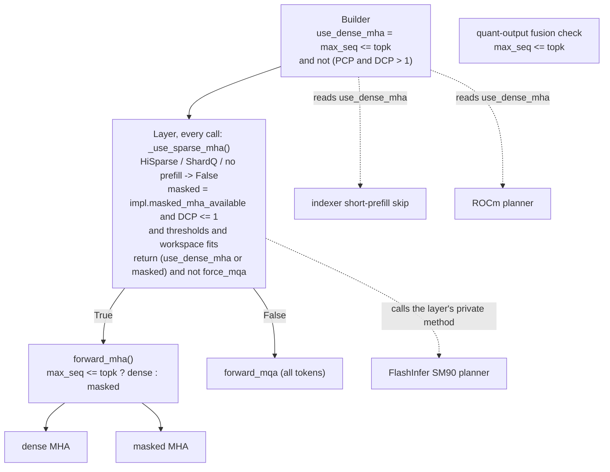
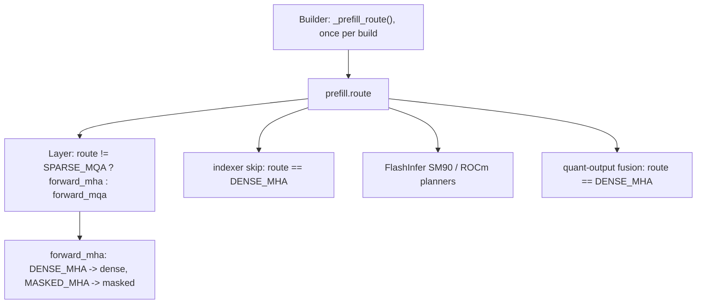

# MATERIAL PACK — vllm-project/vllm PR #67338

- title: [Attention] Decide the sparse MLA prefill route once in the metadata builder
- author: Pb314314
- merged/closed: 2026-11-17
- labels: documentation, performance, rocm, intel-gpu, ready, ci/build, nvidia, verified, dflash
- category: Attention / Kernel | tier: major
- diffstat: +None/-None across None files
- url: https://github.com/vllm-project/vllm/pull/67338

## perf claims detected in body (regex, unverified)
- (none detected by regex)

## PR body
```markdown
<!-- markdownlint-disable -->

## Overview

A sparse MLA prefill runs one of three ways: dense MHA, masked MHA, or sparse MQA (the top-k kernel that decodes use). Today three places each decide part of that choice:
- the metadata builder (`use_dense_mha`);
- `MLAAttention._use_sparse_mha`, at every layer call;
- `SparseMLACommonImpl.forward_mha` (`prefill_max_seq_len <= topk_tokens`).

Seven other places read or re-derive it. This PR makes the metadata builder decide once per metadata build and store the result in `SparseMLAPrefillMetadata.route`. Every consumer reads that field. Serving behavior does not change.

## Background: the three prefill routes

For causal, sink-free sparse MLA, all three compute the same attention in exact arithmetic: each query attends only to its top-k keys chosen by the indexer. They differ in the kernel, and in rounding and query quantization (sparse MQA can take an fp8 query). Models with learnable sinks (HY-V4) need sparse MQA and force it.

| Route | Kernel | Keys per query | When |
| --- | --- | --- | --- |
| `SPARSE_MQA` | Absorbed MLA: q is projected into the latent space and one shared latent KV is gathered by top-k index (the kernel decodes use). Reads the compressed, possibly fp8, cache. | its top-k | The fallback when no other route applies, and always for decodes. |
| `DENSE_MHA` | KV is decompressed per head with `kv_b_proj`, then causal MHA with no top-k mask. | all causal keys | Every prefill in the step has `seq_len <= top-k`, so the top-k already contains every causal key and no mask is needed. |
| `MASKED_MHA` | Same decompressed MHA on FA4, with a per-query bit mask built from the top-k indices (`_build_topk_mask`, applied through FA4 `mask_mod`). | its top-k | Long prefills where the MHA kernel is faster: SM100 + FA4, a supported head geometry, unquantized KV, DCP = 1, inside the measured `_MASKED_MHA_THRESHOLDS`, and the mask fits the workspace. |

The mask in `MASKED_MHA` selects keys; it is not a padding mask. Results agree mathematically across routes, not bitwise (different matmul order and rounding).

A step's tokens are laid out as `[decodes | prefills]`, split at `num_decode_tokens`. Decodes always take sparse MQA: with one query per request (plus speculative tokens), decompressing their keys for MHA costs more than it saves, as in every MLA backend. The route only says what the prefill segment takes; `SPARSE_MQA` means it runs in `forward_mqa` like the decodes (in the same call, except under ShardQ, which dispatches the decode and the token-sharded prefill rows separately). It is decided per metadata build from the prefill maxima (longest sequence and longest query, which may come from different requests) and the rules below. A step without prefills has no route, and so does a step on a layer without a prefill backend (for example FlashInfer SM120): there is no prefill metadata, and prefills run sparse MQA as before.

## Before and after

Before, the choice is split across three places, and readers re-derive parts of it:



After, the builder decides once per metadata build; every reader reads `prefill.route`:



## New structure

One enum, one field and one builder method, all added by this PR. The rest of the diff removes or moves code, except the builder's backend-name lookup, the ShardQ split moved ahead of the route decision (so the route sees it), a benchmark override that forces a route, and test updates.

- `SparseMLAPrefillRoute`: the three routes above.
  - Why a new type: the route has three values. Before, they were spread over a builder bool (`use_dense_mha`), a per-layer check (`_use_sparse_mha`) and a length test inside `forward_mha`, and no single value said which path runs. Extending the old bool would need a second bool plus rules about which pairs are valid.
- `SparseMLAPrefillMetadata.route`: carries the decision from the builder to every reader. It is a required field, so a builder that forgets to set it fails at construction instead of silently falling back.
- `SparseMLACommonMetadataBuilder._prefill_route()`: the only place the routing rules live. It applies them in this order; the first match wins:

| # | Rule | Route | Why |
| --- | --- | --- | --- |
| 1 | `sparse_mla_force_mqa`, HiSparse, or ShardQ this step | `SPARSE_MQA` | Force-MQA is a user override. HiSparse and ShardQ prefills run only in `forward_mqa` (ShardQ's top-k are compact per rank). |
| 2 | `max_seq_len <= top-k`, PCP with DCP > 1 | `SPARSE_MQA` | Dense MHA is not supported under PCP+DCP. |
| 3 | `max_seq_len <= top-k` | `DENSE_MHA` | The top-k covers every causal key. |
| 4 | Masked MHA available for this layer group, DCP = 1, inside the masked thresholds, masks fit | `MASKED_MHA` | Available means both: the builder allocated the mask workspace (`_is_masked_mha_available` for the global KV dtype) and the group's impl has `masked_mha_available` (the same check for its own KV dtype). These can differ, e.g. for an MTP draft with its own `kv_cache_dtype`. |
| 5 | Otherwise | `SPARSE_MQA` | |

## Claims

- One function, `SparseMLACommonMetadataBuilder._prefill_route`, applies every per-step routing rule. Everything else reads its result. Whether a layer has a prefill backend at all is still decided at layer construction, as before; without one there is no prefill metadata and prefills run sparse MQA.
- Builders that plan kernels now read the route from the metadata, instead of calling the layer's private `_use_sparse_mha` (FlashInfer SM90) or reading `use_dense_mha` (ROCm).
- Serving behavior is unchanged for every model that uses sparse MLA. The evidence: the routing rules match Baseline on an exhaustive grid of inputs; route traces have the same layer-call counts per path and token shape (aggregate counts per run, not an ordered per-call log); output differences are no larger than those observed between repeated runs; and GSM8K with real weights matches on GLM-5.3 and DeepSeek-V3.2 (see Validation, "Per-model check").
- Models that do not use sparse MLA (dense MLA, DeepSeek-V4 / V4.1, MiniMax-M3, non-MLA models) are not affected; the reason for each is in "Per-model check".
- The attention benchmark uses `BenchmarkConfig.sparse_mla_route: SparseMLAPrefillRoute | None` as its single route override. The `mha_vs_mqa` variants explicitly force dense, masked, or sparse MQA; `None` follows the builder's decision. This removes the benchmark's duplicate automatic routing rule and replaces its `sparse_mla_force_mqa` / `sparse_mla_mha_mode` fields. The production `AttentionConfig.sparse_mla_force_mqa` option is unchanged.
- No measurable performance change: on GLM-5.3-NVFP4 serving, the mean of two runs per tree differs by at most 0.8% (TTFT), less than the run-to-run spread (see Validation). The kernels are unchanged; only the host-side route decision moved.

## Validation

**Benchmark CLI follow-up (2026-11-16, America/Los_Angeles).** The final results loop now consumes the two-element variant tuples. Explicit YAML `prefill_backends` comparisons force dense MHA within top-k 2048 and masked MHA above it, using the same top-k passed to the runner. Forced masked MHA rejects an explicitly selected backend other than FA4, since its implementation always calls FA4. FP8-output requests without an MHA prefill route are rejected instead of silently omitting quantization. Ordinary automatic routing is unchanged.

GB200 validation completed through the real CLI, including final tables, JSON output, exit status, and wrappers that count dispatches while executing the original GPU implementations: **9 CLI cases / 18 result rows: 15 successful measurements and 3 expected rejections**.
- `mha_vs_mqa`: MQA-only `q64`, plus all three variants for `q64` and `q1s4096`; all finish and print the final table.
- Explicit FA4 comparison: `q64`, `q1s64`, and `q64s2048` execute dense MHA; `q512s4096`, `q1s4096`, and `q64s2049` execute masked MHA. No sparse MQA dispatches occur in these comparisons.
- Automatic `q512s4096` still executes sparse MQA.
- With `fp8_output_scale: 0.125` and `fuse_quant_op: [false, true]`, automatic `q512s4096` reports an error for both modes before any MQA dispatch. A positive `q512` / post-quant case executes MHA and real quantization, with the returned FP8 dtype checked. The positive case is above the backend's decode threshold; `q64` is correctly rejected when classified as MQA.
- Explicit FA2 comparison for `q512s4096` exits 1, writes an error result, and reports `Sparse MLA masked MHA requires prefill_backend=fa4`; it does not emit a successful timing under the wrong backend name.

Reproduction: save the following as `/tmp/mla-prefill-check.yaml` and run:
```bash
HF_HUB_OFFLINE=1 .venv/bin/python benchmarks/attention_benchmarks/benchmark.py \
  --config /tmp/mla-prefill-check.yaml --output-json /tmp/mla-prefill-check.json
```
```yaml
prefill_backends: [fa4]
batch_specs: [q512s4096]
model:
  num_layers: 1
  num_q_heads: 64
  num_kv_heads: 1
  head_dim: 576
  kv_lora_rank: 512
  qk_nope_head_dim: 192
  qk_rope_head_dim: 64
  v_head_dim: 256
  block_size: 64
  max_model_len: 8192
backends: [FLASHMLA_SPARSE]
device: cuda:0
cuda_graphs: false
warmup_ms: 1
```
For the table regression, replace `prefill_backends` with `mode: mha_vs_mqa`, `prefill_backend: fa4`, and `sparse_mla_mha_variants: [mqa]`, and use `batch_specs: [q64]`. On `da6a5062` this reaches `ValueError: not enough values to unpack (expected 3, got 2)`; the revised CLI completes. The FA4 comparison on that head instead dispatches MQA while reporting FA4; the revised CLI dispatches masked MHA.

Pre-commit passed on the three follow-up files. An additional CUTLASS_MLA comparison could not reach measurement: both `da6a5062` and the candidate hit the existing `'MockLayer' object has no attribute 'q_lora_rank'` error. That separate limitation is not counted as passing coverage. A separate FA2 mixed-variant run still prints the full table and exits 1 after errors: masked MHA is rejected as intended, MQA succeeds, and dense FA2 cannot execute with the installed PTX/toolchain combination; dense FA2 is not claimed as validated. The existing B200 benchmark CI smoke runs standard attention backends; these sparse MLA scenarios were validated locally. This follow-up changes benchmark code and documentation only; it makes no new model accuracy or performance claim.

**Review revision (2026-11-17).** Compared against the previous PR head `1ce8fa0b1be8057fa627590477118df7c77f27a5`:
- Moved the enum to `sparse_utils.py`, and the masked-MHA policy helper/table to `sparse_mla_attention.py`. AST comparisons of the enum, range type, table, and helper are identical to the previous head.
- Replaced the benchmark's two route controls with one optional enum. Explicit variants still force their route, including one-token MHA benchmarks; the default now uses the builder's decision. The production force-MQA setting is populated before metadata planning when needed by the forced benchmark variant.
- Simplified the layer-cache regression with real layer/cache constructors, retaining the global-versus-layer dtype disagreement. Both cases pass; removing the layer guard in memory produces the expected `MASKED_MHA != SPARSE_MQA` assertion failure.
- Restored the unrelated `decode_max_query_len` and unused-builder-tensor removals. The FlashMLA and XPU backend files now have no diff against the PR base.
- Updated rendered benchmark documentation. No attention kernel, threshold value, or serving-route rule changes in this revision.

<details>
<summary>Review revision validation: commands, results, and limits</summary>

GB200, Python 3.12, the same precompiled runtime in both worktrees. The following focused suites completed (the broader numerical kernel matrices were started and interrupted; they are not claimed as completed):
```bash
HF_HUB_OFFLINE=1 .venv/bin/python -m pytest tests/v1/attention/test_sparse_mla_backends.py \
  -k 'route or masked_mha or sparse_backend_prefill_correctness or unified_mla_prepares_batch_without_slot_mapping' \
  -q --disable-warnings -o faulthandler_timeout=120
50 passed, 1947 deselected, 206 warnings in 84.42s

HF_HUB_OFFLINE=1 .venv/bin/python -m pytest \
  tests/v1/attention/test_flashinfer_mla_sparse_sm90.py \
  tests/model_executor/layers/test_mla_short_prefill_indexer.py \
  tests/v1/attention/test_dspark_noncausal_sparse_mla.py tests/v1/attention/test_shardq.py \
  -q --disable-warnings
127 passed, 20 skipped, 17 warnings in 96.89s

HF_HUB_OFFLINE=1 .venv/bin/python -m pytest tests/v1/attention/test_mla_backends.py \
  -k masked_mha -q --disable-warnings
32 passed, 2474 deselected, 17 warnings in 14.73s

.venv/bin/pre-commit run --files <changed files>
All applicable hooks passed.
```

Mutation check (source changed only in the test process): remove `and attention_layer.impl.masked_mha_available` from the builder constructor, then run `-k masked_route_needs_layer_masked_mha`:
```text
FAILED test_masked_route_needs_layer_masked_mha[fp8_ds_mla-SparseMLAPrefillRoute.SPARSE_MQA]
AssertionError: MASKED_MHA is not SPARSE_MQA
1 failed, 1 passed, 1995 deselected
```

The benchmark route smoke test below executes actual kernels and records the route, including short-context one-token shapes. All 16 cases pass:
| Shape | Default (`None`) | Forced dense | Forced masked | Forced MQA |
| --- | --- | --- | --- | --- |
| `q1024` | dense | dense | masked | MQA |
| `q4096` | masked | dense | masked | MQA |
| `q512s4096` | MQA | dense | masked | MQA |
| `q1s64` | MQA | dense | masked | MQA |

Run the following script as `PYTHONPATH=<tree> .venv/bin/python benchmark_routes.py <tree> result.json`:
```python
import json
import sys

sys.path.insert(0, sys.argv[1] + "/benchmarks/attention_benchmarks")

from common import BenchmarkConfig
from mla_runner import run_mla_benchmark
from vllm.model_executor.layers.attention import mla_attention as mla
from vllm.model_executor.layers.attention import sparse_mla_attention as sparse
from vllm.v1.attention.backends.mla.flashmla_sparse import FlashMLASparseImpl
from vllm.v1.attention.backends.mla.sparse_utils import SparseMLAPrefillRoute as Route

seen = set()
chosen = []
base_mha = mla.MLACommonBaseImpl.forward_mha
sparse_mha = sparse.SparseMLACommonImpl.forward_mha
mqa = FlashMLASparseImpl.forward_mqa
prefill_route = sparse.SparseMLACommonMetadataBuilder._prefill_route

def record_route(self, *args, **kwargs):
    route = prefill_route(self, *args, **kwargs)
    chosen.append(route)
    return route

def record_dense(self, *args, **kwargs):
    seen.add(Route.DENSE_MHA)
    return base_mha(self, *args, **kwargs)

def record_mha(self, q, k, pe, cache, metadata, *args, **kwargs):
    if metadata.prefill.route is Route.MASKED_MHA:
        seen.add(Route.MASKED_MHA)
    return sparse_mha(self, q, k, pe, cache, metadata, *args, **kwargs)

def record_mqa(self, *args, **kwargs):
    seen.add(Route.SPARSE_MQA)
    return mqa(self, *args, **kwargs)

mla.MLACommonBaseImpl.forward_mha = record_dense
sparse.SparseMLACommonImpl.forward_mha = record_mha
FlashMLASparseImpl.forward_mqa = record_mqa
sparse.SparseMLACommonMetadataBuilder._prefill_route = record_route

records = []
for spec in ("q1024", "q4096", "q512s4096", "q1s64"):
    for route in (None, *Route):
        config = BenchmarkConfig(
            backend="FLASHMLA_SPARSE", batch_spec=spec, num_layers=1,
            head_dim=576, num_q_heads=64, num_kv_heads=1, block_size=64,
            device="cuda:0", max_model_len=8192, use_cuda_graphs=False,
            warmup_ms=1, kv_lora_rank=512, qk_nope_head_dim=192,
            qk_rope_head_dim=64, v_head_dim=256, sparse_mla_route=route,
        )
        seen.clear()
        chosen.clear()
        result = run_mla_benchmark("FLASHMLA_SPARSE", config, prefill_backend="fa4")
        assert result.success, result.error
        expected = route or (chosen[-1] if chosen else Route.SPARSE_MQA)
        assert seen == {expected}, (spec, route, seen, expected)
        row = {"shape": spec, "requested": route.value if route else "auto",
               "observed": expected.value}
        records.append(row)
        print(json.dumps(row), flush=True)
json.dump(records, open(sys.argv[2], "w"), indent=2)
```

The existing `route_diff.py` reproducer below was run twice per tree, comparing the previous head against this revision. This is a runtime/route check with dummy weights, not a new model-quality evaluation:
```bash
PYTHONPATH=<tree> VLLM_DEEP_GEMM_WARMUP=skip VLLM_GPU_SYNC_CHECK=error HF_HUB_OFFLINE=1 \
  .venv/bin/python route_diff.py --out <result.json> --backend FLASHMLA_SPARSE \
  --kv-cache-dtype bfloat16 --layers 2 --mnbt 4096 --max-model-len 10000 \
  --max-tokens 4 --eager --waves '[[512],[3000],[9000]]'
```
All four runs complete without a synchronization error and give the same route counts:
```text
 2 mha:DENSE:tokens=512
 2 mha:MASKED:tokens=3000
 2 mha:MASKED:tokens=4096
18 mqa:prefill_rows=0:decode_rows=1
 2 mqa:prefill_rows=4096:decode_rows=0
 2 mqa:prefill_rows=808:decode_rows=0
```
The 512-token request has identical output tokens/logprobs in all four runs. For the longer requests, all first tokens agree, but later generated tokens vary within both the baseline and revised trees. One baseline/revised pair has identical token sequences; this small dummy-weight experiment does **not** establish strict output equality. The earlier real-weight evaluations below were not rerun for this code-movement revision. ROCm, XPU, and Hopper hardware were not available for this revision's checks.

</details>


**Per-model check.** The route is decided in the shared sparse MLA builder, so every model family that reaches it was checked, and the families that do not reach it are listed with the reason.

Method for the trace rows: `route_diff.py` (collapsed below), Baseline = main at b704146733, After PR = this PR on it, the model's public config cut to a few layers with dense MLPs (except the GLM-5.3-Flash MoE row; `num_nextn_predict_layers` set to 0 except in the MTP row; for multimodal configs, where `route_diff.py` applies no overrides, the `text_config` was cut the same way beforehand (`num_hidden_layers` 8 and its per-layer lists; GLM-5.3-Flash dense row `first_k_dense_replace` 8, MoE row 3, so layers 3-7 keep their MoE) and the run uses `language_model_only=True`), dummy weights, TP1, GB200, default backend and KV cache dtype unless stated, 11 requests of 300 to 20000 tokens in 7 waves, greedy, 8 output tokens. "A/A" is two Baseline runs; a logprob difference at or below A/A is run-to-run noise.

Affected models:

| Model family (code) | How it reaches the route | Check | Layer calls per path and shape | Tokens | Max \|logprob diff\| (A/A) |
| --- | --- | --- | --- | --- | --- |
| GLM-5.x (`GlmMoeDsaForCausalLM`), DeepSeek-V3.2 (`DeepseekV32ForCausalLM`) | shared builder | route traces in the table above (dense, masked, MQA, ShardQ, TP4); GSM8K with real weights on GLM-5.3-NVFP4 and DeepSeek-V3.2-NVFP4 below | identical | identical | at A/A |
| GLM-5.3 with its MTP drafter (`--speculative-config` mtp, 2 tokens) | the MTP layer uses the same builder | trace, 8 target layers + 1 MTP layer | identical (dense, sparse MQA; 9 calls per shape = 8 target layers + 1 MTP layer) | 11/11 | 1.9e-6 (2.9e-6) |
| GLM-5.3-Flash (`Glm5NextForConditionalGeneration`, `models/glm5next`), hybrid linear + sparse layers, dense MLPs | shared builder | trace | identical (dense, sparse MQA) | 11/11 | 2.0e-3 (2.0e-3; the noise comes from its linear-attention layers) |
| GLM-5.3-Flash with its MoE layers, bf16 KV and fp8 KV | same | trace | identical (dense, sparse MQA) | 11/11 | 2.0e-3 (A/A 2.0e-3; two After PR runs also differ by 2.0e-3) |
| HY-V4 (`models/hy_v4`) | shared builder; its learnable sinks set `sparse_mla_force_mqa`, so every prefill is sparse MQA before and after | trace | identical (all sparse MQA) | 11/11 | 2.8e-4 (2.3e-4; slightly above this one A/A pair, with identical tokens and paths) |
| dots3-note (`models/dots3_note`) | its sparse backend subclasses the FlashAttention MLA sparse backend and inherits the shared builder; its `forward_mha` slices the padded cache and calls the shared one | code reading and unit tests; not run end to end, because its sparse MQA kernel is FA3 (Hopper only) and this was tested on GB200 | | | |
| Kimi DSA layers (`models/kimi_k3` with `dsa_config`) | shared builder through `MultiHeadLatentAttentionWrapper(is_sparse=True)`; no model code reads a changed symbol | code reading and unit tests | | | |
| `Glm4MoeLiteForCausalLM` with `index_topk` | shared builder when the config sets `index_topk`; the GLM-4.7-Flash config does not, so it runs dense MLA, and we know of no checkpoint for this class that does | code reading | | | |

Not affected:

| Models | Why | Check |
| --- | --- | --- |
| Dense MLA: DeepSeek-V2/V3/R1, Kimi-K2.5, Kimi-K3 without `dsa_config`, GLM-4.7-Flash and others with `is_sparse=False` | They build no sparse metadata. The only changed line on their path is the quant-output fusion check in `MLAAttention.forward_impl`: a pure `and` chain where the `attn_metadata` / `prefill` None checks moved ahead of the sparse clause, and `not self.impl.is_sparse` still short-circuits it. The removed `MLACommonPrefillMetadata.use_dense_mha` had no dense reader. | DeepSeek-V2-Lite trace (dense MLA, dummy weights): 11/11 identical tokens, logprobs bit-identical; `tests/v1/attention/test_mla_backends.py` (unit tests below) |
| DeepSeek-V4 / V4.1, MiniMax-M3 | own sparse attention and metadata; none of their code references a changed symbol | grep of `models/deepseek_v4`, `models/deepseek_v41`, `models/minimax_m3` |
| Models without MLA | no changed code on their path | |

**Route trace, Baseline vs After PR.** Baseline is main at df5d80339b (one rebase before b704146733; the 15 commits in between touch HiSparse and FlashMLA kernel plumbing, not the route); After PR is that commit plus this PR. The first four rows were run on this base; the last three were run before the rebase (Baseline main at dfebb42d09) and are kept as additional coverage. After the final rebase onto main at b3c08a2555, the FlashMLA sparse bf16 KV row and the default row were rerun with Baseline = main at b3c08a2555: the same layer-call counts as in the table (56 MHA = 16 dense + 40 masked, 416 sparse MQA; 16 dense, 456 sparse MQA), 11/11 identical tokens, max |logprob diff| 1.9e-6 in both.
- Model: GLM-5.3 config cut to its first 8 layers (4 with their own indexer, 4 that reuse a top-k), dense MLPs, dummy weights.
- Run: TP1 (and TP4 in the last row), GB200, eager, 11 requests in 7 waves. Prompt lengths 300 to 20000; `max_num_batched_tokens=8192`, so the long prompts are chunked with context.
- Method: `route_diff.py` (collapsed below) wraps `forward_mha` and `forward_mqa` the same way in both trees. It counts layer calls by path (dense / masked / sparse MQA) and token shape, and records the greedy tokens and the logprobs of the generated tokens. The counts are aggregate per run, not ordered per layer.

| Config | Layer calls by path (all layers, all steps) | Identical? | Tokens | Max \|logprob diff\| | Same tree twice (A/A) |
| --- | --- | --- | --- | --- | --- |
| FlashMLA sparse, bf16 KV (`--kv-cache-dtype bfloat16`) | 16 dense, 40 masked, 416 sparse MQA | yes, per path and shape | 11/11 identical | 1.9e-6 | 2.9e-6 |
| FlashMLA sparse, `fp8_ds_mla` KV | 16 dense, 456 sparse MQA (masked needs an unquantized KV cache) | yes | 11/11 identical | 1.9e-6 | 2.9e-6 |
| Default (FlashInfer sparse; `auto` resolves to fp8 KV for this FP8 checkpoint) | 16 dense, 456 sparse MQA | yes | 11/11 identical | 2.9e-6 | 2.9e-6 |
| FlashInfer sparse, bf16 KV | 16 dense, 456 sparse MQA (no FlashInfer masked thresholds for these dims at TP1) | yes | 11/11 identical | 1.9e-6 | 2.9e-6 |
| FlashInfer sparse, bf1
```

## diff
```diff
diff --git a/.buildkite/test_areas/attention.yaml b/.buildkite/test_areas/attention.yaml
index 3e4a2b24a5f0..836bb43b74ae 100644
--- a/.buildkite/test_areas/attention.yaml
+++ b/.buildkite/test_areas/attention.yaml
@@ -53,6 +53,19 @@ steps:
         v1/attention/test_mla_backends.py
         v1/attention/test_sparse_mla_backends.py
 
+- label: ":nvidia: (B200) ShardQ Metadata"
+  key: shardq-metadata-b200
+  device: b200-k8s
+  num_gpus: 2
+  timeout_in_minutes: 10
+  source_file_dependencies:
+    - vllm/config/attention.py
+    - vllm/model_executor/layers/attention/
+    - vllm/v1/attention/
+    - tests/v1/attention/test_shardq.py
+  commands:
+    - pytest -v -s v1/attention/test_shardq.py -k builder_selects_mqa_after_shardq_split
+
 - label: ":nvidia: (B200) V1 Attention"
   key: v1-attention-b200
   automatic_shard: true
diff --git a/benchmarks/attention_benchmarks/benchmark.py b/benchmarks/attention_benchmarks/benchmark.py
index c42ebe895b3c..9dde2441e055 100644
--- a/benchmarks/attention_benchmarks/benchmark.py
+++ b/benchmarks/attention_benchmarks/benchmark.py
@@ -52,6 +52,8 @@
 )
 
 from vllm.config.cache import CacheDType
+from vllm.v1.attention.backends.mla.sparse_utils import SparseMLAPrefillRoute
+from vllm.v1.attention.backends.registry import AttentionBackendEnum
 from vllm.v1.worker.workspace import init_workspace_manager
 
 
@@ -80,7 +82,6 @@ def run_mla_benchmark(config: BenchmarkConfig, **kwargs) -> BenchmarkResult:
         config.backend,
         config,
         prefill_backend=config.prefill_backend,
-        sparse_mla_force_mqa=config.sparse_mla_force_mqa,
         **kwargs,
     )
 
@@ -1132,13 +1133,13 @@ def main():
         if prefill_backend:
             console.print(f"Prefill backend: {prefill_backend}")
         available_variants = [
-            ("dense_mha", False, "dense"),
-            ("masked_mha", False, "masked"),
-            ("mqa", True, "auto"),
+            ("dense_mha", SparseMLAPrefillRoute.DENSE_MHA),
+            ("masked_mha", SparseMLAPrefillRoute.MASKED_MHA),
+            ("mqa", SparseMLAPrefillRoute.SPARSE_MQA),
         ]
         requested_variants = getattr(args, "sparse_mla_mha_variants", None)
         if requested_variants is not None:
-            valid_variants = {label for label, _, _ in available_variants}
+            valid_variants = {label for label, _ in available_variants}
             invalid_variants = sorted(set(requested_variants) - valid_variants)
             if invalid_variants:
                 raise ValueError(
@@ -1175,7 +1176,7 @@ def main():
         total = 0
         for spec, _ in benchmark_specs:
             q_len = max(request.q_len for request in parse_batch_spec(spec))
-            for variant_label, _, _ in variants:
+            for variant_label, _ in variants:
                 if (
                     variant_label == "dense_mha"
                     and dense_mha_max_seq_len is not None
@@ -1192,7 +1193,7 @@ def main():
             for spec, num_q_heads in benchmark_specs:
                 q_len = max(request.q_len for request in parse_batch_spec(spec))
                 for backend in backends:
-                    for variant_label, force_mqa, mha_mode in variants:
+                    for variant_label, route in variants:
                         if (
                             variant_label == "dense_mha"
                             and dense_mha_max_seq_len is not None
@@ -1231,8 +1232,7 @@ def main():
                             qk_nope_head_dim=getattr(args, "qk_nope_head_dim", None),
                             qk_rope_head_dim=getattr(args, "qk_rope_head_dim", None),
                             v_head_dim=getattr(args, "v_head_dim", None),
-                            sparse_mla_force_mqa=force_mqa,
-                            sparse_mla_mha_mode=mha_mode,
+                            sparse_mla_route=route,
                             sparse_mla_dense_mha_max_seq_len=dense_mha_max_seq_len,
                             sparse_mla_topk_pattern=sparse_mla_topk_pattern,
                             prefill_backend=prefill_backend,
@@ -1250,7 +1250,6 @@ def main():
                                 backend,
                                 config,
                                 prefill_backend=prefill_backend,
-                                sparse_mla_force_mqa=force_mqa,
                             )
                         except Exception as e:
                             result = BenchmarkResult(
@@ -1282,7 +1281,7 @@ def main():
         variant_backends = []
         for num_q_heads in num_q_heads_values:
             for backend in backends:
-                for variant, _, _ in variants:
+                for variant, _ in variants:
                     label = f"{backend}_{variant}"
                     if model_sweep is not None:
                         label = model_sweep.get_label(label, num_q_heads)
@@ -1391,6 +1390,8 @@ def main():
         if prefill_backends:
             # Use first decode backend for impl construction
             decode_backend = backends[0]
+            is_sparse = AttentionBackendEnum[decode_backend].get_class().is_sparse()
+            index_topk = 2048
             total = len(prefill_backends) * len(args.batch_specs)
 
             console.print(
@@ -1400,6 +1401,15 @@ def main():
 
             with tqdm(total=total, desc="Prefill benchmarking") as pbar:
                 for spec in args.batch_specs:
+                    prefill_route = None
+                    if is_sparse:
+                        max_seq_len = max(r.kv_len for r in parse_batch_spec(spec))
+                        # Measure MHA explicitly instead of an automatic MQA fallback.
+                        prefill_route = (
+                            SparseMLAPrefillRoute.DENSE_MHA
+                            if max_seq_len <= index_topk
+                            else SparseMLAPrefillRoute.MASKED_MHA
+                        )
                     for pb in prefill_backends:
                         config = BenchmarkConfig(
                             backend=decode_backend,
@@ -1413,13 +1423,14 @@ def main():
                             profile_memory=args.profile_memory,
                             warmup_ms=args.warmup_ms,
                             prefill_backend=pb,
+                            sparse_mla_route=prefill_route,
                             kv_lora_rank=args.kv_lora_rank,
                             qk_nope_head_dim=args.qk_nope_head_dim,
                             qk_rope_head_dim=args.qk_rope_head_dim,
                             v_head_dim=args.v_head_dim,
                         )
 
-                        result = run_benchmark(config)
+                        result = run_benchmark(config, index_topk=index_topk)
 
                         # Label result with prefill backend name for display
                         labeled_config = replace(result.config, backend=pb)
diff --git a/benchmarks/attention_benchmarks/common.py b/benchmarks/attention_benchmarks/common.py
index 285bea79236f..f774578c118c 100644
--- a/benchmarks/attention_benchmarks/common.py
+++ b/benchmarks/attention_benchmarks/common.py
@@ -18,6 +18,7 @@
 from rich.table import Table
 
 from vllm.triton_utils import triton
+from vllm.v1.attention.backends.mla.sparse_utils import SparseMLAPrefillRoute
 
 
 def batch_spec_sort_key(spec: str) -> tuple[int, int, int]:
@@ -188,7 +189,9 @@ class MockLayer(AttentionLayerBase):
     in get_layers_from_vllm_config when FlashInfer prefill is enabled.
     """
 
-    def __init__(self, device: torch.device, impl=None, kv_cache_spec=None):
+    def __init__(
+        self, device: torch.device, impl=None, kv_cache_spec=None, attn_backend=None
+    ):
         # Don't call super().__init__() as AttentionLayerBase doesn't have __init__
         self._k_scale = torch.tensor(1.0, device=device)
         self._v_scale = torch.tensor(1.0, device=device)
@@ -201,11 +204,11 @@ def __init__(self, device: torch.device, impl=None, kv_cache_spec=None):
         self.impl = impl
         # KV cache spec for get_kv_cache_config
         self._kv_cache_spec = kv_cache_spec
+        self._attn_backend = attn_backend
 
     def get_attn_backend(self):
         """Get the attention backend class (required by AttentionLayerBase)."""
-        # Return None as this is just a mock layer for benchmarking
-        return None
+        return self._attn_backend
 
     def get_kv_cache_config(self, vllm_config=None):
         """Get the KV cache config (required by AttentionLayerBase)."""
@@ -301,8 +304,7 @@ class BenchmarkConfig:
     # Backend-specific tuning
     num_kv_splits: int | None = None  # CUTLASS MLA
     reorder_batch_threshold: int | None = None  # FlashAttn MLA, FlashMLA
-    sparse_mla_force_mqa: bool = False  # Force MQA path for sparse MLA
-    sparse_mla_mha_mode: str = "auto"  # "auto", "dense", or "masked"
+    sparse_mla_route: SparseMLAPrefillRoute | None = None
     sparse_mla_dense_mha_max_seq_len: int | None = None
     sparse_mla_masked_mha_max_seq_len: int | None = None
     sparse_mla_topk_pattern: str = "random"  # "random", "prefix", "sliding_window"
@@ -323,6 +325,7 @@ class BenchmarkResult:
     memory_allocated_mb: float | None = None
     memory_reserved_mb: float | None = None
     error: str | None = None
+    actual_sparse_mla_route: SparseMLAPrefillRoute | None = None
 
     @property
     def success(self) -> bool:
@@ -342,6 +345,11 @@ def to_dict(self) -> dict[str, Any]:
             "memory_allocated_mb": self.memory_allocated_mb,
             "memory_reserved_mb": self.memory_reserved_mb,
             "error": self.error,
+            "actual_sparse_mla_route": (
+                self.actual_sparse_mla_route.name
+                if self.actual_sparse_mla_route is not None
+                else None
+            ),
         }
 
 
@@ -418,7 +426,10 @@ def shorten_backend_name(name: str) -> str:
                 if backend in spec_results:
                     r = spec_results[backend]
                     if r.success:
-                        row.append(f"{r.mean_time:.6f}")
+                        timing = f"{r.mean_time:.6f}"
+                        if r.actual_sparse_mla_route is not None:
+                            timing += f"\n{r.actual_sparse_mla_route.name}"
+                        row.append(timing)
                         if multi and compare_to_fastest:
                             pct = (
                                 (r.mean_time / best_time * 100) if best_time > 0 else 0
@@ -456,6 +467,7 @@ def save_csv(self, results: list[BenchmarkResult], path: str):
                     "batch_spec",
                     "num_layers",
                     "kv_cache_dtype",
+                    "actual_sparse_mla_route",
                     "mean_time",
                     "std_time",
                     "throughput",
@@ -470,6 +482,11 @@ def save_csv(self, results: list[BenchmarkResult], path: str):
                         "batch_spec": r.config.batch_spec,
                         "num_layers": r.config.num_layers,
                         "kv_cache_dtype": r.config.kv_cache_dtype,
+                        "actual_sparse_mla_route": (
+                            r.actual_sparse_mla_route.name
+                            if r.actual_sparse_mla_route is not None
+                            else ""
+                        ),
                         "mean_time": r.mean_time,
                         "std_time": r.std_time,
                         "throughput": r.throughput_tokens_per_sec or 0,
diff --git a/benchmarks/attention_benchmarks/mla_runner.py b/benchmarks/attention_benchmarks/mla_runner.py
index 47d4bb9f3d59..acb12628c333 100644
--- a/benchmarks/attention_benchmarks/mla_runner.py
+++ b/benchmarks/attention_benchmarks/mla_runner.py
@@ -33,8 +33,12 @@
     VllmConfig,
     set_current_vllm_config,
 )
+from vllm.logger import init_logger
 from vllm.model_executor.layers.linear import ColumnParallelLinear
 from vllm.v1.attention.backends.mla.prefill.registry import MLAPrefillBackendEnum
+from vllm.v1.attention.backends.mla.sparse_utils import SparseMLAPrefillRoute
+
+logger = init_logger(__name__)
 
 
 def _safe_profile_name(value: str) -> str:
@@ -121,7 +125,6 @@ def create_minimal_vllm_config(
     index_topk: int | None = None,
     prefill_backend: str | None = None,
     kv_cache_dtype: str = "auto",
-    sparse_mla_force_mqa: bool = False,
 ) -> VllmConfig:
     """Create minimal VllmConfig for MLA benchmarks.
 
@@ -140,8 +143,6 @@ def create_minimal_vllm_config(
                         "trtllm"). Configures the attention config to force
                         the specified prefill backend.
         kv_cache_dtype: KV cache dtype, e.g. "auto" or "fp8"
-        sparse_mla_force_mqa: If True, forces all sparse MLA tokens through
-                    forward_mqa (even prefill tokens).
 
     Returns:
         VllmConfig for benchmarking
@@ -249,9 +250,6 @@ def create_minimal_vllm_config(
                 "flash_attn_version"
             ]
 
-    if sparse_mla_force_mqa:
-        vllm_config.attention_config.sparse_mla_force_mqa = True
-
     return vllm_config
 
 
@@ -661,7 +659,12 @@ def _create_backend_impl(
     )
 
     # Create mock layer
-    layer = MockLayer(device, impl=impl, kv_cache_spec=kv_cache_spec)
+    layer = MockLayer(
+        device,
+        impl=impl,
+        kv_cache_spec=kv_cache_spec,
+        attn_backend=backend_cfg["backend_class"],
+    )
 
     # Attach a prefill backend (MLAAttention does this in __init__; the metadata
     # builder reads layer.prefill_backend from static_forward_context).
@@ -843,28 +846,33 @@ def _run_single_benchmark(
             getattr(config, "sparse_mla_topk_pattern", "random"),
         )
 
-    # Determine which forward methods to use based on metadata.
-    # Non-sparse backends use .decode/.prefill sub-objects.
-    # Sparse backends use num_decode_tokens/num_prefills directly.
-    #
-    # sparse_mla_force_mqa overrides: even for prefill metadata, use MQA.
-    force_mqa = getattr(config, "sparse_mla_force_mqa", False)
-    force_dense_mha = getattr(config, "sparse_mla_mha_mode", "auto") == "dense"
-    if force_mqa:
-        has_decode = True
-        has_prefill = False
-    elif is_sparse:
-        has_decode = metadata.num_decode_tokens > 0
-        has_prefill = metadata.num_prefills > 0
+    if is_sparse:
+        if config.sparse_mla_route is not None:
+            if (
+                metadata.prefill is None
+                and config.sparse_mla_route is not SparseMLAPrefillRoute.SPARSE_MQA
+            ):
+                raise RuntimeError("Sparse MLA MHA benchmark requires prefill metadata")
+            if metadata.prefill is not None:
+                metadata.prefill.route = config.sparse_mla_route
+        has_prefill = (
+            metadata.prefill is not None
+            and metadata.prefill.route is not SparseMLAPrefillRoute.SPARSE_MQA
+        )
+        has_decode = metadata.num_decode_tokens > 0 or not has_prefill
     else:
         has_decode = metadata.decode is not None
         has_prefill = metadata.prefill is not None
     if not has_decode and not has_prefill:
         raise RuntimeError("Metadata has neither decode nor prefill metadata")
-    if is_sparse and force_dense_mha and not has_prefill:
-        raise RuntimeError(
-            "Sparse MLA dense_mha benchmark did not produce prefill metadata. "
-            "Check reorder_batch_threshold/path forcing."
+    if output_scale is not None and not has_prefill:
+        raise ValueError("FP8 output benchmarking requires an MHA prefill route")
+    actual_route = None
+    if is_sparse:
+        actual_route = (
+            metadata.prefill.route
+            if metadata.prefill is not None
+            else SparseMLAPrefillRoute.SPARSE_MQA
         )
 
     num_decode = (
@@ -929,17 +937,10 @@ def _run_single_benchmark(
             prefill_quant_op = QuantFP8(static=True, group_shape=GroupShape.PER_TENSOR)
 
     fused_output = output_scale is not None and fuse_quant_op
-    mha_mode = getattr(config, "sparse_mla_mha_mode", "auto")
 
     # Build forward function (runs a single decode/prefill pass)
     def forward_fn():
         results = []
-        impl._sparse_mla_force_masked_mha = (  # type: ignore[attr-defined]
-            mha_mode == "masked"
-        )
-        impl._sparse_mla_force_dense_mha = (  # type: ignore[attr-defined]
-            mha_mode == "dense"
-        )
         if has_decode:
             results.append(impl.forward_mqa(decode_inputs, kv_cache, metadata, layer))
         if has_prefill:
@@ -975,6 +976,7 @@ def benchmark_fn():
             min_time=0.0,
             max_time=0.0,
             throughput_tokens_per_sec=0.0,
+            actual_sparse_mla_route=actual_route,
         )
 
     if config.torch_profile:
@@ -1017,6 +1019,7 @@ def benchmark_fn():
             min_time=0.0,
             max_time=0.0,
             throughput_tokens_per_sec=0.0,
+            actual_sparse_mla_route=actual_route,
         )
 
     all_ms = run_do_bench(benchmark_fn, config.use_cuda_graphs, config.warmup_ms)
@@ -1033,6 +1036,7 @@ def benchmark_fn():
         min_time=min(times),
         max_time=max(times),
         throughput_tokens_per_sec=total_q / mean_time if mean_time > 0 else 0,
+        actual_sparse_mla_route=actual_route,
     )
 
 
@@ -1041,7 +1045,6 @@ def _run_mla_benchmark_batched(
     configs_with_params: list[tuple],  # [(config, threshold, num_splits), ...]
     index_topk: int = 2048,
     prefill_backend: str | None = None,
-    sparse_mla_force_mqa: bool = False,
     output_scale: float | None = None,
     fuse_quant_op: bool = False,
 ) -> list[BenchmarkResult]:
@@ -1065,8 +1068,6 @@ def _run_mla_benchmark_batched(
             keeps the plain bf16 output (no quantization).
         fuse_quant_op: With output_scale set, True lets the prefill kernel write
             FP8 directly; False runs bf16 attention then a standalone quant.
-        sparse_mla_force_mqa: If True, forces all sparse MLA tokens through
-            forward_mqa (even prefill tokens).
 
     Returns:
         List of BenchmarkResult objects
@@ -1126,7 +1127,6 @@ def _run_mla_benchmark_batched(
         index_topk=index_topk if is_sparse else None,
         prefill_backend=prefill_backend,
         kv_cache_dtype=kv_cache_dtype,
-        sparse_mla_force_mqa=sparse_mla_force_mqa,
     )
 
     results = []
@@ -1186,10 +1186,18 @@ def _run_mla_benchmark_batched(
                     )
         # Run each benchmark with the shared impl
         for config, threshold, num_splits in configs_with_params:
+            vllm_config.attention_config.sparse_mla_force_mqa = (
+                config.sparse_mla_route is SparseMLAPrefillRoute.SPARSE_MQA
+            )
             force_masked_mha = (
-                is_sparse and getattr(config, "sparse_mla_mha_mode", "auto") == "masked"
+                is_sparse
+                and config.sparse_mla_route is SparseMLAPrefillRoute.MASKED_MHA
             )
             if force_masked_mha:
+                if prefill_backend not in (None, "fa4"):
+                    raise ValueError(
+                        "Sparse MLA masked MHA requires prefill_backend=fa4"
+                    )
                 impl.masked_mha_available = True
                 from vllm.model_executor.layers.attention.sparse_mla_attention import (
                     GLOBAL_TOPK_MASK_MAX_BYTES,
@@ -1218,14 +1226,13 @@ def _run_mla_benchmark_batched(
             # Set threshold for this benchmark (FlashAttn/FlashMLA only)
             original_threshold = None
             effective_threshold = threshold
-            force_dense_mha = (
-                is_sparse
-                and getattr(config, "sparse_mla_mha_mode", "auto") == "dense"
-                and not getattr(config, "sparse_mla_force_mqa", False)
+            force_mha = is_sparse and config.sparse_mla_route in (
+                SparseMLAPrefillRoute.DENSE_MHA,
+                SparseMLAPrefillRoute.MASKED_MHA,
             )
-            if force_dense_mha:
+            if force_mha:
                 # Sparse MLA normally treats q_len <= 1 as decode. Use an
-                # impossible threshold so dense_mha benchmarks actually run
+                # impossible threshold so forced MHA benchmarks actually run
                 # the prefill/MHA path, including q_len=1 short extends.
                 effective_threshold = -1
             if effective_threshold is not None and builder_instance:
@@ -1253,6 +1260,18 @@ def _run_mla_benchmark_batched(
                     fuse_quant_op=fuse_quant_op,
                 )
                 results.append(result)
+                if (
+                    prefill_backend is not None
+                    and config.sparse_mla_route is None
+                    and result.actual_sparse_mla_route
+                    is SparseMLAPrefillRoute.SPARSE_MQA
+                ):
+                    logger.warning_once(
+                        "The actual sparse MLA route is SPARSE_MQA; requested "
+                        "prefill backend %r was not executed. Set "
+                        "BenchmarkConfig.sparse_mla_route explicitly to benchmark MHA.",
+                        prefill_backend,
+                    )
 
             finally:
                 # Restore original threshold
@@ -1278,7 +1297,7 @@ def run_mla_benchmark(
     num_kv_splits: int | None = None,
     index_topk: int = 2048,
     prefill_backend: str | None = None,
-    sparse_mla_force_mqa: bool = False,
+    *,
     output_scale: float | None = None,
     fuse_quant_op: bool = False,
 ) -> BenchmarkResult | list[BenchmarkResult]:
@@ -1297,10 +1316,8 @@ def run_mla_benchmark(
                                  (single config mode only)
         num_kv_splits: Number of KV splits for CUTLASS (single config mode only)
         index_topk: Topk value for sparse MLA backends (default 2048)
-        prefill_backend: Prefill backend name (e.g., "fa3", "fa4").
-            When set, forces the specified FlashAttention version for prefill.
-        sparse_mla_force_mqa: If True, forces all sparse MLA tokens through
-            forward_mqa (even prefill tokens).
+        prefill_backend: Backend used for MHA prefill (e.g., "fa3", "fa4").
+            Sparse MLA routing is controlled by config.sparse_mla_route.
         output_scale: Static per-tensor FP8 scale for prefill output (None = bf16).
         fuse_quant_op: With output_scale set, fuse the FP8 write into the prefill
             kernel vs a standalone post-quant kernel. See _run_single_benchmark.
@@ -1333,7 +1350,6 @@ def run_mla_benchmark(
         configs_with_params,
         index_topk,
         prefill_backend=prefill_backend,
-        sparse_mla_force_mqa=sparse_mla_force_mqa,
         output_scale=output_scale,
         fuse_quant_op=fuse_quant_op,
     )
diff --git a/tests/kernels/attention/test_rocm_aiter_mla_sparse_metadata_sync.py b/tests/kernels/attention/test_rocm_aiter_mla_sparse_metadata_sync.py
index 51691cf117ba..37aa0ba62110 100644
--- a/tests/kernels/attention/test_rocm_aiter_mla_sparse_metadata_sync.py
+++ b/tests/kernels/attention/test_rocm_aiter_mla_sparse_metadata_sync.py
@@ -29,6 +29,7 @@
 from vllm.config import VllmConfig
 from vllm.v1.attention.backend import CommonAttentionMetadata
 from vllm.v1.attention.backends.mla import rocm_aiter_mla_sparse as sparse_mod
+from vllm.v1.attention.backends.mla.sparse_utils import SparseMLAPrefillRoute
 
 
 class _FakeAiter(ModuleType):
@@ -315,7 +316,11 @@ def _construct_builder(monkeypatch, impl: SimpleNamespace, cache_dtype: str):
         speculative_config=None,
         compilation_config=SimpleNamespace(
             static_forward_context={
-                "layers.0": SimpleNamespace(impl=impl, prefill_backend=None)
+                "layers.0": SimpleNamespace(
+                    impl=impl,
+                    prefill_backend=None,
+                    get_attn_backend=lambda: sparse_mod.ROCMAiterMLASparseBackend,
+                )
             }
         ),
     )
@@ -545,7 +550,7 @@ def test_dense_prefill_builds_sparse_metadata_for_decode_subset(monkeypatch):
         num_decode_tokens=1,
         seq_lens=seq_lens,
         prefill_max_seq_len=4,
-        prefill=SimpleNamespace(use_dense_mha=True),
+        prefill=SimpleNamespace(route=SparseMLAPrefillRoute.DENSE_MHA),
     )
 
     monkeypatch.setattr(
@@ -632,7 +637,7 @@ def test_long_prefill_shares_full_sparse_metadata_with_decode(monkeypatch):
         num_decode_tokens=1,
         seq_lens=seq_lens,
         prefill_max_seq_len=5,
-        prefill=SimpleNamespace(use_dense_mha=False),
+        prefill=SimpleNamespace(route=SparseMLAPrefillRoute.SPARSE_MQA),
     )
 
     monkeypatch.setattr(
@@ -868,7 +873,15 @@ def test_sparse_metadata_workload_length_dtype_matrix(
         num_decode_tokens=num_decodes,
         seq_lens=seq_lens,
         prefill_max_seq_len=prefill_len if num_prefills else 0,
-        prefill=SimpleNamespace(use_dense_mha=not is_long) if num_prefills else None,
+        prefill=(
+            SimpleNamespace(
+                route=SparseMLAPrefillRoute.SPARSE_MQA
+                if is_long
+                else SparseMLAPrefillRoute.DENSE_MHA
+            )
+            if num_prefills
+            else None
+        ),
     )
     monkeypatch.setattr(
         sparse_mod.SparseMLACommonMetadataBuilder,
diff --git a/tests/model_executor/layers/test_mla_short_prefill_indexer.py b/tests/model_executor/layers/test_mla_short_prefill_indexer.py
index e23a41a51549..8d8834dd6b8c 100644
--- a/tests/model_executor/layers/test_mla_short_prefill_indexer.py
+++ b/tests/model_executor/layers/test_mla_short_prefill_indexer.py
@@ -2,6 +2,7 @@
 # SPDX-FileCopyrightText: Copyright contributors to the vLLM project
 
 import inspect
+from functools import partial
 from types import SimpleNamespace
 
 import pytest
@@ -10,6 +11,9 @@
 import vllm.model_executor.layers.sparse_attn_indexer as sparse_indexer
 import vllm.models.deepseek_v32.attention as deepseek_attention
 from vllm.config import CUDAGraphMode
+from vllm.model_executor.layers.attention.mla_attention import (
+    MLAAttention,
+)
 from vllm.models.deepseek_v32 import attention as deepseek_v32_attention
 from vllm.models.deepseek_v32.attention import DeepseekV32Attention
 from vllm.v1.attention.backends.mla.indexer import (
@@ -17,6 +21,7 @@
     DeepseekV32IndexerPrefillChunkMetadata,
     DeepseekV32IndexerPrefillMetadata,
 )
+from vllm.v1.attention.backends.mla.sparse_utils import SparseMLAPrefillRoute
 
 INDEXER_LAYER = "model.layers.0.self_attn.indexer.k_cache"
 MLA_LAYER = "model.layers.0.self_attn.attn"
@@ -108,10 +113,14 @@ def make_indexer_metadata(
     )
 
 
-def make_mla_metadata(*, use_dense_mha: bool = True, num_decode_tokens: int = 0):
+def make_mla_metadata(
+    *,
+    route: SparseMLAPrefillRoute = SparseMLAPrefillRoute.DENSE_MHA,
+    num_decode_tokens: int = 0,
+):
     return SimpleNamespace(
         num_decode_tokens=num_decode_tokens,
-        prefill=SimpleNamespace(use_dense_mha=use_dense_mha),
+        prefill=SimpleNamespace(route=route),
     )
 
 
@@ -155,7 +164,11 @@ def test_short_prefill_updates_k_cache_before_scoring_decision(
     if indexer_metadata.num_decodes:
         indexer_metadata.decode = object()
     mla_metadata = make_mla_metadata(
-        use_dense_mha=batch_kind != "force_mqa",
+        route=(
+            SparseMLAPrefillRoute.SPARSE_MQA
+            if batch_kind == "force_mqa"
+            else SparseMLAPrefillRoute.DENSE_MHA
+        ),
         num_decode_tokens=mla_num_decode_tokens,
     )
 
@@ -268,7 +281,10 @@ def test_rocm_short_prefill_skips_indexer_q_and_scoring(
     num_tokens, num_heads, nope_dim, rope_dim = 3, 2, 4, 2
     should_skip = batch_kind == "short"
     mla_metadata = make_mla_metadata(
-        use_dense_mha=batch_kind != "masked_mha",
+        route={
+            "masked_mha": SparseMLAPrefillRoute.MASKED_MHA,
+            "force_mqa": SparseMLAPrefillRoute.SPARSE_MQA,
+        }.get(batch_kind, SparseMLAPrefillRoute.DENSE_MHA),
         num_decode_tokens=int(batch_kind == "mixed"),
     )
     mla_metadata.num_actual_tokens = num_tokens
@@ -337,7 +353,7 @@ def fn(*args):
         skip_topk=False,
         use_pcp=False,
         _dense_mha_metadata_layer_name="" if batch_kind == "disabled" else MLA_LAYER,
-        _use_sparse_mha=lambda _: batch_kind != "force_mqa",
+        _use_sparse_mha=partial(MLAAttention._use_sparse_mha, None),
         indexer_rope_emb=SimpleNamespace(cos_sin_cache=None),
         rotary_emb=SimpleNamespace(cos_sin_cache=None),
         q_a_layernorm=SimpleNamespace(weight=None, variance_epsilon=1e-6),
diff --git a/tests/v1/attention/test_dspark_noncausal_sparse_mla.py b/tests/v1/attention/test_dspark_noncausal_sparse_mla.py
index 51c55846a170..e235d5ef2f6e 100644
--- a/tests/v1/attention/test_dspark_noncausal_sparse_mla.py
+++ b/tests/v1/attention/test_dspark_noncausal_sparse_mla.py
@@ -341,7 +341,9 @@ def _sparse_sdpa(idx_tensor, q_tok, k_mqa=k_mqa, v_mqa=v_mqa):
         vllm_config=vllm_config,
     )
     vllm_config.compilation_config.static_forward_context["placeholder"] = (
-        SimpleNamespace(prefill_backend=prefill_backend)
+        SimpleNamespace(
+            prefill_backend=prefill_backend, get_attn_backend=lambda: backend_cls
+        )
     )
 
     builder = backend_cls.get_builder_cls()(
diff --git a/tests/v1/attention/test_flashinfer_mla_sparse_sm90.py b/tests/v1/attention/test_flashinfer_mla_sparse_sm90.py
index 56e899cbe136..4e734dd57fac 100644
--- a/tests/v1/attention/test_flashinfer_mla_sparse_sm90.py
+++ b/tests/v1/attention/test_flashinfer_mla_sparse_sm90.py
@@ -16,6 +16,7 @@
 
 # isort: off
 import vllm.v1.attention.backends.mla.flashinfer_mla_sparse_sm90 as sm90_mod
+from vllm.v1.attention.backends.mla.sparse_utils import SparseMLAPrefillRoute
 from vllm.v1.attention.backends.mla.flashinfer_mla_sparse_sm90 import (
     FlashInferMLASparseSM90Backend,
     FlashInferMLASparseSM90Builder,
@@ -169,16 +170,16 @@ def test_forward_wiring(monkeypatch, qk_rope, kv_dtype):
         assert kwargs == {}
 
 
-@pytest.mark.parametrize("use_mha", [False, True])
+@pytest.mark.parametrize("route", list(SparseMLAPrefillRoute))
 @pytest.mark.parametrize("num_decodes", [0, 1])
-def test_builder_plans_only_rows_dispatched_to_mqa(monkeypatch, use_mha, num_decodes):
+def test_builder_plans_only_rows_dispatched_to_mqa(monkeypatch, route, num_decodes):
     """MHA prefill rows must not make the MQA kernel read beyond its query."""
     builder = object.__new__(FlashInferMLASparseSM90Builder)
     builder._adaptive_verification = False
     state = FakeState(TOPK)
     builder.state = state
-    builder._attention_layer = SimpleNamespace(_use_sparse_mha=lambda _: use_mha)
     metadata = object.__new__(sm90_mod.FlashInferMLASparseSM90Metadata)
+    metadata.prefill = SimpleNamespace(route=route)
     metadata.state = None
     metadata.req_id_per_token = None
     metadata.num_prefills = 1
@@ -203,7 +204,7 @@ def test_builder_plans_only_rows_dispatched_to_mqa(monkeypatch, use_mha, num_dec
 
     assert result.state is builder.state
     expected_lens = [1402] if num_decodes else []
-    if not use_mha:
+    if route is SparseMLAPrefillRoute.SPARSE_MQA:
         expected_lens += [1, 2, 3, 4, 5]
     assert state.plan_calls[0][0] == len(expected_lens)
     assert state.plan_calls[0][1].tolist() == expected_lens
diff --git a/tests/v1/attention/test_mla_backends.py b/tests/v1/attention/test_mla_backends.py
index df63b27ce2db..92f7ba64c23e 100644
--- a/tests/v1/attention/test_mla_backends.py
+++ b/tests/v1/attention/test_mla_backends.py
@@ -31,9 +31,9 @@
     MLACommonMetadataBuilder,
     QueryLenSupport,
     _DecodeConcatQuantFP8,
-    _use_masked_mha,
     build_mla_chunked_context_metadata,
 )
+from vllm.model_executor.layers.attention.sparse_mla_attention import _use_masked_mha
 from vllm.model_executor.layers.quantization.utils.quant_utils import GroupShape
 from vllm.platforms import current_platform
 from vllm.utils.math_utils import cdiv
diff --git a/tests/v1/attention/test_shardq.py b/tests/v1/attention/test_shardq.py
index 71c15e314f0e..ff9a63005e5c 100644
--- a/tests/v1/attention/test_shardq.py
+++ b/tests/v1/attention/test_shardq.py
@@ -9,8 +9,12 @@
 import torch
 import torch.multiprocessing as mp
 
-from tests.v1.attention.utils import BatchSpec, create_common_attn_metadata
-from vllm.config import VllmConfig, set_current_vllm_config
+from tests.v1.attention.utils import (
+    BatchSpec,
+    create_common_attn_metadata,
+    create_vllm_config,
+)
+from vllm.config import CUDAGraphMode, ModelConfig, VllmConfig, set_current_vllm_config
 from vllm.distributed.parallel_state import (
     destroy_distributed_environment,
     destroy_model_parallel,
@@ -163,3 +167,102 @@ def test_shard_q_round_trip(use_sm, q_dtype, num_decode_tokens):
         args=(world, get_open_port(), use_sm, q_dtype, num_decode_tokens),
         nprocs=world,
     )
+
+
+def _check_builder_shardq_route(rank, world, port):
+    from vllm.model_executor.layers.attention.mla_attention import MLAAttention
+    from vllm.model_executor.layers.linear import ColumnParallelLinear
+    from vllm.v1.attention.backends.mla.flashmla_sparse import FlashMLASparseBackend
+    from vllm.v1.attention.backends.mla.sparse_utils import SparseMLAPrefillRoute
+    from vllm.v1.worker.workspace import init_workspace_manager, reset_workspace_manager
+
+    torch.accelerator.set_device_index(rank)
+    device = torch.device("cuda", rank)
+    config = create_vllm_config(
+        model_name="deepseek-ai/DeepSeek-V3.2",
+        tensor_parallel_size=world,
+        max_model_len=4096,
+        max_num_batched_tokens=2112,
+        max_num_seqs=2,
+        num_gpu_blocks=128,
+        block_size=64,
+        dtype="bfloat16",
+    )
+    config.cache_config.cache_dtype = "fp8_ds_mla"
+    config.model_config = ModelConfig(
+        model="deepseek-ai/DeepSeek-V3.2",
+        hf_overrides={"num_attention_heads": 32},
+        dtype="bfloat16",
+        max_model_len=4096,
+    )
+    config.compilation_config.cudagraph_mode = CUDAGraphMode.NONE
+    with set_current_vllm_config(config):
+        init_distributed_environment(
+            world_size=world,
+            rank=rank,
+            distributed_init_method=f"tcp://127.0.0.1:{port}",
+            local_rank=rank,
+            backend=current_platform.dist_backend,
+        )
+        ensure_model_parallel_initialized(world, 1)
+        init_workspace_manager(device)
+        try:
+            # The indexer shards the long 64-query request, while MLA classifies
+            # it as decode. MLA's remaining prefill fits within the top-k.
+            common = create_common_attn_metadata(
+                BatchSpec(seq_lens=[4096, 2048], query_lens=[64, 2048]),
+                64,
+                device,
+                arange_block_indices=True,
+            )
+            for enabled in (False, True):
+                prefix = f"layer_{enabled}"
+                with torch.device(device):
+                    layer = MLAAttention(
+                        num_heads=32 // world,
+                        scale=192**-0.5,
+                        qk_nope_head_dim=128,
+                        qk_rope_head_dim=64,
+                        v_head_dim=128,
+                        q_lora_rank=1536,
+                        kv_lora_rank=512,
+                        kv_b_proj=ColumnParallelLinear(512, 32 * 256, bias=False),
+                        cache_config=config.cache_config,
+                        prefix=prefix,
+                        attn_backend=FlashMLASparseBackend,
+                        use_sparse=True,
+                        topk_indices_buffer=torch.empty(
+                            (2112, 2048), dtype=torch.int32
+                        ),
+                        shardq_eligible=enabled,
+                    )
+                builder = FlashMLASparseBackend.get_builder_cls()(
+                    layer.get_kv_cache_config(config).spec, [prefix], config, device
+                )
+                assert layer.use_shardq == enabled
+                metadata = builder.build(0, common)
+                assert (metadata.shardq is not None) == enabled
+                assert metadata.prefill is not None
+                expected = (
+                    SparseMLAPrefillRoute.SPARSE_MQA
+                    if enabled
+                    else SparseMLAPrefillRoute.DENSE_MHA
+                )
+                assert metadata.prefill.route is expected, metadata.prefill.route
+        finally:
+            reset_workspace_manager()
+            destroy_model_parallel()
+            destroy_distributed_environment()
+
+
+def test_builder_selects_mqa_after_shardq_split():
+    """The real builder must select the route after computing the ShardQ split."""
+    world = 2
+    if not current_platform.is_cuda() or torch.accelerator.device_count() < world:
+        pytest.skip("requires two CUDA GPUs for FlashMLA ShardQ")
+    from vllm.v1.attention.ops import flashmla
+
+    supported, reason = flashmla.is_flashmla_sparse_supported()
+    if not supported:
+        pytest.skip(reason)
+    mp.spawn(_check_builder_shardq_route, args=(world, get_open_port()), nprocs=world)
diff --git a/tests/v1/attention/test_sparse_mla_backends.py b/tests/v1/attention/test_sparse_mla_backends.py
index aae693f085c1..c036fe54ac92 100644
--- a/tests/v1/attention/test_sparse_mla_backends.py
+++ b/tests/v1/attention/test_sparse_mla_backends.py
@@ -28,6 +28,7 @@
 from vllm import _custom_ops as ops
 from vllm.compilation.breakable_cudagraph import BreakableCUDAGraphCapture
 from vllm.config import (
+    CacheConfig,
     CUDAGraphMode,
     HiSparseConfig,
     SpeculativeConfig,
@@ -41,19 +42,23 @@
 from vllm.model_executor.layers.attention import (
     sparse_mla_attention as sparse_mla_module,
 )
-from vllm.model_executor.layers.attention.mla_attention import _use_masked_mha
+from vllm.model_executor.layers.attention.mla_attention import (
+    MLADims,
+)
 from vllm.model_executor.layers.attention.sparse_mla_attention import (
     GLOBAL_TOPK_MASK_MAX_BYTES,
     SparseMLACommonImpl,
+    SparseMLACommonMetadataBuilder,
     SparseMLAPrefillMetadata,
     _is_masked_mha_available,
     _masked_mha_workspace_fits,
     _topk_mask_shape,
-    _use_dense_mha_prefill,
+    _use_masked_mha,
 )
 from vllm.model_executor.layers.linear import ColumnParallelLinear
 from vllm.platforms import current_platform
 from vllm.platforms.interface import DeviceCapability
+from vllm.v1.attention.backends.mla.sparse_utils import SparseMLAPrefillRoute
 
 # The sparse-backend correctness tests support CUDA, ROCm and XPU. On ROCm
 # and XPU, the autouse fixture below skips tests that exercise CUDA-specific
@@ -416,20 +421,136 @@ def test_flashinfer_sparse_mla_attends_tokens_past_grid_limit(
         torch.testing.assert_close(out[t].float(), ref, atol=2e-2, rtol=2e-2)
 
 
-def test_hisparse_routes_prefill_to_sparse_mqa():
-    layer = SimpleNamespace(hisparse_cache=object())
+_DENSE = SparseMLAPrefillRoute.DENSE_MHA
+_MASKED = SparseMLAPrefillRoute.MASKED_MHA
+_MQA = SparseMLAPrefillRoute.SPARSE_MQA
+
 
-    assert not mla_attention.MLAAttention._use_sparse_mha(layer, SimpleNamespace())
+@pytest.mark.parametrize(
+    ("route", "uses_mha"), [(_DENSE, True), (_MASKED, True), (_MQA, False)]
+)
+def test_layer_takes_mha_for_mha_routes(route, uses_mha):
+    metadata = SimpleNamespace(prefill=SimpleNamespace(route=route))
+    assert mla_attention.MLAAttention._use_sparse_mha(None, metadata) is uses_mha
 
 
-def test_hisparse_metadata_keeps_short_prefill_indexer_enabled():
-    config = SimpleNamespace(
+@pytest.mark.parametr
... [truncated]

```

> 8 file(s) dropped from diff for size (see PR for full diff).
