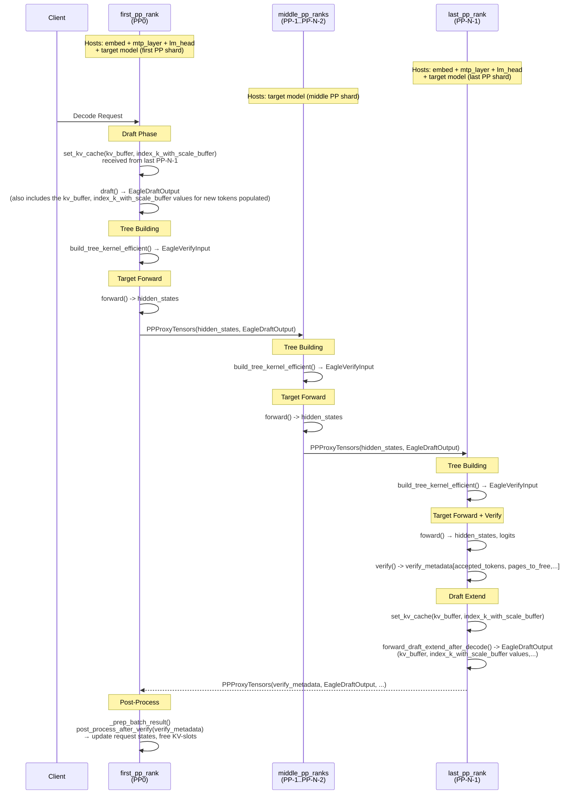

<!-- pack for RFC #23162 (sglang) — source material for the summary card -->
# RFC #23162: [RFC] GLM-5 Spec. Decode + PP in Disaggregation Decode Mode

| 字段 | 值 |
| --- | --- |
| 仓库 | sgl-project/sglang |
| 编号 | [#23162](https://github.com/sgl-project/sglang/issues/23162) |
| 作者 | MMuzzammil1 |
| 创建日期 | 2026-04-19 |
| 状态 | ⚪ closed (2026-06-24) |
| labels | (none) |
| 热度 | 👍 4 · 💬 4 |
| 分类 | Disaggregated Serving |

## 正文(PRD / 提案全文)

### Checklist

- [x] If this is not a feature request but a general question, please start a discussion at https://github.com/sgl-project/sglang/discussions. Otherwise, it will be closed.
- [x] Please use English. Otherwise, it will be closed.

### Motivation

I'd briefly share my plan of action on how we can support Speculative Decoding + PP in Disagg Decode Mode. Feel free to drop your comments/suggestions.

## Model Weights Layout 
- The speculative model weights will be duplicated loaded on `first_pp_rank` and `last_pp_rank`:
  - This implies duplicate `lm_head` on the `first_pp_rank` and duplicate `embed` on the `last_pp_rank`. 
- The target model weights will be set-up in the regular PP setting.

## Flow
- Draft Phase would happen on the `first_pp_rank` -> `draft_tokens`, `scores` would be sent to each PP-rank via the `PPProxyTensors` already implemented.
- Each individual PP-rank would materialize `build_tree_kernel_efficient()` to get `EagleVerifyInput`.
- The last PP-rank would run the `verify()` to get the `accepted_tokens` -> `verify_metadata` sent to the `first_pp_rank`.
- The last PP-rank would also run `forward_draft_extend_after_decode()`.
- `_prep_batch_result` would run the `post_process_after_verify(verify_metadata)` to update request states (finished/unfinished) and free unused KV-slots on the first PP-rank.
- `verify_metadata` would then be passed along to PP-1..PP-2 and so on for request state adjustment on each PP-rank.

## Diagram
## Speculative Decoding + Pipeline Parallelism in Disagg Decode Mode (Flow of a Microbatch)

## Target Worker
- I plan to extend `EagleWorker` module for this support (since PP doesn't support overlap mode anyways so there's no point working with `EagleWorker2`.

## Concerns
- On why mtp layer needs to be loaded on both first and last PP ranks: 
  - For the target model to verify, we need drafted token  outputs before the target forward run -> need to obtain the draft tokens on the first PP rank itself.
  - `batch` can get modified when we get the `get_next_disagg_decode_batch_to_run()` on first PP rank. Both `draft()` and `draft_extend_after_decode()` need to run on the same `batch`, one before target model forward, other afterwards. 
- Since `draft()` happens on first PP-rank and the `draft_extend_after_decode()` happens on last PP-rank, there is a necessity to pass `incremental KV values` across PP-ranks -> Need some feedback on the feasibility of doing this.
- Performance: Would an implementation like this be performant or not. Need some feedback on this as well.

### Related resources

Relevant Files: 
- `python/sglang/srt/speculative/eagle_worker.py`
- `python/sglang/srt/managers/scheduler_pp_mixin.py`
- `python/sglang/srt/models/deepseek_nextn.py`, `python/sglang/srt/models/deepseek_v2.py` (`GLMMoeDsaForCausalLM`'s base class)
