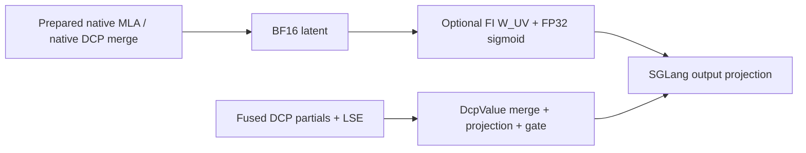

<!-- pack for RFC #49536 (sglang) — source material for the summary card -->
# RFC #49536: [RFC] Kimi K3 decode: FlashInfer reuse and integration scope

| 字段 | 值 |
| --- | --- |
| 仓库 | sgl-project/sglang |
| 编号 | [#49536](https://github.com/sgl-project/sglang/issues/49536) |
| 作者 | YaoleWu |
| 创建日期 | 2026-11-10 |
| 状态 | 🟢 open  |
| labels | (none) |
| 热度 | 👍 0 · 💬 1 |
| 分类 | Attention / Kernel |

## 正文(PRD / 提案全文)

## Motivation

Kimi K3 serving mixes long prefills and cache restoration with repeated decode steps. For single-node B300/SM103, TP8, no-speculation serving, we want to reduce decode latency while preserving KV capacity, recurrent-state ownership, HiCache behavior and public API contracts.

An existing candidate brings an opt-in, prepared 93-layer executor with DCP1/DCP8 profiles into SGLang. Before asking maintainers to carry that model-specific implementation, this RFC asks **what is the smallest useful integration to maintain now that FlashInfer supplies a reusable primitive?** The candidate and broader serving context are recorded in [#48510](https://github.com/sgl-project/sglang/pull/48510) and [#48626](https://github.com/sgl-project/sglang/issues/48626).

I suggest qualifying primitive reuse in an existing SGLang consumer first, and landing lifecycle/correctness changes separately where they fix an existing affected path. The full executor would remain a candidate until matched whole-model results and an ownership/CI plan justify it. The proposed integration would be opt-in and use existing engine interfaces.

## Existing FlashInfer work

The starting point is yyihuang's merged MLA value-projection and gate primitive, request-length load update, and automatic program selection. yyihuang also authored the initial SGLang adapter incorporated into #48510. The reuse discussion was closed with the `completed` state. The original `MlaValue` implementation is Lee Nau's work, and its source notices remain in the candidate. See [FI #8867](https://github.com/flashinfer-ai/flashinfer/pull/8867), [#8904](https://github.com/flashinfer-ai/flashinfer/pull/8904), [#8917](https://github.com/flashinfer-ai/flashinfer/pull/8917), [discussion #8795](https://github.com/flashinfer-ai/flashinfer/issues/8795), and [sgl-nvidia-mega #17](https://github.com/sgl-project/sgl-nvidia-mega/pull/17).

The shipped `flashinfer.cake_mla_value_gate` contract supplies:

- BF16 latent values and BF16 W_UV with a contiguous latent axis, plus a strided BF16 gate within the API's layout restrictions.
- BF16-rounded value projection multiplied by an **unrounded FP32 sigmoid**, then BF16 output. Rows with request length <= 0 produce zero, including padded rows with invalid gate contents.
- Preparation that binds W_UV outside graph capture, and launches on the current stream with changed-input graph replay. Replacing bound weight storage requires a new preparation.
- Library-owned automatic 8-row/16-row program selection. Consumer evaluation should include the actual PDL predecessor and complete call timing before considering another variant.

The candidate adapter's coverage is:

| Execution path in #48510 | Optional FI value gate |
| --- | --- |
| Prepared executor, DCP1 | Used at `MlaValue` sites |
| `k3_native_mla`, DCP1 or DCP8 | Used after native attention/DCP merge |
| `k3_full_decode`, fused DCP8 | Retains `DcpValue`, which performs distributed merge, projection and gate |
| Ordinary native model forward | Proposed integration below |

Fused distributed `DcpValue` reuse would need a separate library/engine design. The inspected candidate revision `a4f5b36a` pins FI 0.7.2, which lacks the experimental module, and retains `MlaValue` on that build. A build shipping the module needs matching FI Python, cubin and JIT-cache packages.

The diagram shows the candidate's existing boundary. Extending the upper path to the ordinary native model is the first option for discussion.

## Integration choices

| Choice | Benefit | Maintenance and remaining work |
| --- | --- | --- |
| Incremental FI reuse in the native model | Retains existing scheduling, attention and cache/restore paths | A complete K3 consumer call site, explicit numerical policy, and native graph/weight-lifetime qualification |
| Current opt-in prepared executor | Coordinates embedding, MLA/KDA, projections, MoE and AttnRes across prepared decode widths | Model-specific code, workspace/weight binding, distributed waits, fallback and restore obligations, and whole-model qualification |
| Vendor kernels in an external plugin | Separates kernel release cadence from SGLang | An agreed engine interface, owner, pinned release/API contract and matching GPU CI, including DCP/HiCache obligations |

### Native consumer

The inspected main revision already has `project_mla_values(attn_output, zero_allocator)` after the native DCP merge. K3 computes its output gate later, in the `o_proj` wrapper. The projection hook currently lacks the ready gate and valid-row/request metadata required by FI. LoRA corrections can also occur between projection and gating. The existing hook and gate wrapper are visible in the [native projection code](https://github.com/sgl-project/sglang/blob/533c06768925b7758fffc809f0f0d4c3d830f5e0/python/sglang/srt/models/deepseek_common/attention_forward_methods/forward_mla.py) and [K3 implementation](https://github.com/sgl-project/sglang/blob/533c06768925b7758fffc809f0f0d4c3d830f5e0/python/sglang/srt/models/kimi_k3.py).

For maintainer discussion, a first native slice could reuse that hook or add a narrowly scoped K3 call site, supply those inputs, and consume the gate once. It would preserve the gate side-stream join, capture, padding and output projection. I propose starting with the advertised BF16 decode geometry and DCP1, retaining the original native path for unsupported cases. LoRA/correction paths would stay on the original implementation until their operation order is supported. Native post-merge DCP8 would follow with consumer validation.

The precision policy needs agreement first. The native BF16 gate preserves an intermediate BF16 sigmoid rounding, whereas FI currently exposes only `sigmoid_precision="fp32"`. Its bitwise agreement with `MlaValue` covers the prepared implementation's contract. A native opt-in would need its own declared and validated numerical contract. Requiring native-rounding compatibility would introduce a separate FI API dependency.

### Execution framework

The established monokernel RFC proposes an in-tree framework with out-of-tree vendor implementations. It records landed framework work, future CUDA plugins, and the question of moving a stable plugin in-tree. K3's placement decision should build on that discussion. See [#43949](https://github.com/sgl-project/sglang/issues/43949).

#48510 already uses `MegakernelSpec` and ModelRunner installation. Resources are prepared before KV sizing. Weight views bind after backend setup and before capture, and routing decisions remain fixed for captured buckets. Prefill, eager warmup and unprepared widths use the original model. Errors during a routed execution propagate.

The monokernel RFC's current contract refuses context parallelism and KV offload, and binds caches under a different lifetime. K3 DCP8/HiCache needs typed MLA/recurrent-state views, owner-local write slots, global/local lengths, native MLA/DCP callbacks, live per-layer restore joins and replay storage checks. The candidate provides these through `MegakernelBinding`/`HybridStepView`. Plugin packaging would require agreement on which existing interfaces become supported. A native operator slice can continue using the native path's restore getters.

SGLang would retain scheduling, cache allocation, recurrent state, restoration, sampling and API ownership. The prepared executor currently refuses online weight updates because native K3 reload fixes do not refresh its additional captured/derived resources. The relevant native reload work is [#43675](https://github.com/sgl-project/sglang/pull/43675).

## Proposed landing sequence

1. **Consumer-complete primitive reuse, subject to maintainer agreement.** A guarded native K3 call site would land with the FI facade/preparation lifetime it consumes, numerical policy, fallback, and eager/changed-input graph checks. The existing prepared adapter supplies a reference while that native slice is implemented and qualified.
2. **Independently useful fixes.** A lifecycle or correctness repair could land separately when an existing consumer is affected, with a regression and duplicate check against main. Candidate-specific hooks would stay with their consuming candidate.
3. **Full executor decision.** Keep #48510 as the candidate while collecting the model evidence below and agreeing long-term ownership, placement and CI/release responsibilities. Its advertised TP8/DCP1/DCP8 support remains subject to that acceptance.

## Evidence and acceptance

| Available evidence | Scope |
| --- | --- |
| yyihuang's upstream GPU numerical/layout/current-stream/graph tests and timings | FI component behavior and operator performance |
| B300/SM103 FI `f454a17f` + SGLang source-package checks | Real registry/preparation, recovery after a native load failure, and bitwise CuTe `MlaValue`/FI agreement at B1/q1, B25/q1 and B64/q2 in eager and changed-input graph replay |
| Candidate host/ownership regressions | Specific initialization, admission, binding and restore contracts, including dependency-isolated checks |

Remaining qualification includes coherent installed FI wheel-trio compatibility, the complete PreparedMla/model consumer, current-head TP8/DCP1/DCP8 model quality and native HiCache host/store transfers/restoration. The in-tree AttnRes consumers now pass the scoped SM103 eager/graph fixture. The [November 10 consumer follow-up](https://github.com/sgl-project/sglang/issues/49536#issuecomment-6765773450) records the actual native/FI segment, measured BF16/FP32 differences, complete-segment timings, and the official 0.7.3 package-content gap. Historical approximately 11% integrated-build/profile measurements predate later fixes and provide background rather than current acceptance.

The architecture comparison should include **native baseline**, **native + FI once implemented**, and **prepared executor**, with FI off/on isolated where applicable. Hold checkpoint/tokenizer, dependencies, configuration, inputs and prefix reuse, thinking mode, output/termination policy, concurrency, graph coverage, topology and memory budget fixed. Include cold/warm and restoration cases. Report TTFT, decode latency/throughput, peak memory, retained KV capacity, numerical drift and representative task outputs. Compare drift with stock-run variability, repeat representative points, and verify restoration ownership/progress as well as outputs. Measure long-context behavior separately from the configured 1M admission limit. This would cover the advertised single-node SM103 TP8 no-speculation workload.

## Decisions requested

1. Is native consumer-level primitive reuse the preferred first landing, or should K3 first be qualified through the existing prepared/plugin path? Which concrete call-site change is acceptable?
2. Is FI's FP32 sigmoid contract acceptable as an explicit opt-in for the native path, or is native BF16-rounding compatibility required first?
3. If the full executor remains worthwhile, should it live in-tree or behind the established vendor-plugin architecture, and who owns the engine interface, release pins and matching GPU CI?
4. What minimum matched model/restore/capacity evidence would justify the full executor's maintenance cost?

#48510 would stay open as the candidate while maintainers decide the first useful slice on top of the completed FI implementation work.
