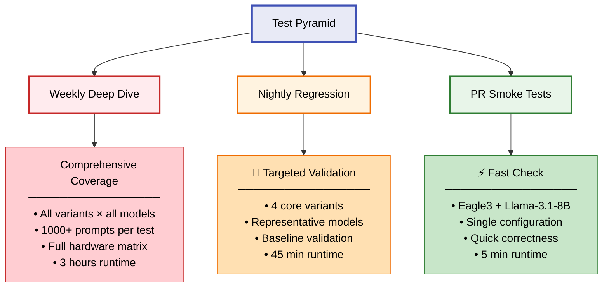

<!-- pack for RFC #28135 (vllm) — source material for the summary card -->
# RFC #28135: [RFC]: Robust End-to-End CI/CD Regression Testing for Speculative Decoding

| 字段 | 值 |
| --- | --- |
| 仓库 | vllm-project/vllm |
| 编号 | [#28135](https://github.com/vllm-project/vllm/issues/28135) |
| 作者 | rahul-tuli |
| 创建日期 | 2025-11-05 |
| 状态 | ⚪ closed (2026-03-11) |
| labels | RFC, stale |
| 热度 | 👍 6 · 💬 11 |
| 分类 | Speculative Decoding |

## 正文(PRD / 提案全文)

### Motivation.

## Executive Summary

Proposes regression testing for speculative decoding in vLLM, starting with Eagle3 and expanding to all variants.

**Objectives:**
- Prevent regressions in acceptance rates and speedup
- Detect performance degradation in CI
- Validate correctness across variants
- Manage CI costs

**Impact:**
- Detect regressions in hours vs. days
- Provide performance baselines

---

## Table of Contents

1. [Background and Motivation](#background-and-motivation)
2. [Current State Analysis](#current-state-analysis)
3. [Proposal Overview](#proposal-overview)
4. [Design Details](#design-details)
5. [Phased Implementation](#phased-implementation)
6. [CI Resource Management](#ci-resource-management)
7. [Benchmarking Strategy](#benchmarking-strategy)
8. [Future Expansion](#future-expansion)
9. [Open Questions](#open-questions)
10. [References](#references)
11. [Call to Action](#call-to-action)

---

## Background and Motivation

Speculative decoding improves LLM latency 2-3x by using a draft model to predict tokens ahead, verified in parallel. vLLM supports n-gram, EAGLE/Eagle3, Medusa, and MTP variants.

**Problem:** Small code changes can break acceptance rates and speedup without failing correctness tests.

**Current Gaps:**
1. No acceptance rate tracking in `tests/v1/e2e/test_spec_decode.py` (only 66-80% match thresholds)
2. Nightly benchmarks lack baselines and alerts
3. Incomplete coverage for MTP variants
4. No documented performance expectations per variant

---

## Current State Analysis

### Existing Test Infrastructure

#### 1. Correctness Tests
**Location:** `tests/v1/e2e/test_spec_decode.py`

**Current Coverage:**
- **N-gram**: Basic correctness test with 100 mixed prompts (66% match threshold)
- **EAGLE**: Multiple model variants tested (Llama-3.1-8B, Llama-4-Scout-17B-16E, DeepSeek)
- **Eagle3**: Qwen3-8B, Llama-3.1-8B variants
- **MTP**: MiMo-7B, DeepSeek-V3 (80% match threshold)

**Test Pattern:**
```python
# Reference implementation
ref_llm = LLM(model=model_name, max_model_len=2048)
ref_outputs = ref_llm.chat(test_prompts, sampling_config)

# Speculative implementation
spec_llm = LLM(
    model=model_name,
    speculative_config={
        "method": method,
        "model": spec_model_name,
        "num_speculative_tokens": 3,
    },
    max_model_len=2048,
)
spec_outputs = spec_llm.chat(test_prompts, sampling_config)

# Heuristic validation
matches = sum(ref.outputs[0].text == spec.outputs[0].text
              for ref, spec in zip(ref_outputs, spec_outputs))
assert matches >= int(0.66 * len(ref_outputs))  # 66% threshold
```

**Limitations:**
- Match rate threshold is arbitrary and doesn't track temporal trends
- No measurement of acceptance rate or actual speedup
- Tests run with limited prompt diversity
- No multimodal coverage for most variants
- Thresholds not scientifically derived

#### 2. Buildkite CI Integration
**Location:** `.buildkite/test-pipeline.yaml:307`

**Current Configuration:**
```yaml
- label: V1 Speculative Decoding Test (Integration)
  commands:
    - pytest -v -s v1/spec_decode
```

**Example Offline Tests (line 362-364):**
```bash
python3 offline_inference/spec_decode.py --test \
  --method eagle --num_spec_tokens 3 \
  --dataset-name hf --dataset-path philschmid/mt-bench \
  --num-prompts 80 --temp 0 --top-p 1.0 --top-k -1 \
  --tp 1 --enable-chunked-prefill --max-model-len 2048
```

**Limitations:**
- Not part of `fast_check` CI (only runs on full CI)
- No performance metrics collected
- No trend analysis or regression detection
- Tests don't fail on performance degradation

#### 3. Benchmarking Infrastructure
**Location:** `benchmarks/benchmark_ngram_proposer.py`

**Capabilities:**
- Microbenchmark for n-gram proposal latency
- Parameterized testing across different n-gram sizes
- Timing collection and statistical analysis

**Nightly Benchmarks:**
**Location:** `.buildkite/nightly-benchmarks/tests/serving-tests.json:57`

```json
{
  "test_name": "serving_llama70B_tp4_sharegpt_specdecode",
  "qps_list": [2],
  "server_parameters": {
    "model": "meta-llama/Meta-Llama-3-70B-Instruct",
    "tensor_parallel_size": 4,
    "speculative_config": {
      "model": "ibm-fms/llama3-70b-accelerator",
      "num_speculative_tokens": 4,
    }
  }
}
```

**Limitations:**
- Only covers one speculative decoding scenario
- No Eagle3-specific benchmarks
- Results published to PyTorch Performance Dashboard but no automated regression detection
- No acceptance rate or speedup tracking

#### 4. Example Scripts
**Location:** `examples/offline_inference/spec_decode.py`

**Features:**
- Comprehensive CLI for testing different methods
- Support for multimodal prompts
- Configurable sampling parameters
- Metrics collection (`vllm.v1.metrics.reader`)

**Gap:** Examples are manual tools, not integrated into automated testing

### What's Missing

1. **Regression Tracking Infrastructure**
   - No historical baseline storage
   - No automated comparison against baselines
   - No alerting on degradation

2. **Quality Metrics**
   - Acceptance rate not systematically measured
   - Speedup not validated
   - Draft model utilization not tracked

3. **Comprehensive Coverage**
   - MTP variants lack dedicated tests
   - Multimodal speculative decoding undertested
   - Tensor parallelism edge cases not covered
   - Different hardware platforms (AMD, Intel) not systematically tested

4. **Performance Regression Detection**
   - No automated detection of latency increases
   - No throughput regression tracking
   - No memory usage monitoring

5. **Documentation**
   - No documented expected baselines
   - No guidance on acceptable performance ranges
   - No troubleshooting guides for failures

---

## Proposal Overview

### Core Principles

1. Multi-layered testing: smoke (PR), nightly, weekly
2. Empirical baselines for each variant
3. Progressive rollout: Eagle3 → EAGLE/n-gram → MTP variants

### Proposed Test Taxonomy



### Success Criteria

Per-variant thresholds:
1. Match rate ≥ baseline
2. Acceptance rate within ±10%
3. TTFT/TPOT within ±15%
4. No crashes/OOMs

---

## Design Details

### Test Architecture Overview

Three test categories: correctness, quality, performance. All validate against baselines.

**Note:** Metrics collection/dashboards/alerting infrastructure TBD (see Open Questions).

### 1. Correctness Tests

**Purpose:** Verify speculative = non-speculative outputs.

**Test Pattern:**
```
FOR each variant + model:
  prompts = generate_test_prompts(100, diverse_categories)
  ref_outputs = run_inference(speculative: disabled)
  spec_outputs = run_inference(speculative: enabled)
  match_rate = calculate_match_rate(ref_outputs, spec_outputs)

  baseline = load_baseline(variant, model)
  IF match_rate < baseline.expected - baseline.tolerance:
    FAIL
```

**Note:** Match rate < 100% is acceptable due to sampling variance.

### 2. Quality Regression Tests

**Purpose:** Track acceptance rate and draft efficiency.

**Test Pattern:**
```
FOR each variant + model:
  results = run_inference_with_metrics(prompts, variant)
  metrics = {
    acceptance_rate: accepted / proposed,
    avg_drafts_per_step: total_drafts / steps
  }

  baseline = load_baseline(variant, model)
  FOR each metric:
    IF metric NOT within baseline.tolerance:
      FAIL
```

**Thresholds:** Acceptance rate 60-80% (±10%).

### 3. Performance Regression Tests

**Purpose:** Monitor TTFT, TPOT, end-to-end latency.

**Test Pattern:**
```
FOR each variant + model + hardware:
  latency_results = benchmark_latency(prompts, variant, hardware)
  metrics = {
    ttft_p50, ttft_p99,
    tpot_p50, tpot_p99,
    e2e_latency_p50
  }

  baseline = load_baseline(variant, model, hardware)
  FOR each metric:
    IF metric > baseline.expected + baseline.tolerance:
      FAIL
```

**Note:** Use percentiles (p50, p99), hardware-specific baselines, ±15% tolerance.

### 4. Baseline Management

**Requirements:**
- Version controlled (easy PR review)
- Human readable (JSON/YAML/TOML)
- Per variant + model + hardware

**Example Baseline:**
```json
{
  "variant": "eagle3",
  "model": "meta-llama/Llama-3.1-8B-Instruct",
  "draft_model": "yuhuili/EAGLE3-LLaMA3.1-Instruct-8B",
  "hardware": "L4",
  "metrics": {
    "match_rate": {"expected": 0.75, "tolerance_pct": 10},
    "acceptance_rate": {"expected": 0.73, "tolerance_pct": 10},
    "ttft_p50_ms": {"expected": 44.0, "tolerance_pct": 15}
  }
}
```

**Validation:**
```
FOR each metric:
  tolerance = expected * (tolerance_pct / 100)
  IF actual < expected - tolerance OR actual > expected + tolerance:
    FAIL
```

**Update Process:** PR review required. Updates for intentional changes only, not regressions.

**TBD:** Storage format, directory structure, approval process (see Open Questions).

---

## Phased Implementation

### Phase 0: Foundation

**Deliverables:**
1. Test infrastructure + baseline storage
2. Eagle3 baseline (Llama-3.1-8B, 10-20 runs)
3. One working regression test
4. Test markers, optional nightly CI

**Success:** Eagle3 baseline established, one test passing, documented, extensible.

---

### Phase 1: Eagle3 Comprehensive Coverage

**Deliverables:**
1. Correctness, quality, performance tests for Eagle3
2. Baselines for 3+ models (Llama-3.1-8B, Qwen3-8B, optionally larger)
3. Nightly CI integration + alerting
4. Documentation

**Success:** 3+ models tested, nightly tests running, documented.

---

### Phase 2: Expand to Core Variants

**Deliverables:**
1. EAGLE tests + baselines (2-3 models)
2. N-gram tests + baselines
3. Optional: Medusa tests
4. Optional: Cross-variant analysis

**Success:** 3-4 variants tested, integrated into nightly CI.

---

### Phase 3: MTP Variants and Advanced Scenarios

**Deliverables:**
1. 2-3 MTP variants (DeepSeek MTP, MiMo MTP)
2. Advanced scenarios: multimodal, long context, multi-GPU, or alt hardware
3. Integration with existing benchmarks

**Success:** 2+ MTP variants tested, 1+ advanced scenario validated.

---

### Phase 4: Optimization and Operationalization

**Deliverables:**
1. Performance optimization (parallelization, caching, remove redundant tests)
2. Reliability improvements (reduce false positives, retry logic, better diagnostics)
4. Feedback loop and threshold tuning

**Success:** <10% false positives, <15min nightly runtime, docs complete.

---

## CI Resource Management

### Resource Usage

**Test Tiers:**

| Test Tier | Frequency | Variants | Models | GPU | Duration |
|-----------|-----------|----------|--------|-----|----------|
| PR Smoke | Per PR | 1 (Eagle3) | 1 | L4 | 5 min |
| Nightly | Daily | 4 | 3 | L4 + A100 | 45 min |
| Weekly Deep Dive | Weekly | 10 | 5 | L4 + A100 + H100 | 3 hours |

### Optimization Strategies

1. **Smart Triggering**
   - Only run spec decode tests when relevant files change:
     ```yaml
     source_file_dependencies:
       - vllm/v1/spec_decode/
       - vllm/model_executor/models/*eagle*.py
       - vllm/model_executor/models/*medusa*.py
       - vllm/config/speculative.py
       - tests/v1/regression/spec_decode/
     ```

2. **Test Sharding**
   - Parallelize test execution across multiple workers
   - Use Buildkite parallelism feature:
     ```yaml
     - label: "Spec Decode Regression (Eagle3)"
       parallelism: 3
       command: pytest -v -s v1/regression/spec_decode/test_eagle3.py::shard_${BUILDKITE_PARALLEL_JOB}
     ```

3. **Progressive Coverage**
   - Start with 1-2 variants, expand gradually
   - Prioritize high-value tests (most frequently used variants)

4. **Test Result Caching**
   - Skip tests if commit doesn't touch relevant code paths
   - Cache test results for unchanged code

**Resource Allocation:**

```yaml
# .buildkite/test-pipeline.yaml additions

- label: "🦅 Spec Decode Smoke Test (Eagle3)"
  fast_check: true  # Run on all PRs
  timeout_in_minutes: 10
  gpu: "l4"  # Cheapest GPU
  source_file_dependencies:
    - vllm/v1/spec_decode/
    - vllm/model_executor/models/llama_eagle3.py
    - vllm/config/speculative.py
    - tests/v1/regression/spec_decode/
  commands:
    - pytest -v -s tests/v1/regression/spec_decode/test_eagle3_smoke.py

- label: "🦅 Spec Decode Nightly Regression"
  # Only on nightly schedule, not per-PR
  schedule: "0 2 * * *"  # 2 AM daily
  timeout_in_minutes: 60
  gpu: "a100"
  num_gpus: 1
  parallelism: 4  # Shard across 4 workers
  commands:
    - pytest -v -s tests/v1/regression/spec_decode/ --shard-id=${BUILDKITE_PARALLEL_JOB} --num-shards=${BUILDKITE_PARALLEL_JOB_COUNT}
  artifact_paths:
    - "test_results/*.json"  # Upload metrics
  notify:
    - slack: "#vllm-ci-alerts"
      if: build.state == "failed"

- label: "🦅 Spec Decode Weekly Deep Dive"
  schedule: "0 4 * * 0"  # Sunday 4 AM
  timeout_in_minutes: 240
  gpu: "a100"
  num_gpus: 4
  commands:
    - pytest -v -s tests/v1/regression/spec_decode/ --comprehensive --all-variants
  artifact_paths:
    - "test_results/*.json"
    - "benchmark_results/*.json"
```

---

## Benchmarking Strategy

### Integration with Existing Infrastructure

vLLM already has robust benchmarking infrastructure:
- `benchmarks/benchmark_serving.py` for online serving
- `benchmarks/benchmark_throughput.py` for offline throughput
- `benchmarks/benchmark_latency.py` for latency profiling
- `.buildkite/nightly-benchmarks/` for continuous benchmarking

**Proposal:** Extend existing benchmarks with speculative decoding focus

### Benchmark Suite

#### 1. Latency Benchmarks

**Script:** `benchmarks/benchmark_spec_decode_latency.py` (new)

```python
"""
Benchmark speculative decoding latency metrics.

Measures:
- TTFT (Time to First Token)
- TPOT (Time per Output Token)
- E2E Latency
- Per-step latency breakdown

Usage:
    python benchmarks/benchmark_spec_decode_latency.py \
        --method eagle3 \
        --model meta-llama/Llama-3.1-8B-Instruct \
        --draft-model yuhuili/EAGLE3-LLaMA3.1-Instruct-8B \
        --num-prompts 100 \
        --dataset sharegpt
"""
```

**Metrics:**
- TTFT p50, p95, p99
- TPOT p50, p95, p99
- E2E latency distribution
- Latency overhead vs non-speculative baseline

#### 2. Throughput Benchmarks

**Script:** Extend `benchmarks/benchmark_throughput.py`

**Additions:**
- Compare throughput with/without speculative decoding
- Measure throughput degradation at different batch sizes
- Identify optimal batch size for speculative decoding

#### 3. Quality Benchmarks

**Script:** `benchmarks/benchmark_spec_decode_quality.py` (new)

**Metrics:**
- Acceptance rate across different prompt types
- Average drafts per step
- Draft efficiency (accepted tokens / proposed tokens)
- Speedup ratio vs non-speculative

#### 4. Serving Benchmarks

**Integration:** Extend `.buildkite/nightly-benchmarks/tests/serving-tests.json`

**Current Coverage:**
```json
{
  "test_name": "serving_llama70B_tp4_sharegpt_specdecode",
  "qps_list": [2],
  ...
}
```

**Proposed Expansion:**
```json
[
  {
    "test_name": "serving_llama8B_eagle3_sharegpt",
    "qps_list": [1, 2, 5, 10],
    "server_parameters": {
      "model": "meta-llama/Llama-3.1-8B-Instruct",
      "tensor_parallel_size": 1,
      "speculative_config": {
        "method": "eagle3",
        "model": "yuhuili/EAGLE3-LLaMA3.1-Instruct-8B",
        "num_speculative_tokens": 5
      }
    }
  },
  {
    "test_name": "serving_qwen8B_eagle3_mt_bench",
    "qps_list": [1, 2, 5],
    "server_parameters": {
      "model": "Qwen/Qwen3-8B",
      "tensor_parallel_size": 1,
      "speculative_config": {
        "method": "eagle3",
        "model": "AngelSlim/Qwen3-8B_eagle3",
        "num_speculative_tokens": 5
      }
    }
  },
  {
    "test_name": "serving_llama8B_ngram_sharegpt",
    "qps_list": [1, 5, 10],
    "server_parameters": {
      "model": "meta-llama/Llama-3.1-8B-Instruct",
      "speculative_config": {
        "method": "ngram",
        "num_speculative_tokens": 5,
        "prompt_lookup_max": 5
      }
    }
  }
]
```

### Baseline Tracking

**Note:** Uses the same simplified baseline format as regression tests (see section 4).

**Storage:** JSON files in `tests/v1/regression/baselines/`

**Example:** `eagle3_llama3.1_8b_benchmark.json`
```json
{
  "variant": "eagle3",
  "model": "meta-llama/Llama-3.1-8B-Instruct",
  "draft_model": "yuhuili/EAGLE3-LLaMA3.1-Instruct-8B",
  "gpu_type": "L4",
  "dataset": "sharegpt",
  "baselines": {
    "ttft_p50_ms": {
      "expected": 44.0,
      "tolerance_pct": 15
    },
    "tpot_p50_ms": {
      "expected": 12.3,
      "tolerance_pct": 15
    },
    "acceptance_rate": {
      "expected": 0.73,
      "tolerance_pct": 10
    },
    "speedup": {
      "expected": 2.1,
      "tolerance_pct": 15
    }
  },
  "last_updated": "2025-11-05",
  "baseline_commit": "3481e4074",
  "notes": "Baseline from 10 benchmark runs on L4 GPU"
}
```

### Metrics Collection and Reporting

**Purpose:** Track regression test results over time to identify trends and provide visibility.

**Open Questions for Discussion:**

1. **Metrics Storage:**
   - Where to store test run results? (CI artifacts, S3/GCS, time-series DB)
   - How long to retain historical data?
   - Should metrics be queryable? If so, what infrastructure?

2. **Visualization and Dashboards:**
   - Do we need real-time dashboards? (e.g., Grafana, custom web UI)
   - Or is static reporting sufficient? (HTML reports, markdown summaries)

**Minimal Requirements:**

At minimum, the testing infrastructure should:
- Export test results as structured data (JSON, CSV, etc.)
- Provide clear pass/fail status for CI integration
- Generate human-readable summaries of test runs
- Store results as CI artifacts for debugging

**Optional Enhancements:**

If resources and infrastructure permit:
- Historical trend visualization (acceptance rate over time, latency trends)
- Comparative analysis (variant A vs variant B performance)
- Automated regression bisection (identify which commit introduced regression)
- Performance dashboards for community visibility

**Example Minimal Report (Text Output):**
```
Speculative Decoding Regression Test Summary
============================================
Date: 2025-11-05 | Commit: 3481e4074

Overall: ✓ PASSED (4/4 variants passing)

Eagle3 - Llama-3.1-8B-Instruct: ✓ PASS
  acceptance_rate: 0.742 [0.657-0.803] ✓
  speedup: 2.15x [1.79-2.42] ✓

EAGLE - Llama-3.1-8B-Instruct: ✓ PASS
  acceptance_rate: 0.681 [0.594-0.726] ✓
  speedup: 1.89x [1.53-2.07] ✓

N-gram - Llama-3.1-8B-Instruct: ✓ PASS
  match_rate: 0.78 [0.66-0.86] ✓

MTP - MiMo-7B: ✓ PASS
  acceptance_rate: 0.812 [0.72-0.88] ✓
```

---

## Future Expansion

### 1. Hardware Diversity

**Current Focus:** NVIDIA L4, A100, H100

**Implementation:**
- Add hardware-specific baselines
- Validate performance characteristics per hardware
- Detect hardware-specific regressions

### 2. Multi-Modal Speculative Decoding

Current tests have limited multimodal coverage. Future expansion:
- Vision + text speculative decoding
- Audio + text specula

<!-- ...body truncated at 20k chars... -->
