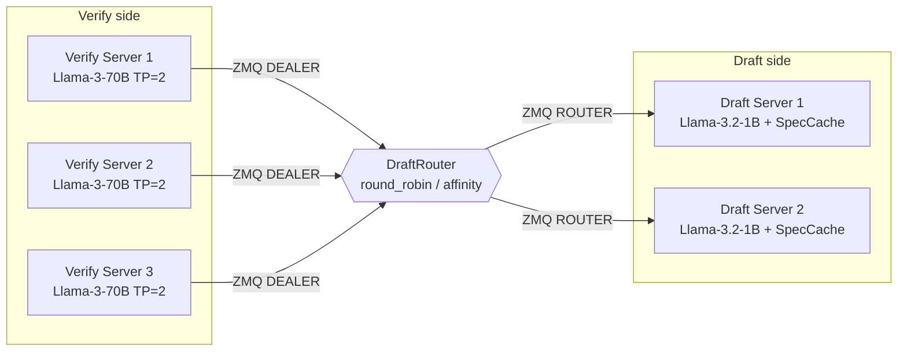
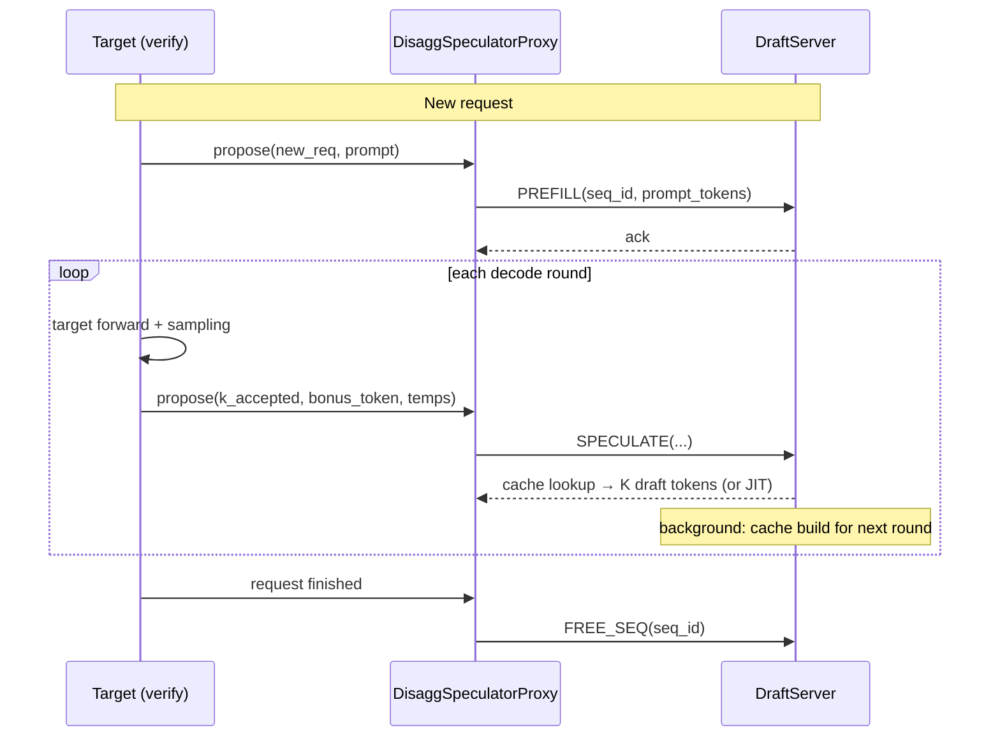
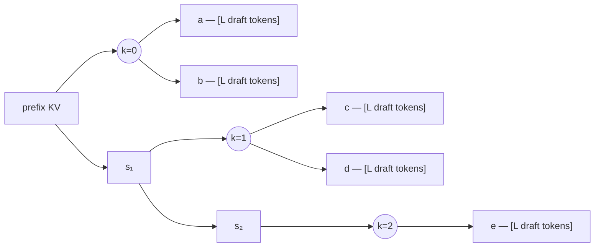

<!-- pack for RFC #42109 (vllm) — source material for the summary card -->
# RFC #42109: [RFC]: Disaggregated Speculative Decoding with Standalone Parallel Draft Model

| 字段 | 值 |
| --- | --- |
| 仓库 | vllm-project/vllm |
| 编号 | [#42109](https://github.com/vllm-project/vllm/issues/42109) |
| 作者 | laviier |
| 创建日期 | 2026-05-08 |
| 状态 | 🟢 open  |
| labels | RFC, stale |
| 热度 | 👍 3 · 💬 5 |
| 分类 | Speculative Decoding |

## 正文(PRD / 提案全文)

### Motivation.

Speculative decoding in vLLM today co-locates the draft model with the target: the draft runs on the target's TP group, competes for the same SMs / HBM bandwidth, and is driven by the target's scheduler. This is efficient for small draft models (EAGLE, MTP), but has two structural limits:
1. **Draft compute steals from target compute.** On a TP=2 Llama-3-70B target at high concurrency, a 1B–8B draft can add 10–30% to per-step latency on the target GPUs even when the draft itself is idle-compute-bound, because it shares the forward-pass critical path.
2. **Cache-build parallelism is capped by the target's schedule.** Any "predict what the target will verify next round" caching scheme has to complete between target steps — the draft cannot run ahead.

Disaggregated speculative decoding (**Disagg-SD**) moves the draft model to a dedicated GPU (or pool of GPUs) reached over a fast interconnect (ZMQ + shared host for same-node, RDMA for cross-node). The target sends a *verification outcome* after each step; the draft server returns *K draft tokens per request* from a **speculation cache** that was pre-built while the target was verifying the previous round. This gives:
- **Fully overlapped draft/target compute.** The target's latency is independent of draft work.
- **Pre-computed fan-outs.** The draft predicts the most likely verification outcomes `(k_accepted, bonus_token)` for the next round and has the K draft tokens ready before the target asks.
- **N:M scaling.** N verify servers can share M draft servers; each draft can run a larger model than the target's per-step budget allows.

We have an internal POC of Disagg-SD on vLLM (integrated via ZMQ, standalone `draft_server` process, `SpeculationCache` with geometric fan-out, per-VS dedicated KV blocks). It is functional end-to-end at N:M=3:2 on Llama-3.1-70B (verify) + Llama-3.2-1B (draft), and we have latency/throughput benchmarks showing ~1.4× TPOT improvement vs co-located spec decode at the same total GPU budget. 

The **bottleneck in the POC** is cache build: at K=6, N=56 branches, it's launch-bound (6 small kernels per round). We are working on a **standalone parallel draft model** (mask-token MTP-style) which can compute all fan-out branches in a single forward pass. Combined with Disagg-SD, this would push draft-side latency from `K × small_forward` to `1 × medium_forward`, unlocking higher N:M ratios and larger draft models without hurting target latency.

### Co-located vs disaggregated timeline illustration

```mermaid
gantt
    title Three consecutive decode rounds (time units, illustrative)
    dateFormat X
    axisFormat %s

    section Co-located (today)
    Target verify round N     :t1, 0, 10
    Draft speculate (K steps) :d1, after t1, 14
    Target verify round N+1   :t2, after d1, 10
    Draft speculate (K steps) :d2, after t2, 14
    Target verify round N+2   :t3, after d2, 10

    section Disagg-SD — target
    Target verify round N     :u1, 0, 10
    Target verify round N+1   :u2, after u1, 10
    Target verify round N+2   :u3, after u2, 10

    section Disagg-SD — draft
    Cache build for round N+1 :e1, 0, 14
    Cache build for round N+2 :e2, after e1, 14
```



Let `v` be a target verify step and `d` be a draft K-step forward. In the co-located path target and draft serialize on the same GPU: each round adds `v + d` to the critical path, so `R` rounds take `R·v + (R−1)·d`. Wall time per round asymptotically approaches `v + d`.

In Disagg-SD the draft runs on its own GPU. **Cache build for one round is typically longer than a single target verify (`d > v`)**, but it overlaps across multiple target rounds. Target verifies run back-to-back unblocked (`R·v` for `R` rounds); each `SPECULATE` response is served from the cache (a tensor lookup, negligible vs `v`). Wall time per round approaches `v`.

The asymptotic target-throughput speedup is `(v + d) / v = 1 + d/v`. Disagg-SD stops winning if cache build exceeds the time between consecutive `SPECULATE` calls (i.e. `d > v`, *and* no amount of pipelining can hide it — cache hits start missing and fall back to JIT). This sets the upper bound on draft model size / fan-out budget for a given target throughput. Another approach we are considering is parallel-draft cache build (fewer kernel launches → shorter `d` → higher ceiling on draft size).

### Proposed Change.

The change is in three parts: (1) a standalone draft server process, (2) verify-side integration as a drop-in speculator, (3) a speculation cache with geometric fan-out for hiding draft latency across rounds.

### N:M topology



Each `DisaggSpeculatorProxy` lives on TP rank 0 of its verify server and holds a `DraftRouter` with one `ZmqDraftConnector` per draft server. Each draft server partitions its `SpeculationCache` and dedicated KV blocks per verify-server ID so tenants do not thrash each other.

### 1. Standalone `DraftServer` process

A new process (`python -m vllm.v1.spec_decode.draft_server`) hosts a dedicated draft model on a GPU separate from the target's TP group. It:
- Binds a ZMQ `ROUTER` socket at a configurable address (default `tcp://*:50051`).
- Loads the draft model with its own `ModelRunner` (does not participate in the target's TP or scheduler).
- Handles three commands over ZMQ:
  - `PREFILL(seq_id, prompt_tokens)`: run prefill for a new request.
  - `SPECULATE(seq_id, k_accepted, bonus_token, temperatures)`: return K draft tokens using the speculation cache, falling back to JIT speculation on cache miss.
  - `FREE_SEQ(seq_id)`: release KV blocks when a request finishes.
- Maintains a `SpeculationCache` (tokens + logits + dedicated KV blocks) keyed by `(seq_id, k_accepted, bonus_token)`.
- Supports timeout-based eviction of dead verify-server sessions.

State is partitioned per verify server to prevent cross-tenant cache thrashing (internal seq IDs are remapped, dedicated KV blocks are reserved per-VS).

#### Per-round lifecycle



The response to `SPECULATE` is returned immediately from the cache (or JIT on miss); cache building for the *next* round happens after the response is sent, overlapping with the target's next verify step.

### 2. Verify-side integration: `DisaggSpeculatorProxy`

A proxy speculator on the verify side (replaces the in-process speculator when `disagg_draft_addresses` is set):
- Lives on TP rank 0 of the target's model runner. Other ranks short-circuit `propose()` and receive draft tokens via TP broadcast.
- Holds a `DraftRouter` with one `ZmqDraftConnector` per draft server. Routing policies: `round_robin` (default) and `affinity` (stable mapping by `hash(verify_server_id) mod num_drafts`).
- After each target step, sends `(seq_ids, k_accepted, bonus_tokens)` via ZMQ and blocks on the response with a configurable timeout (default 5s).
- Implements graceful degradation: marks unresponsive servers unavailable, returns zero-token drafts until reconnect succeeds, with periodic reconnect attempts.

New `SpeculativeConfig` fields:
```python
disagg_draft_addresses: list[str] | None = None
disagg_fan_out: int = 1  # per acceptance position (geometric allocation)
disagg_saguaro_c: float | None = None
disagg_jit_fallback: bool = True
disagg_draft_routing_policy: Literal["round_robin", "affinity"] = "round_robin"
disagg_draft_timeout_ms: int = 5000
disagg_draft_latency_warn_ms: float = 500.0
```

A single new predicate `use_disagg()` gates all Disagg-SD code paths. When unset, behavior is identical to mainline.

### 3. Speculation cache with geometric fan-out

For each in-flight request, the draft pre-builds `F_k` K-token branches per acceptance position `k ∈ [0, K]`. Each branch is rooted at a different `(k_accepted, bonus_candidate)` — the top-`F_k` bonus candidates from the previous round's draft logits. Budget is allocated geometrically per SSD Theorem 12 (acceptance probability decreases with k, so lower k gets more budget).



*Fan-out example, L=2, F=[2, 2, 1], B=5 branches.*

Cache build runs **tree decode** — K forward passes, each a varlen-batched step over all B branches in parallel, with per-branch block tables to keep KV writes isolated. On cache hit the branch's dedicated blocks are swapped into the main sequence so subsequent decode/JIT attends to valid KV. On cache miss the server falls back to **JIT speculation** (K sequential decode steps for the main sequence only) so latency stays bounded.

### Summary of new/changed files

New:
- `vllm/v1/spec_decode/draft_server.py` — ZMQ `ROUTER` draft server with speculation cache, JIT fallback, timeout eviction.
- `vllm/v1/spec_decode/draft_connector.py`, `draft_router.py` — verify-side ZMQ `DEALER` connector + multi-draft router.
- `vllm/v1/spec_decode/draft_data_models.py` — wire protocol (msgpack-encoded commands + tensor frames).
- `vllm/v1/worker/gpu/spec_decode/disagg_draft/` — `DisaggSpeculatorProxy`, `DraftModelRunner` (with `DraftKVCacheMixin`), `SpeculationCache`, `OutcomePredictor` (geometric fan-out), `SaguaroSampler`.
- `vllm/entrypoints/draft_server.py` — CLI launcher.

Changed:
- `vllm/config/speculative.py` — new disagg fields.
- `vllm/v1/worker/gpu_model_runner.py` — lazy `DisaggSpeculatorProxy` init on first `propose()`; TP broadcast of draft tokens.

### Backward compatibility

All changes are gated on `disagg_draft_addresses` being set. When unset, the code paths are inert. No change to the in-process spec decode path.

### Feedback Period.

Four weeks from posting. We have an internal implementation for Disagg-SD framework described above, and are actively working on parallel draft model. 

### CC List.

_No response_

### Any Other Things.

_No response_

### Before submitting a new issue...

- [x] Make sure you already searched for relevant issues, and asked the chatbot living at the bottom right corner of the [documentation page](https://docs.vllm.ai/en/latest/), which can answer lots of frequently asked questions.
