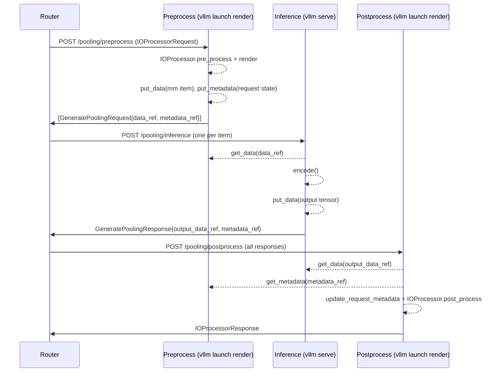

<!-- pack for RFC #64039 (vllm) — source material for the summary card -->
# RFC #64039: [RFC]: Disaggregated pre/post-processing for pooling IO Processor plugins

| 字段 | 值 |
| --- | --- |
| 仓库 | vllm-project/vllm |
| 编号 | [#64039](https://github.com/vllm-project/vllm/issues/64039) |
| 作者 | kon-pap |
| 创建日期 | 2026-10-27 |
| 状态 | 🟢 open  |
| labels | RFC, kv-connector, pooling |
| 热度 | 👍 0 · 💬 0 |
| 分类 | Disaggregated Serving |

## 正文(PRD / 提案全文)

### Motivation.

IO Processor plugins (`vllm/plugins/io_processors`) allow pooling models to accept and return arbitrary data. One example is TerraTorch with Prithvi-EO-2.0 for geospatial segmentation. For these models, `IOProcessor.pre_process()` (decoding, tiling and normalising large rasters) and `post_process()` (stitching tiles back and encoding the output) are CPU-heavy. They often take longer than the forward pass itself.

Today all three stages run in the `vllm serve` process that owns the GPU. As a result:

- the GPU waits while pre-processing and post-processing run on the CPU;
- adding CPU capacity for processing means adding more GPU replicas;
- the work cannot be placed on cheaper GPU-less nodes.

vLLM already separates rendering from inference for generative models (`vllm launch render`, `scale_out/render` and `scale_out/derender`). It also already moves data between instances for P/D with `KVTransferConfig` and for encoder disaggregation with `ECTransferConfig`. This RFC proposes applying the same two ideas to pooling with IO Processor plugins:

- pre-processing and post-processing run on GPU-less render instances that scale on their own;
- the GPU instance only runs inference;
- tensors move between instances through a pluggable connector, and requests carry only references to them.

**Measurements** (TerraTorch Prithvi-EO-2.0 segmentation, using the implementation described below):

- **Inference is a minority of request time.** On a monolithic deployment, inference takes only 11–31% of end-to-end time. Pre-processing accounts for 31–37% and post-processing for 33–55%. Inference's share falls as images grow from 1 to 100 tiles.
- **Monolithic deployments saturate early because of CPU/GPU interference** (1 tile per request, 16 CPU workers in both setups):

  | At 80 req/s | Monolithic (16 workers) | Disaggregated (8 pre + 8 post) |
  |---|---|---|
  | Throughput | ~45 tiles/s (plateaus at ~40 req/s) | ~79 tiles/s (still scaling) |
  | Mean latency | ~1.7 s | ~0.34 s |
  | GPU utilization | ~45% | ~84% |

### Proposed Change.

All of the following is opt-in. Existing endpoints and default behaviour do not change.

**1. Three-stage request flow**

Endpoints:

| Endpoint | Server | Role |
|---|---|---|
| `POST /pooling/preprocess` | `vllm launch render` | Runs `IOProcessor.pre_process()` and rendering. Returns one `GeneratePoolingRequest` per item. |
| `POST /pooling/inference` | `vllm serve` | Fetches the pre-processed `MultiModalKwargsItem` and runs `encode()`. Returns a `GeneratePoolingResponse` that references the output tensor. |
| `POST /pooling/postprocess` | `vllm launch render` | Fetches the outputs and request metadata, then runs `IOProcessor.post_process()`. |

The router that fans requests out across the three stages lives outside vLLM. We have a working proxy implementation.

**2. Protocol: references, not payloads**

New models: `DataRef` (`object_id` plus `locator`), `MetadataRef`, `GeneratePoolingRequest`/`GeneratePoolingResponse` and `PostProcessPoolingRequest`.

- The `object_id` of the pre-processed item reuses its `mm_hash`. The inference output is stored as `<mm_hash>:<served_model_name>:output`.
- Data is keyed by object and metadata by request, so one data object can serve requests whose metadata differs.
- When no connector is configured, the same endpoints carry the payloads inline as base64 msgpack. Stages can therefore be split without shared storage, which is useful for debugging and small deployments.

**3. `IOTransferConfig` / `--io-transfer-config`**

This mirrors `KVTransferConfig` and `ECTransferConfig`:

- `io_connector` selects the connector;
- `io_role` is one of `io_producer`, `io_consumer` or `io_both`;
- `io_connector_extra_config` holds connector-specific settings;
- `io_connector_module_path` loads an out-of-tree connector.

**4. IO connector framework (`vllm/distributed/io_transfer`)**

- `IOConnectorBase` defines `put_data`, `get_data`, `cleanup_data`, `put_metadata`, `get_metadata` and `cleanup_metadata`, each with an async variant.
- A lazy-loading factory and process-wide state create the connector once per process, as the EC and KV transfer state modules do. Both servers shut it down on exit.
- On render instances, blocking connector calls run on a dedicated thread pool (`max_io_threads`), so they do not take renderer workers.
- Two reference backends:
  - `IOExampleConnector` uses a shared filesystem, such as a Kubernetes PVC.
  - `IOP2PConnector` uses ZMQ ROUTER/DEALER, is pull-based and sends tensor buffers as zero-copy frames.
- Serialization uses the existing `MsgpackEncoder`/`MsgpackDecoder` and `msgspec`. No new dependencies are added.

**5. IOProcessor plugin hooks**

`get_request_metadata()` and `update_request_metadata()` are added with no-op defaults. Plugins use them to export state saved during `pre_process` (for example tiling layout or geo-referencing) and restore it on a different post-processing instance. Existing plugins need no changes.

**Implementation plan**

A working implementation exists, about 2.6k LOC across six self-contained commits. Depending on feedback, we would split it into a series of PRs:

1. `IOTransferConfig` and the IOProcessor metadata hooks (small, no behaviour change)
2. Disaggregated pooling protocol models and tensor serde
3. IO connector framework with `IOExampleConnector` (`IOP2PConnector` could follow separately)
4. The `/pooling/inference` endpoint
5. `/pooling/preprocess` and `/pooling/postprocess` on the render server, plus docs and an example

Each PR would include unit tests for its part: connector round trips, config validation and the routes with a mock IO processor.

**Open questions for maintainers**

1. Is `vllm/distributed/io_transfer` the right home? Should it share more infrastructure with `ec_transfer`? Both move per-item multimodal data between instances, but the payloads and lifecycles differ.
2. Is it acceptable to add the new routes under `/pooling/*`, or should they live under a scale-out namespace next to `render`/`derender`?
3. Should `IOP2PConnector` be in-tree, or should only the filesystem reference connector ship in-tree, with others loaded through `io_connector_module_path`?
4. How should we cover this in CI? Tests can use the filesystem connector and a dummy IO processor plugin on CPU.

**Current limitations**

- Only full three-stage disaggregation is supported. Partial setups, such as co-locating inference and post-processing, are not.
- Each prompt must contain exactly one `image` item. This is enough for TerraTorch, and other inputs are rejected with a 400 error.
- `IOP2PConnector` still needs performance tuning under high load.

### Feedback Period.

Two weeks.

### CC List.

@noooop @DarkLight1337 @aoshen02 @christian-pinto 

### Any Other Things.

_No response_

### Before submitting a new issue...

- [x] Make sure you already searched for relevant issues, and asked the chatbot living at the bottom right corner of the [documentation page](https://docs.vllm.ai/en/latest/), which can answer lots of frequently asked questions.
