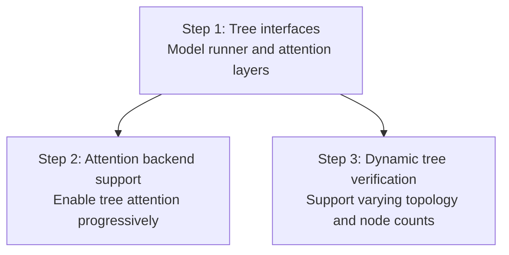

<!-- pack for RFC #65813 (vllm) — source material for the summary card -->
# RFC #65813: [RFC]: Add a Tree Speculative Decoding Framework

| 字段 | 值 |
| --- | --- |
| 仓库 | vllm-project/vllm |
| 编号 | [#65813](https://github.com/vllm-project/vllm/issues/65813) |
| 作者 | drslark |
| 创建日期 | 2026-11-05 |
| 状态 | 🟢 open  |
| labels | speculative-decoding |
| 热度 | 👍 0 · 💬 1 |
| 分类 | Speculative Decoding |

## 正文(PRD / 提案全文)

### Motivation

Tree-based speculative decoding is an active research direction, with recent work such as [EAGLE-4](https://github.com/eagle-hq/EAGLE-4) and [SpecPilot](https://github.com/StargazerX0/SpecPilot) exploring tree-based drafting and verification. By covering multiple candidate continuations, tree methods can substantially improve draft acceptance and increase the number of tokens accepted per target verification step.

However, upstream vLLM lacks a unified, reusable tree speculation framework, making these methods difficult to implement and evaluate.

### Proposed Change

Build tree speculative decoding support incrementally:

1. **Introduce tree interfaces in the model runner and attention layers.** Define common tree metadata and interfaces for tree proposals, verification, and accepted-path commitment, including KV cache and drafter state updates.
2. **Add attention backend support progressively.** Enable tree attention in individual backends, starting with static trees. Each backend should explicitly declare its supported capabilities.
3. **Support dynamic tree verification.** Handle trees with varying topology and node counts across requests and decoding steps, enabling adaptive expansion and pruning.

After the shared interfaces are established, steps 2 and 3 can proceed in parallel.

Existing chain speculative decoding should remain compatible throughout these stages.

### Validation

Validate attention isolation, verification correctness, and cache consistency. Compare end-to-end latency, throughput, accepted tokens per verification step, and memory overhead against autoregressive and chain speculative decoding.
