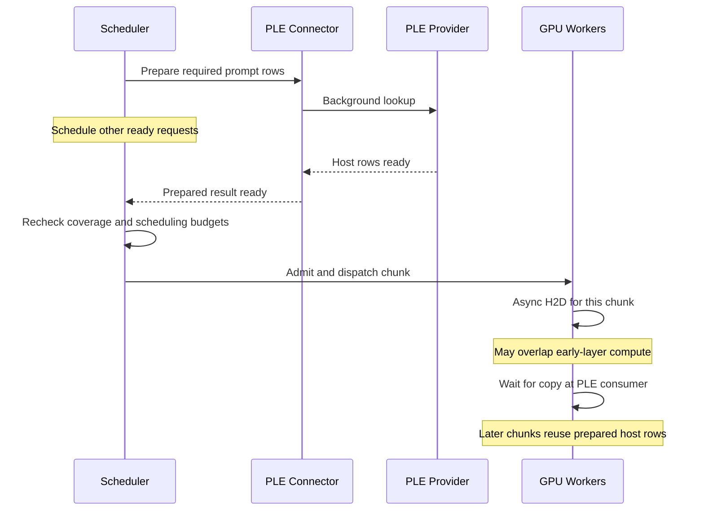

<!-- pack for RFC #67922 (vllm) — source material for the summary card -->
# RFC #67922: [RFC]: PLE Connector for Disaggregated Embedding Serving

| 字段 | 值 |
| --- | --- |
| 仓库 | vllm-project/vllm |
| 编号 | [#67922](https://github.com/vllm-project/vllm/issues/67922) |
| 作者 | RulinJuice |
| 创建日期 | 2026-11-16 |
| 状态 | 🟢 open  |
| labels | kv-connector, quantization |
| 热度 | 👍 2 · 💬 2 |
| 分类 | Disaggregated Serving |

## 正文(PRD / 提案全文)

## Motivation

Qwen models use large N-gram embedding tables: the open-weight [Qwen3.8-Flash-Next](https://huggingface.co/Qwen/Qwen3.8-Flash-Next) includes **51B** embedding parameters, and [Qwen4-Max](https://qwen.ai/blog?id=qwen4-max) reports **328B** ([launch text](https://m.sohu.com/a/1102096678_384789)). This RFC uses PLE (per-layer embedding) for this lookup path.

Assuming FP8 storage (one byte per parameter), these tables would occupy approximately **51 GB and 328 GB**, respectively, excluding quantization scales, metadata and runtime buffers. Replicating these tables across prefill instances multiplies storage costs, even when offloaded to host memory.

At scale, lookup failures should have limited impact, and recovery should not require restarting inference workers.

We propose a **PLE Connector** that connects vLLM prefill instances to a shared lookup service and prepares embedding rows asynchronously before prefill execution.

## Proposed Change

This RFC targets prefill instances in disaggregated prefill/decode deployments.

### Shared lookup service

A dedicated service owns a versioned, immutable PLE table and performs sparse row lookups for multiple prefill instances. It may shard or replicate the table and scale independently of inference compute.

Within vLLM, the PLE Connector uses a provider interface for local or remote lookup and manages preparation, retries and a bounded result pool. Providers return raw rows in the requested row-ID order. Model-specific hashing, dequantization, projection and gating remain in vLLM.

For remote lookup, prefill instances retain only prepared rows locally.

### High availability

This architecture simplifies failover in large-scale production deployments. When a lookup server fails, the connector retries the lookup without restarting inference workers.

### Prepare before compute admission

The PLE Connector runs in EngineCore and uses known prefill token IDs to prepare rows in the background:

After prefix-cache reuse, the connector prepares the full remaining prompt suffix for reuse across chunks. Replay or preemption requires coverage to be checked again.

### Correctness and resource bounds

Providers bind to a table version and layout at startup; retries must preserve that identity. Results become visible only after all requested rows have been written. Preparation has a byte budget and deadline, including retries; unrecovered failures propagate as request errors. On completion or cancellation, results remain allocated until outstanding provider writes and all worker copies finish. Device staging buffers also remain protected until the previous GPU consumer completes.

These requirements are independent of the storage and transport backend.

## Planned Extensions

- **Remote PLE for decode:** Extend remote lookup to decode instances, with a focus on per-token latency.
- **GPU acceleration on lookup servers:** Use GPUs on remote lookup servers to accelerate row gathering and result transfer.

## Related Work

[PLE disk offload (#59958)](https://github.com/vllm-project/vllm/pull/59958) and [next-chunk prefetch (#66941)](https://github.com/vllm-project/vllm/pull/66941) provide relevant mechanisms for row reading and overlap.

[Shared host tables (#64002)](https://github.com/vllm-project/vllm/issues/64002) lets workers map shared table storage and execute lookups themselves. The [cross-engine Engram pool (#67539)](https://github.com/vllm-project/vllm/pull/67539) distributes table shards across inference engines. Here, an independent lookup service owns the table and returns gathered rows to prefill instances.

## Feedback Requested

- Should vLLM expose a PLE provider interface for local and remote table lookup, with retries handled by the connector?
- Is preparation in EngineCore before compute admission the appropriate integration point?

## CC List

@ZJY0516 @youkaichao
